# GUI walkthrough: build V-10 and V-17 from scratch

For the M8.G human gate: *a person builds V-10 and V-17 from scratch in the GUI following
the tutorial text, and lists every point of friction.* This file is that text. Follow it
step by step, compare each answer with the number given, and write every place where you
got stuck, guessed, or were surprised into the friction log at the end.

This is the third version of the text. It describes the window after the redesign of tasks
M11.66 to M11.78 (the rules are in `docs/gui-conventions.md`). Every menu name, button
text, field label and tree node below was read from the running window, and both
procedures were run end to end by `scripts/walkthrough_screenshots.py`, which builds the
real application without a screen, performs each step through the same widgets a click
reaches, prints the trees and panel texts quoted here, and saves the screenshots. The tree
blocks, the summary texts and the screenshots come from a run on 2026-11-28. (Rerun it with
`.venv\Scripts\python.exe scripts\walkthrough_screenshots.py`; it rewrites the PNG files in
`docs/img/gui-walkthrough/`.) The screenshots were rendered offscreen, so they have no
window frame, and the fonts and spacing on your screen will differ a little. The V-10 run
is also a test (`tests/gui/test_end_to_end.py`). A session page with these steps and a
friction log that is saved as you type was made for the earlier window
(https://claude.ai/artifact/AVKWHDY1Pa6YZ22go6weAH, private); it is brought up to date with
this text as the last part of task M11.79. No person has used the redesigned window yet, so
ease of use is exactly what the gate is meant to find.

## 0. Starting the GUI

From the project folder in a terminal:

```
.venv\Scripts\python.exe -m thermalfea.gui.app
```

The main window has a model tree ("Model" dock, top left), the property panel
("Properties" dock, below it), the viewport in the middle, and a bottom dock with two tabs:
"Messages" (the solver log is written there) and "Issues". At start the "Issues" tab is in
front; click "Messages" to read the log. Menus: File, Edit, View, Geometry, Mesh, Solve,
Results, Tools, Help. The toolbar holds the selection modes (None, Point, Boundary, Part,
Node, Element) and a "Fit view" button. In a 2D model **Boundary** picks curves and
**Part** picks surfaces. You rarely need the toolbar yourself: every pick (below) switches
it to the right mode and back.

The model tree has two columns. The first column is the name, the second is a summary of
the item (for example the conductivity of a material, or "3 boundaries · convection
Convection 1" for a selection). View > **Summary column** hides and shows the second
column. The title of the Model dock follows the model: "Model — Untitled · planar · K" for
a new model, and "Model — Untitled · planar · t 1 m · K" once the parts have a thickness
(the last item is the temperature unit).

A small **warning mark** on a tree item means that Solve > Validate would complain about
it. The tooltip of the item gives the message. In a new model "Loads & Boundary
Conditions" carries one (a steady analysis needs a temperature reference), and after you
draw the geometry "Parts" carries one (the areas have no part). The marks go away by
themselves as you fix the model; they are updated a moment after each edit.

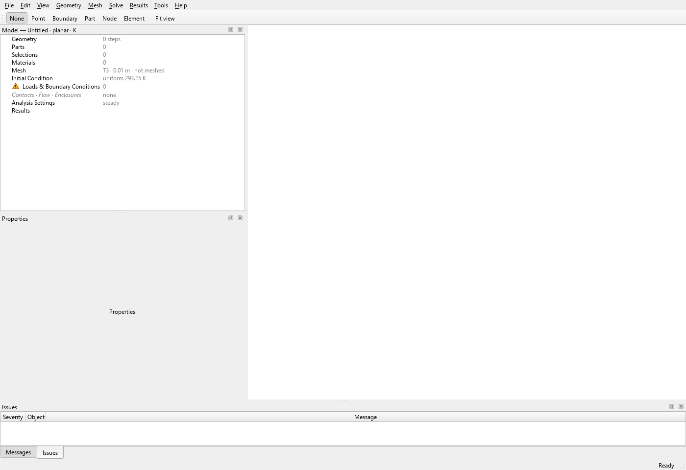
*A new model: the toolbar, the two-column tree with the folded line and one warning mark, the dock title.*

Things to know before you start:

- **Temperatures are entered in kelvin** unless you change the units with Tools > Units...
  (the steps below assume the default, SI with K). 100 degC is 373.15 K and 0 degC is
  273.15 K.
- **Press Enter after typing a number** in a property field. The value is applied when you
  press Enter or leave the field, and each applied change is one undo step (Edit > Undo).
  A dropdown of values (material, analysis type, ...) applies when you choose.
- Property fields that are physical functions (conductivity, temperature, heat-transfer
  coefficient, ...) show a mode box (Constant, Table, Expression) above the value. A
  required field starts on "Constant": type the number. An optional field names its empty
  mode by its meaning ("Isotropic").
- An empty optional box shows grey hint text that says what empty means ("no limit",
  "suggested from the mesh").
- Panels are made of **framed boxes**, each with a title and a one-line description.
  Advanced settings are collapsed: a "More" line at the bottom of a box, or a whole box
  whose title ends in "(advanced)". Click it to open it. The title counts the values that
  are not the default ("Convergence (advanced) · 2 changed"), so you can see that
  something was changed without opening it.
- **Buttons on a single field or a table row are icons**, each with a tooltip: **+**
  adds a row, the **crosshair** picks in the view, **pencil** edits, **check mark**
  (Update) applies a pending change, **U-turn arrow** (Revert) drops it, **✕** removes.
  Commands for a whole panel keep words (Generate mesh, Validate, Solve, Plot).
- **The selection field.** Loads, parts and the mesh refer to geometry through *named
  selections*. A field shows its role as the label ("Boundary", "Boundary or point",
  "Selection" for a part), one dropdown of the compatible selections with their sizes
  ("cooled · 3 boundaries"), and the icons crosshair (a new selection, picked in the view)
  and pencil (edit the entities of the current one). **Choosing another selection in the
  dropdown does not change the object yet**: the dropdown gets an amber border, a note
  says "Not applied", and the check mark (Update) applies it while the U-turn arrow
  (Revert) goes back. If you leave the panel with a change pending, it is dropped and the
  status bar says "Selection change not applied".
- **Name every selection yourself.** The Name box of a new selection starts empty and
  "Create and use" stays disabled until you type a valid name that is not yet used.
- **One way to pick in the view.** Whenever you pick (a new selection, the stream path,
  the nodes of a history, the probe, the geometry dialogs) a yellow strip in the panel
  shows what to click and counts what you have picked ("2 boundaries picked"); Ctrl+click
  adds or removes one entity. **Enter confirms and Esc cancels**, as do the strip's
  buttons. What you picked is highlighted in the view.
- The View menu has: Fit view, the docks (Model, Properties, Messages, Issues), a Stretch
  submenu, Summary column, Load symbols, Part names, Load values and a "Color by" submenu
  (Part, Material, None). The default is Part: each part is filled with its own color in
  the viewport, and the same color is the swatch beside the part in the tree.
- The example models are also under File > Examples ("V-10 - NAFEMS T4 ..." and
  "V-17 - slab cooled by convection ..."). Open them after your own build to compare.

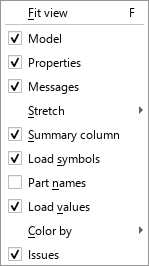
*The View menu.*

## 1. V-10: NAFEMS T4 (steady, 2D)

**Problem** (`docs/verification.md`, `examples/v10_nafems_t4.py`): rectangle 0.6 m (x) by
1.0 m (y); conductivity k = 52 W/(m K); bottom edge 100 degC; left edge adiabatic; right and
top edges convection with h = 750 W/(m^2 K) to 0 degC.

**Expected answer:** temperature at the point (0.6, 0.2) = **18.3 degC**, accepted within
**0.15 degC** at element size 0.025 (the script gives 18.206 degC with the default triangles;
the window gives the same 18.206 degC).
The energy balance of a linear steady case must close to better than 1e-8 (V-34).

### 1.1 Geometry: two rectangles

The check point (0.6, 0.2) must be a mesh node. The GUI cannot place a mesh node at a given
point, so draw the plate as two stacked rectangles that meet at y = 0.2; the shared edge puts
a vertex, and so a node, at (0.6, 0.2). This is what the example script does too.

1. Geometry > **Rectangle...** opens a dialog titled "Rectangle". (It also lets you place the
   rectangle by clicking in the viewport; Enter accepts and Esc cancels, as with every pick.)
2. Type x = `0`, y = `0`, Width = `0.6`, Height = `0.2`. Leave "Corner radius" at 0 and "Id"
   empty (an id is generated). Press **OK**.

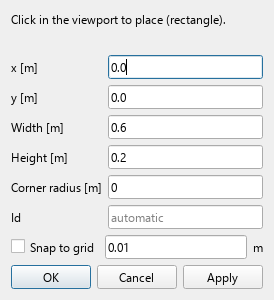
*The Rectangle dialog with the first rectangle.*
3. Geometry > **Rectangle...** again: x = `0`, y = `0.2`, Width = `0.6`, Height = `0.8`.
   Press **OK**.
4. The geometry is rebuilt by itself after each OK (the status bar says "Building
   geometry..." and then "Geometry rebuilt"). The model tree node "Geometry" now lists
   `rectangle1` and `rectangle2`; their summaries read "rectangle 0.6 × 0.2 m" and
   "rectangle 0.6 × 0.8 m". "Parts" now carries a warning mark (the two areas have no part
   yet) and so does "Loads & Boundary Conditions".
5. View > **Fit view** (or the key F). The viewport is fitted only when the first shape
   appears, so the second rectangle is partly out of view until you do this.

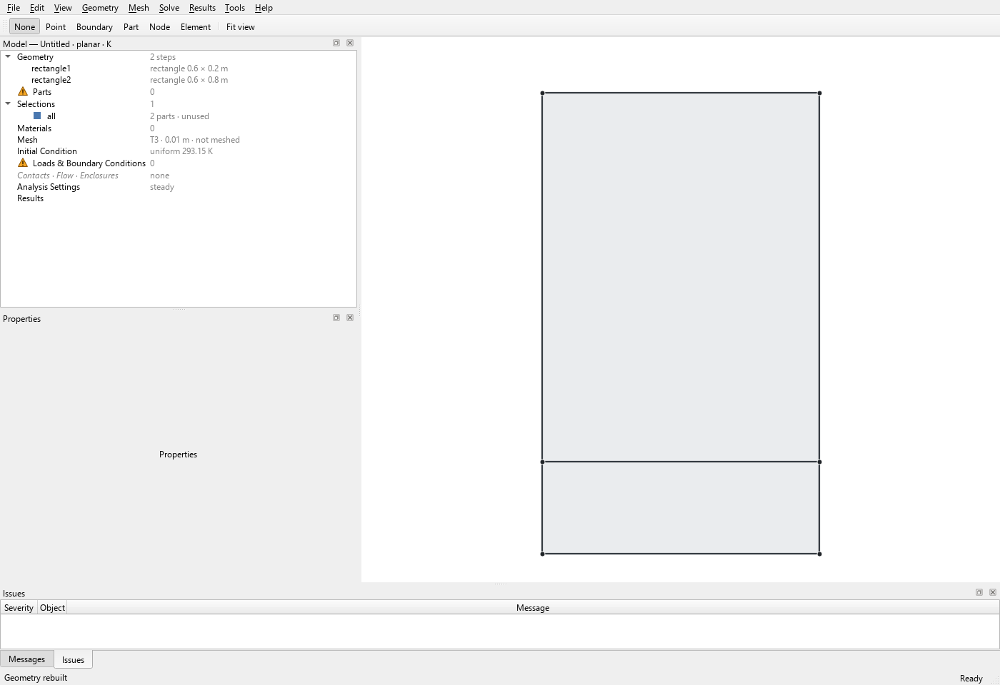
*Both rectangles after Fit view; the summaries give their sizes.*
6. Click `rectangle1` in the tree: the surface it made is highlighted in the viewport. A
   step highlights what it owns.
7. *Optional.* Rename the steps: right-click `rectangle1` > **Rename** (or edit the name in
   place), type `lower strip`, press Enter; rename `rectangle2` to `upper strip`. The
   geometry is rebuilt, and any later step that refers to the renamed one (a boolean) follows
   the new name. The tree below uses these names; if you skip this step read `rectangle1`
   and `rectangle2`.

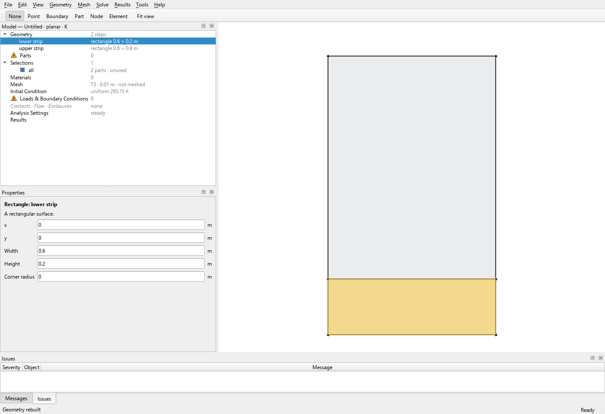
*The steps renamed; clicking "lower strip" highlights the surface it owns.*

You should see a 0.6 by 1.0 plate with a line across it at y = 0.2 (two surfaces, seven
curves). The tree also gets a "Selections" entry "all" ("2 parts · unused"), made by the
program.

### 1.2 Loads: set the boundaries, then the values

The three conditions need named boundary selections. You create each selection from the
condition's own panel with the crosshair icon, and you give it a name.

**Fixed temperature (bottom edge, 100 degC):**

1. In the model tree, right-click **Loads & Boundary Conditions**. Choose **Add** >
   **Add Fixed Temperature**. A node "Fixed Temperature 1" appears (with a warning mark: it
   has no boundary yet) and its panel ("Fixed Temperature: Fixed Temperature 1") opens in
   Properties. The first row, labeled "Boundary or point", shows "(none)".

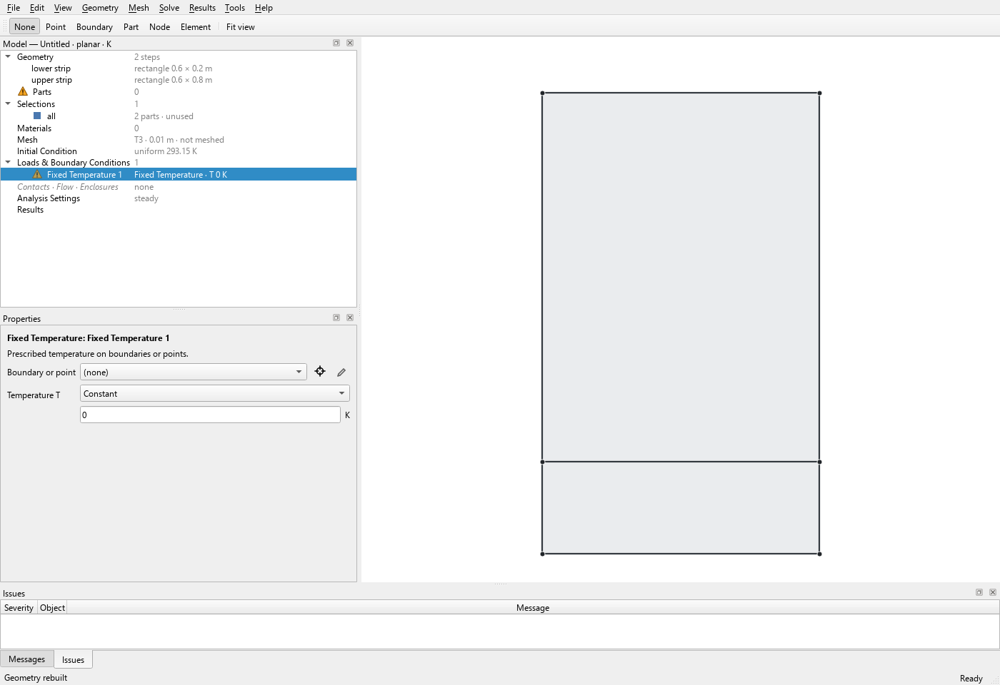
*A new fixed temperature: the selection row shows "(none)" and the icons for a new and for an edited selection.*
2. Press the **crosshair** icon beside the dropdown (tooltip: "New selection: pick it in the
   view"). The toolbar switches to **Boundary** by itself (a fixed temperature may also be
   put on points, but a pick starts on boundaries). A yellow strip opens under the row: "Click
   the boundaries of the new selection in the view (Ctrl+click adds or removes one).", a
   count, an empty "Name" box and the buttons "Create and use" and "Cancel".
3. Click the bottom edge of the plate (y = 0). The strip says "1 boundary picked" and the
   edge is highlighted. Type `base` in "Name"; "Create and use" is now enabled. Press it
   (or Enter). The dropdown now reads "base · 1 boundary" and the toolbar goes back to
   **None**.
4. In "Temperature T" type `373.15` and press Enter (unit shown: K).

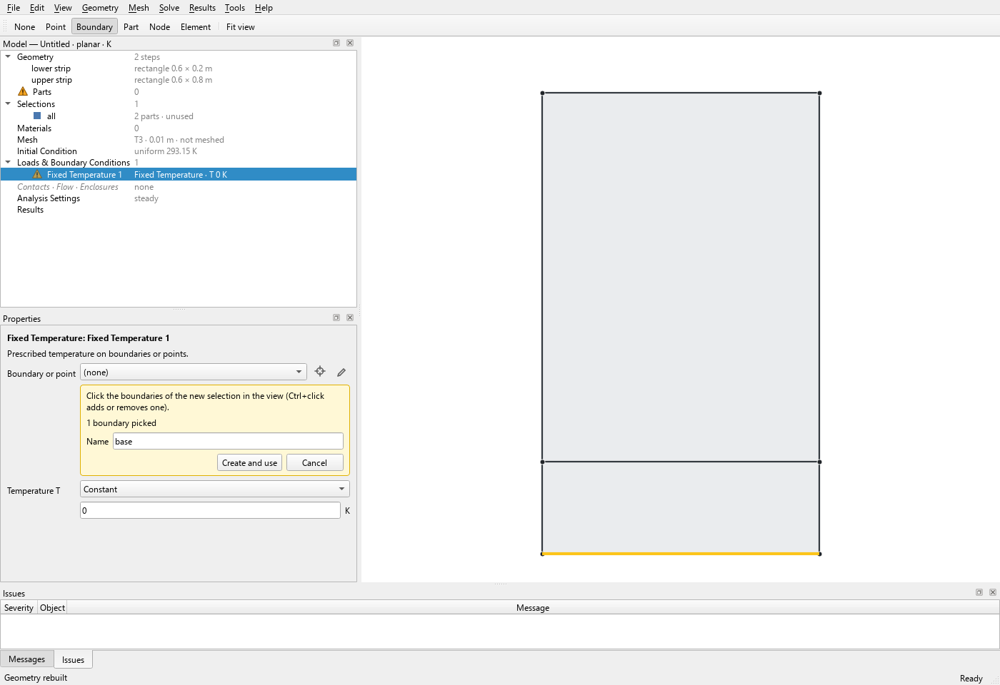
*Picking the bottom edge: "1 boundary picked", the name typed, before "Create and use".*

**Convection (right and top edges, h = 750, 0 degC):**

1. Right-click **Loads & Boundary Conditions** > **Add** > **Add Convection**. The selection
   row is labeled "Boundary".
2. Crosshair icon. The right edge is two curves (split at y = 0.2): click the lower right
   edge, then hold **Ctrl** and click the upper right edge and the top edge. The strip says
   "3 boundaries picked". Type the name `cooled`, press **Create and use**.
3. "Heat-transfer coefficient h": `750`, Enter (unit W/(m^2 K)).
4. "Fluid temperature T∞": `273.15`, Enter (K).

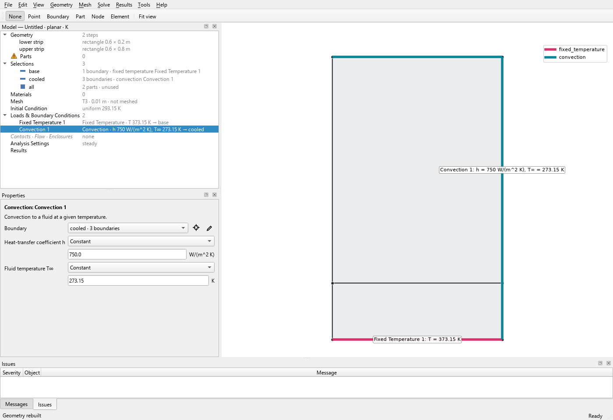
*The convection after "Create and use" and the two values.*

**Adiabatic (left edge):**

1. Right-click **Loads & Boundary Conditions** > **Add** > **Add Adiabatic**.
2. Crosshair icon, click the lower left edge, Ctrl-click the upper left edge ("2 boundaries
   picked"), name `left side`, **Create and use**.

The viewport now shows load symbols with their value labels for the three conditions (the
labels are drawn in front of the lines, so a highlight never hides them). Selecting a
condition in the tree highlights its boundaries.

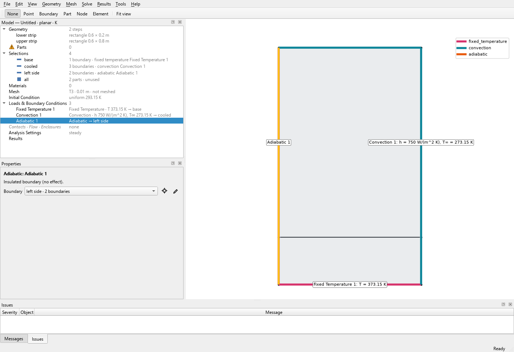
*The three loads with their symbols, value labels and the selection "left side" highlighted.*

**A name that is used is refused.** Try it once: add another Adiabatic, press the crosshair,
click any edge and type `base` in "Name". A red message under the box says "the selection
name 'base' is already used" (shown once, here, and nowhere else) and "Create and use"
stays disabled. Press Esc (or **Cancel**): the pick ends, nothing is stored. Then press Edit >
Undo once to remove the extra Adiabatic condition (the "Add Adiabatic" step). To give a
field a different set of entities later, use the pencil icon (below).

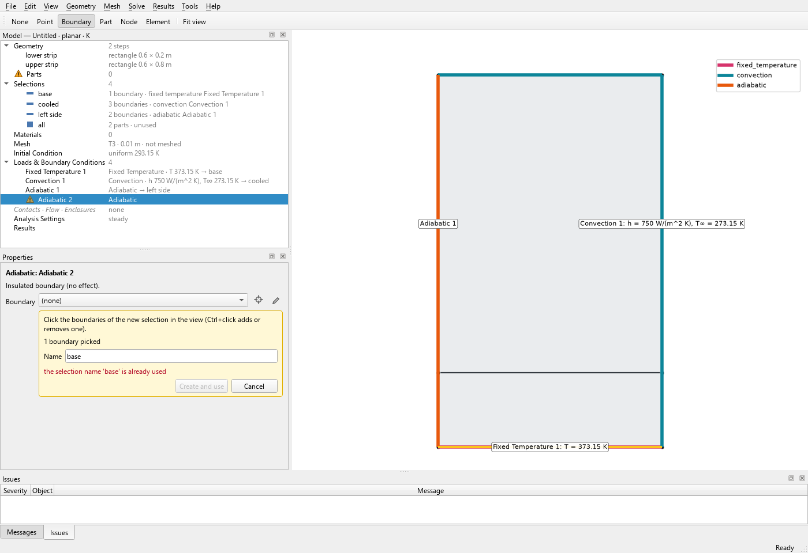
*A used name is refused in red under the Name box; "Create and use" stays disabled.*

**A changed choice waits for the check mark.** Select "Adiabatic 1" and choose "base · 1
boundary" in its dropdown. The load does not change: the dropdown has an amber border and the
note reads "Not applied. Update uses base; Revert keeps left side." The check mark applies it
(one undo step); the U-turn arrow puts the old choice back. If you click another item in the
tree instead, the change is dropped and the status bar says "Selection change not applied".
Do not apply it here.

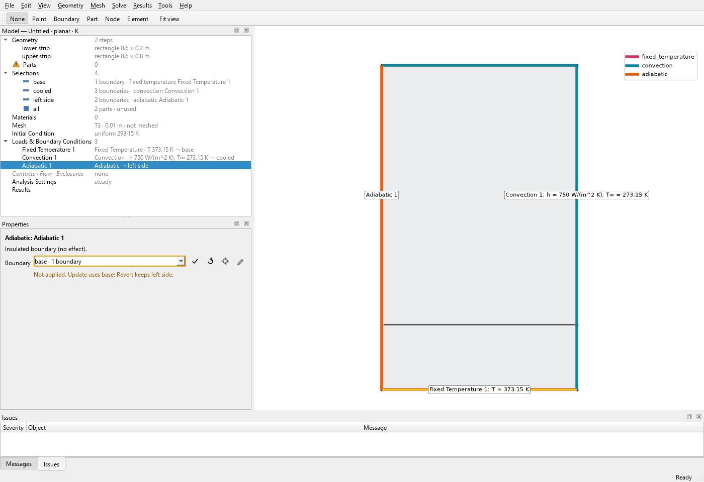
*A pending choice: amber border, the note, the check mark and the U-turn arrow.*

**Editing the entities of a selection.** The pencil icon opens the same strip for the
selection the field holds: "Change the boundaries of left side in the view (Ctrl+click adds
or removes one).", with the entities already picked. **Save** rewrites the selection (every
load that uses it follows; the strip names the other users); **Save as new** needs a name
and uses a new selection instead. Press **Cancel** now.

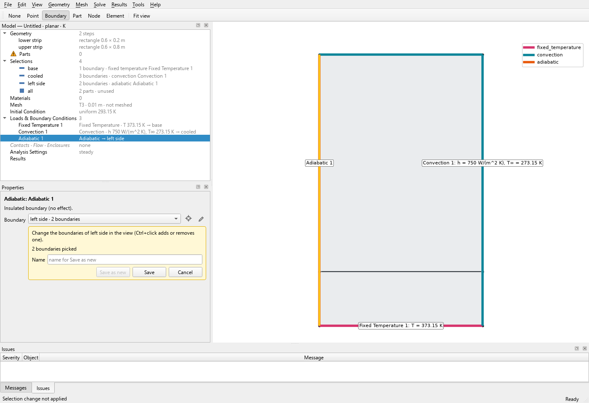
*The pencil icon: the strip with Save, Save as new and Cancel.*

### 1.3 Material and part

1. Right-click **Materials** > **Add material**. A material "Material 1" appears; all its
   properties start at 0, which means "not set yet". It has a color swatch beside it.
2. In its panel set "Conductivity (along axis)" (mode Constant) to `52` and press Enter.
   The next field, "Conductivity (across axis)", stays on "Isotropic" (empty means the same
   conductivity in every direction). Density and specific heat do not affect a steady
   answer; they may stay at 0. (A conductivity left at 0 is refused by Validate: "has a
   conductivity that is not positive".) The summary column of the tree now reads
   "k 52 W/(m K) · custom". The panel also has "From library" with "Use library values" and
   "Restore library values".

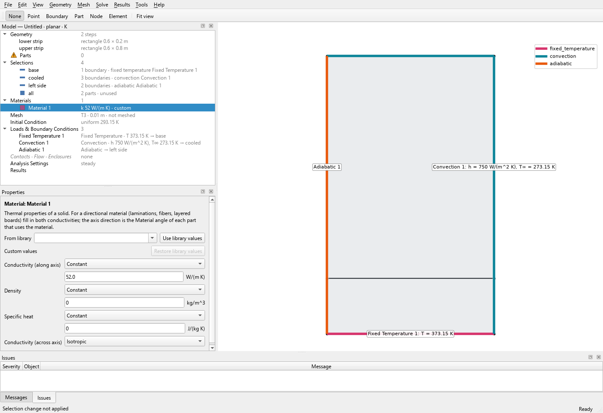
*Material 1 with k = 52 along the axis; the across-axis mode is "Isotropic"; the summary says "custom".*
3. Right-click **Parts** > **Add part**. A part "Part 1" appears and its panel ("Part")
   opens. Its fields are "Name", "Selection", "Material" and "Thickness". ("Material
   angle" appears only when the material has a conductivity across the axis.) "Material"
   already holds "Material 1". Replace "Name" with `Plate` and press Enter (or right-click
   the part in the tree > **Rename**).
4. In the "Selection" field press the crosshair. The toolbar switches to **Part**; click
   inside the lower rectangle, Ctrl-click inside the upper one ("2 parts picked"). Type
   the name `plate` and press **Create and use**. "Thickness" stays 1.
5. The part's swatch color is the color of its surfaces in the viewport. Switch View >
   **Color by** to Material and back to Part to see the viewport follow. View > **Part
   names** shows the part name ("Plate") on the part.

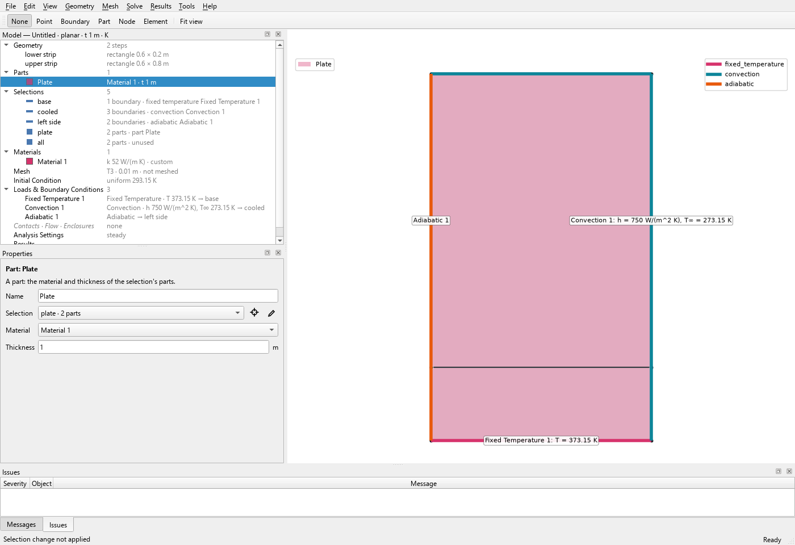
*The part "Plate": its panel, its swatch and its color in the viewport.*

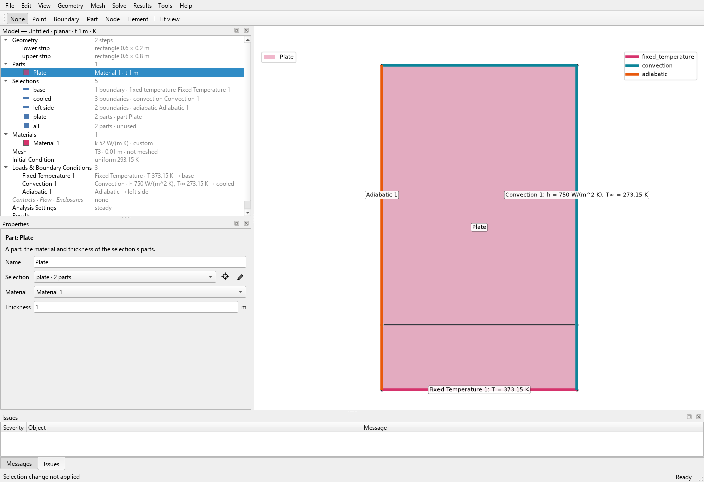
*View > Part names: the label "Plate" in the viewport.*

### 1.4 Mesh

1. Click the **Mesh** node in the tree. The panel "Mesh" opens. It has five framed boxes:
   **Element size** ("Global element size" and the tables "Boundary sizes" and "Point
   sizes"), **Element type** ("Element order" and "Element shape"; its "More" line holds
   "Algorithm" and "Smoothing passes"), **Structured mesh** ("Structured parts" and
   "Boundary divisions"), **Refinements**, and **Statistics and quality**, with the
   **Generate mesh** button between the last two. Each table shows "none" until you add a
   row with "+ Add" or "⌖ New...".
2. "Global element size": `0.025`, Enter. Leave "Element order" "Linear (1)" and "Element
   shape" "Triangles".
3. Press **Generate mesh** (or Mesh > **Generate mesh**). The status bar reports
   "Mesh generated: 1210 nodes, 2290 elements". The mesh is drawn in the viewport, and
   "Statistics and quality" lists the counts and the element quality.

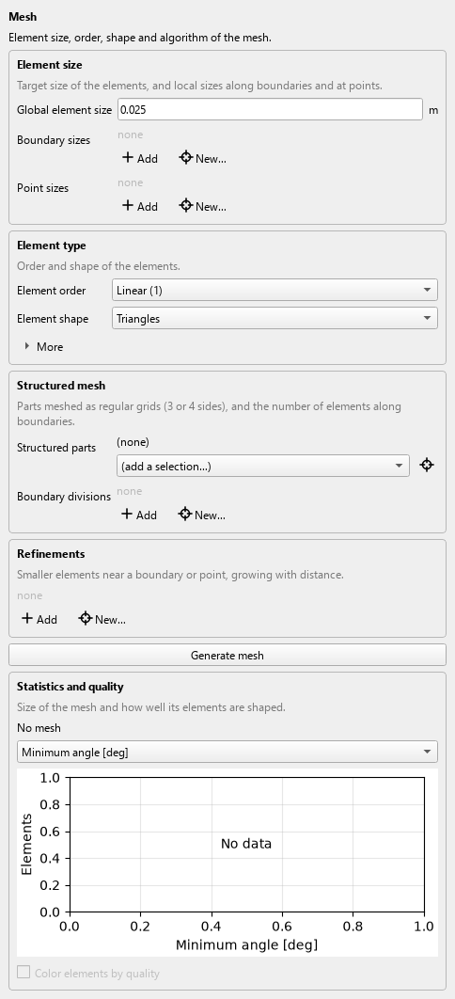
*The Mesh panel before meshing, all five boxes (the panel is taller than the dock; this is the whole panel).*

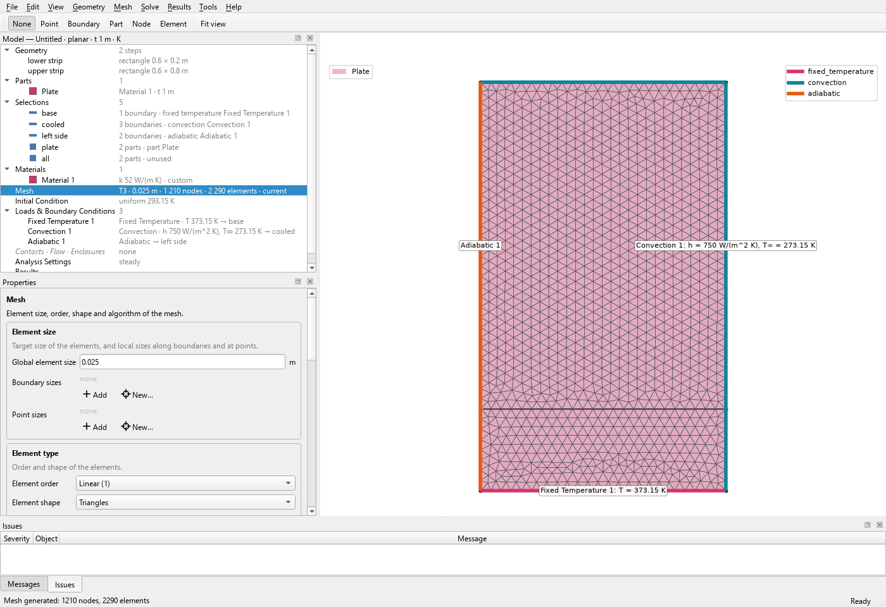
*After Generate mesh: 1210 nodes, 2290 elements; the Mesh summary ends "current".*

### 1.5 Expected model tree (before the solve)

The tree should read like this. The first column is the item and the second, after the
bar, is its summary (the bar is only drawn here to separate the columns). Selections are
listed in alphabetical order, with "all" last. Geometry names are those of the optional
rename. No item carries a warning mark any more.

```
Model — Untitled · planar · t 1 m · K          (title of the Model dock)

Geometry                       | 2 steps
  lower strip                  | rectangle 0.6 × 0.2 m
  upper strip                  | rectangle 0.6 × 0.8 m
Parts                          | 1
  Plate                        | Material 1 · t 1 m
Selections                     | 5
  base                         | 1 boundary · fixed temperature Fixed Temperature 1
  cooled                       | 3 boundaries · convection Convection 1
  left side                    | 2 boundaries · adiabatic Adiabatic 1
  plate                        | 2 parts · part Plate
  all                          | 2 parts · unused
Materials                      | 1
  Material 1                   | k 52 W/(m K) · custom
Mesh                           | T3 · 0.025 m · 1 210 nodes · 2 290 elements · current
Initial Condition              | uniform 293.15 K
Loads & Boundary Conditions    | 3
  Fixed Temperature 1          | Fixed Temperature · T 373.15 K → base
  Convection 1                 | Convection · h 750 W/(m^2 K), T∞ 273.15 K → cooled
  Adiabatic 1                  | Adiabatic → left side
Contacts · Flow · Enclosures   | none          (one dimmed line)
Analysis Settings              | steady
Results
```

The order of the top-level sections is: Geometry, Parts, Selections, Materials, Mesh,
Initial Condition, Loads & Boundary Conditions, then "Contacts · Flow · Enclosures" (one
dimmed, italic line while the model has no contact, stream, network or enclosure), then
Analysis Settings and Results. Right-click the dimmed line: the menu offers **Add contact**,
**Add stream** and **Create network**. (Do not use it here.) After one of these is added the
line is replaced by the three sections Contacts, Flow and Enclosures.

The Selections section (described under "Selections" in 1.8) shows every named selection
with its count and its users. The "plate" selection shows "part Plate" because the part
uses it.

### 1.6 Solve

1. Solve > **Validate**. The status bar must say "Validation: no issues" (or list only
   warnings; any error must be fixed first).
2. Solve > **Solve**. A window titled "Solving" shows the progress and ends with a
   "Finished" state; it stays open until you close it. A linear steady case takes a moment.

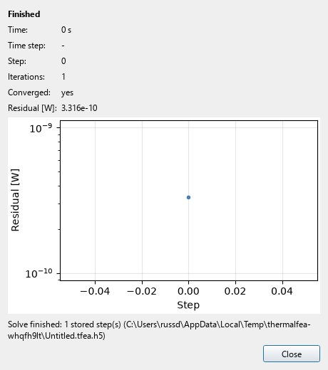
*The Solving window at the end of the steady solve.*
3. A node "Temperature 1" appears under **Results** in the tree, with the summary
   "contour · current", and the temperature contour is drawn in the viewport. A contour is
   a saved item of the model like any other: it is stored in the model file and each change
   to it is an undo step. (The contour starts banded with 12 levels. Click the node to see
   its panel. It starts with a header of four lines: "Analysis: steady", "Mesh: T3 ·
   1 210 nodes · 2 290 elements", "Results written <date and time>" and "Status: current".
   Then a box "Display" with the checkbox "Show in the view" (untick it to hide the field
   and keep its settings), "Field", "Step", "Time" and "Mesh overlay", and a box "Color
   scale" with "Range", "Min / max", the banded setting and "Levels".)

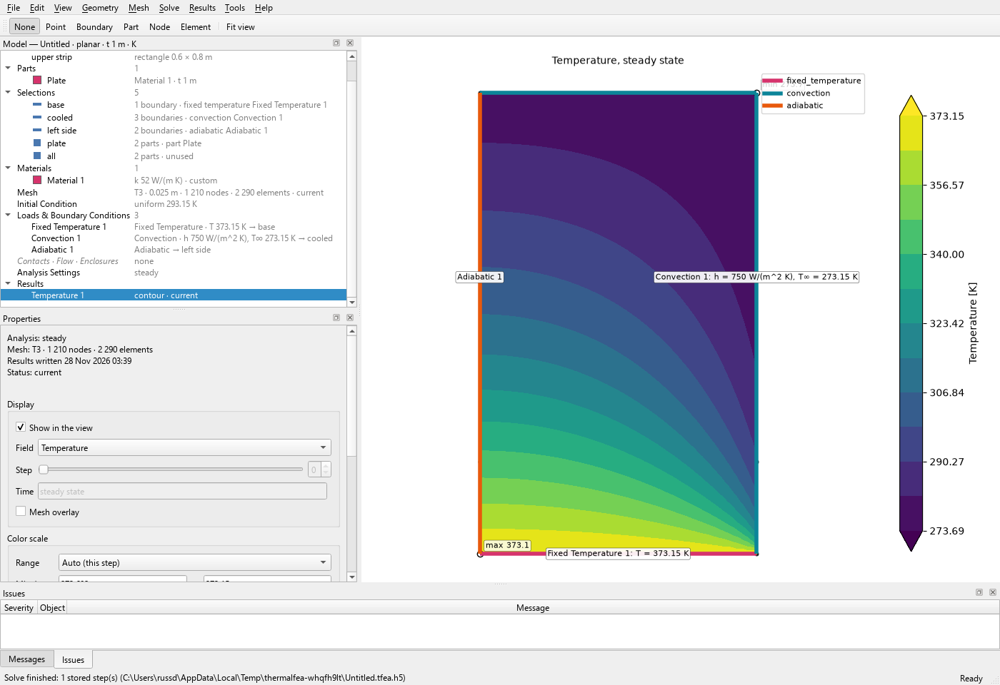
*The result with its header: "Status: current".*

### 1.7 Compare with the benchmark

- **The number.** File > Export > **Nodal results (CSV)...**, choose a file name. Open the
  CSV in a spreadsheet. Columns are `step,time,node,x,y,T,qx,qy` with T in kelvin. Find the
  row with x = 0.6 and y = 0.2. T minus 273.15 must be between 18.15 and 18.45 degC (target
  18.3, tolerance 0.15). Expect about 291.356 K (18.206 degC).
- **A quick look.** Results > **Probe**, then click the viewport as close as you can to the
  right edge at the line y = 0.2. A strip reads "Click in the view to read values · Esc to
  stop." The status bar shows x, y and the temperature in K, and
  each click leaves a marker with its value (cleared when the probe is turned off, by Esc or
  by choosing Probe again). This is limited by the pixel you hit and by the point lying on
  the boundary, so use it only as a rough check; the CSV is the exact one.
- **Energy balance.** The "Messages" dock (click its tab) shows the solver log. It lists the
  heat entering through each condition (Fixed Temperature 1 about +10396 W, Convection 1
  about -10396 W) and "relative imbalance". The value must be below 1e-8; it is about
  5e-15. Results > **Energy balance** plots the heat flows against time and lists every
  stored step in a table (with the imbalance; select cells and press Ctrl+C to copy them).
  A steady result shows the table only.

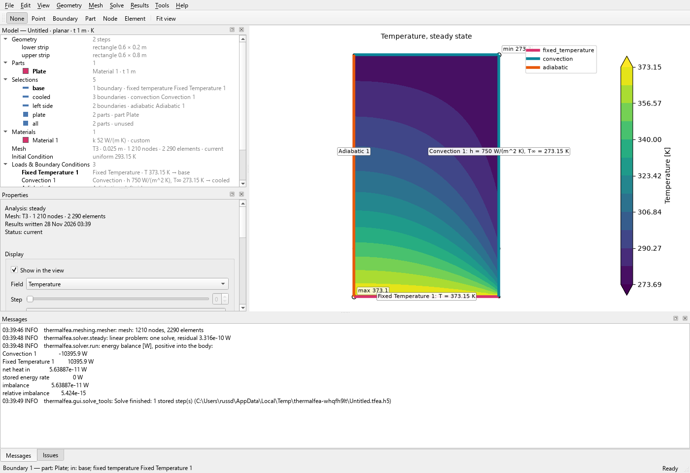
*The Messages dock with the end of the energy balance (the dock was enlarged for this picture).*

### 1.8 What to check in this review (V-10)

Do these after the solve; none of them changes the answer.

1. **Toolbar.** The buttons read None, Point, Boundary, Part, Node, Element. There is no
   "Curve" or "Surface" button. During every pick the toolbar is switched to the right mode
   and, afterwards, switched back.
2. **Tree and dock title.** The section order and the summaries are as in 1.5. The dock
   title reads "Model — Untitled · planar · t 1 m · K". View > **Summary column** hides the
   second column and shows it again. The dimmed "Contacts · Flow · Enclosures" line has the
   three menu entries named in 1.5. Warning marks appear and disappear as described in 0.
3. **Geometry.** Clicking a step highlights what it owns. Renaming a step (right-click >
   **Rename**, or in place) keeps the model valid. Undo restores the old name.
4. **Parts.** The part is called "Plate"; the panel fields are Name, Selection, Material,
   Thickness. The part and the material have color swatches. View > **Color by** Part,
   Material and None change the viewport fills; View > **Part names** labels the parts.
5. **Selection field.** One row with the role as label and a dropdown "name · N boundaries".
   A new selection is picked with the crosshair, in a strip with an instruction, a count
   ("1 boundary picked", "3 boundaries picked", "2 parts picked") and an empty Name box. A
   used name is refused in red once, under the box. A changed dropdown waits for the check
   mark (amber border, "Not applied ..."), and leaving the panel drops it with the status
   message "Selection change not applied". The pencil icon edits the entities (Save, Save as
   new). Enter confirms and Esc cancels a pick.
6. **Selections section.** Click "cooled" in the tree: its boundaries are highlighted. Its
   panel shows "Name" (`cooled`), "Kind" ("3 boundaries"), "Entities" (tag numbers and
   "total length 1.6 m"), "Bounds parts" ("Plate"), "Used by" (a link "convection
   Convection 1": press it and the tree jumps to that load), the buttons "Add from
   viewport" and "Remove from viewport", and "Delete" (greyed out while the selection is
   used; the tooltip names the users). The two viewport buttons open the same pick strip as
   in 1.2 ("Click the boundaries to add to 'cooled' in the view ..." with "Add" and
   "Cancel"); Esc cancels. Rename it to `cooled sides` in the panel: the load summary then
   reads "→ cooled sides" (users follow). Undo it. With the focus on the tree, Page Down and
   Page Up step to the next and previous selection.

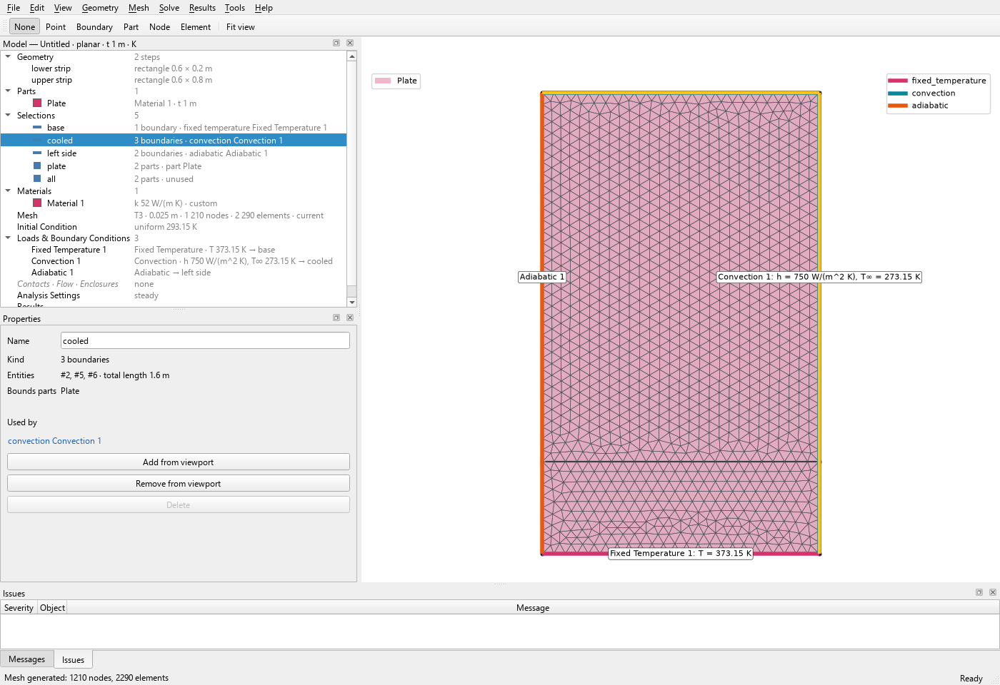
*The selection "cooled": its boundaries highlighted, its panel with Kind, Entities, Bounds parts and Used by.*

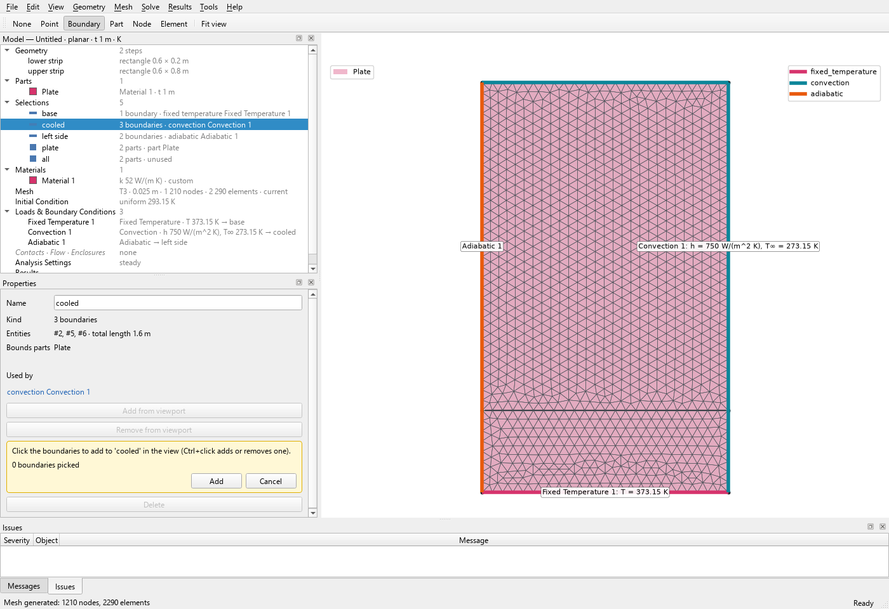
*"Add from viewport": the pick strip with an instruction, a count, Add and Cancel; the toolbar is on Boundary.*
7. **Materials.** The summary is "k 52 W/(m K) · custom" and the source line in the panel
   reads "Custom values". Optional: add a second material, type part of a name in "From
   library", press **Use library values**: the summary reads "<entry> · library" and the
   source line "Values from the built-in library: <entry>". Change its conductivity: the
   summary reads "· edited", and **Restore library values** is enabled and brings it back.
   Then Edit > Undo until "Material 2" is gone. A new material with every value at 0 shows
   "k 0 W/(m K) · custom"; no warning mark was seen on it while no part used it.
8. **Form labels.** Nothing in V-10 uses the value tables (see V-17 for "Boundary
   divisions" and "Structured parts"); open the Initial Condition panel: "Kind" offers
   "Uniform", "Expression of x and y", "Per part" and "From a results file", and the panel
   shows only the fields of the chosen kind. Choose "Per part" to see the table
   "Temperature per part", then set it back to "Uniform".
9. **Results.** The result node reads "contour · current" and its panel has the four-line
   header of 1.6. The viewport title reads "Temperature, steady state". Do 1.9 below to see
   the out-of-date state.
10. **Hover and inspect.** Choose **Boundary** in the toolbar (nothing may be picking) and
    move the pointer over the bottom edge. A tooltip shows, for example, "Boundary 1", "part:
    Plate", "in: base" and "fixed temperature Fixed Temperature 1" (the tag number may
    differ). Click the edge once: the same report appears in the status bar ("Boundary 1 —
    part: Plate; in: base; fixed temperature Fixed Temperature 1"), and the tree items it
    names (Plate, base, Fixed Temperature 1) are shown in bold. Click empty space to clear
    it. In **Part** mode the tooltip names the part and its selection ("in: plate"); in
    **Point** mode the vertices. While a pick strip is open, a plain click picks and does
    not inspect.


*Boundary mode, one click on the bottom edge: the report in the status bar, Plate, base and the load in bold in the tree.*
11. **View menu.** "Part names" toggles labels with the part names ("Plate") in the
    viewport; "Load values" toggles the values next to the load symbols (on by default);
    "Load symbols" toggles the symbols.

### 1.9 Extra checks (optional, they test the editing machinery)

- Change "Heat-transfer coefficient h" of the convection to `800`. The status of the
  results becomes "out of date": the summary of "Temperature 1" reads "contour · out of
  date", the viewport title reads "Temperature, steady state · out of date", and the panel
  of the result shows "Status: out of date (1 change)" and a yellow box: "These results
  are out of date: the model changed since the solve (1)." and the line "• Load Convection
  1: Heat-transfer coefficient h 750 W/(m^2 K) → 800 W/(m^2 K)". The mesh stays valid
  (its summary still ends "current"). Edit > **Undo** returns it to 750 and the results
  are "current" again.

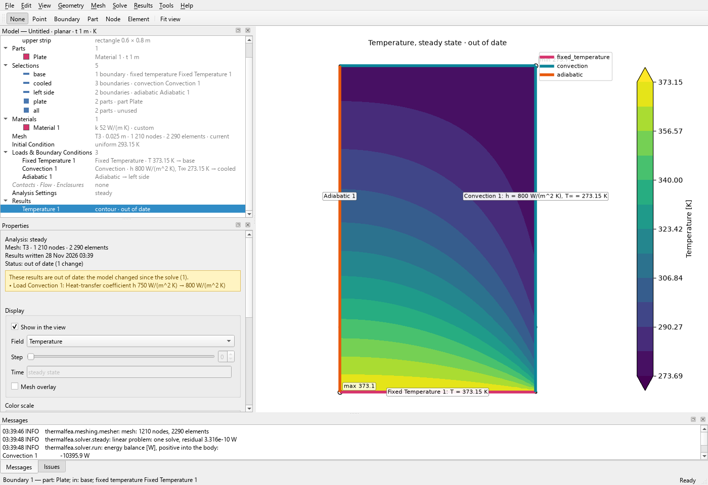
*h changed to 800: the result is out of date, the change is listed and the title says so.*
- Change "Global element size" to `0.03`: now the mesh is out of date (its summary ends
  "out of date") and Solve is greyed out until you press **Generate mesh** again. Undo it.
- File > **Save As...** `v10.tfea`; File > **New**; File > **Open...** `v10.tfea`. The
  geometry is rebuilt by itself. After you press **Generate mesh**, the results saved beside
  the model (`v10.tfea.h5`) are attached again, if you solved after saving.

## 2. V-17: slab cooled by convection (transient, 1D)

**Problem** (`docs/verification.md`, `examples/v17_slab_convection.py`): a slab of half
thickness L = 0.05 m, symmetric about x = 0, initial temperature 400 K, convection at
x = L with h = 500 W/(m^2 K) to 300 K. Material: k = 50 W/(m K), density 7800 kg/m^3,
specific heat 500 J/(kg K) (the defaults of the verification document). It is modelled as a
strip 0.05 m long and 0.005 m high (L/10); the top and bottom are insulated, the left side is
the symmetry plane.

**Expected answer.** The series solution in `docs/verification.md` (diffusivity
alpha = 50/(7800 x 500) = 1.282e-5 m^2/s, Bi = hL/k = 0.5) gives at the two Fourier numbers:

| Fo | Time [s] | Centre x = 0 [K] | Surface x = L [K] |
|---|---|---|---|
| 0.2 | 39 | 397.2600 | 379.0147 |
| 1.0 | 195 | 369.8383 | 355.4589 |

Tolerance: relative error 2e-3 (V-17) at the nodes (0, 0) and (0.05, 0), with 40 elements
along the slab and the automatic time step. Using the procedure below the scripted run gave
397.096 / 379.248 K at 39 s and 370.352 / 355.882 K at 195 s, worst relative error 1.4e-3
(the window gives the same numbers).

### 2.1 Start a new model

File > **New** (or start the program afresh). A new model is a planar analysis, which V-17
needs. (Analysis Settings > "Geometry type" changes it to axisymmetric.) The Model dock
title reads "Model — Untitled · planar · K" and the tree is the empty one: every section
shows "0" or its default, "Contacts · Flow · Enclosures" is one dimmed line, and "Loads &
Boundary Conditions" carries a warning mark.

### 2.2 Geometry

1. Geometry > **Rectangle...**: x = `0`, y = `0`, Width = `0.05`, Height = `0.005`. **OK**.
2. View > **Fit view** (F) if the strip is not centered.

The strip is 10 times longer than high, so on screen it is a thin band; zoom with the mouse
wheel if you cannot hit the edges (middle-button drag pans). Or use View > **Stretch** >
"Stretch y × 10": the strip is drawn ten times higher and a note in the view says "Stretched
y × 10: not true scale". Picking works on the stretched view. Choose "True scale" to
return.

### 2.3 Loads and selections

The mesh needs one selection per group of boundaries that get an element count, and the
loads create them. Use three conditions, as for V-10 (right-click **Loads & Boundary
Conditions** > **Add** > ...; for each, the crosshair in the "Boundary" row, click, type the
name in "Name", **Create and use**):

1. **Add Convection**: pick the right edge (x = 0.05), name it `cooled end`.
   "Heat-transfer coefficient h" `500`, "Fluid temperature T∞" `300`.
2. **Add Symmetry**: pick the left edge (x = 0), name it `symmetry plane`. (A symmetry or an
   adiabatic edge has the same effect; the model asks for symmetry at x = 0.)
3. **Add Adiabatic**: pick the bottom edge, Ctrl-click the top edge ("2 boundaries picked"),
   name them `long sides`. This condition changes nothing physically; it exists to give the
   mesh settings a selection for the two long sides. (You can instead make that selection
   in the mesh panel with the "⌖ New..." button of the "Boundary divisions" table, see
   2.5.)

### 2.4 Material and part

1. **Materials** > **Add material**. In its panel set "Conductivity (along axis)" `50`,
   "Density" `7800`, "Specific heat" `500` (each: mode Constant, type, Enter). Leave
   "Conductivity (across axis)" on "Isotropic".
2. **Parts** > **Add part**. Rename it `Slab` (the "Name" field, or right-click > **Rename**).
   In "Selection": the crosshair, click inside the strip ("1 part picked"), type the name
   `slab` in "Name", **Create and use**. "Material" is "Material 1".

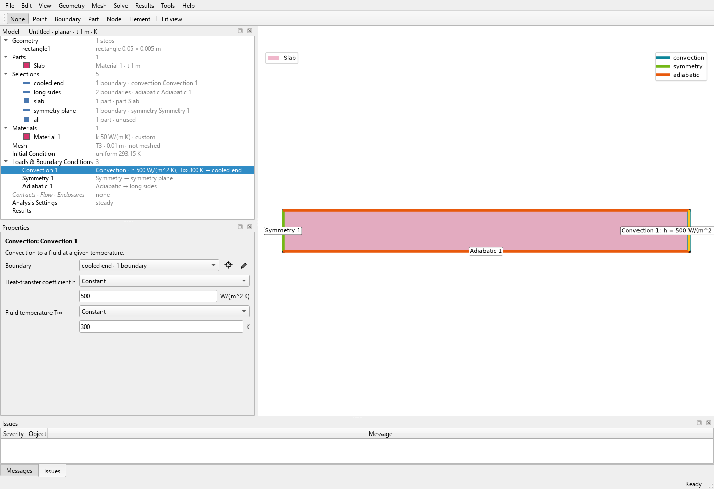
*V-17 with its three loads, named selections and the part "Slab".*

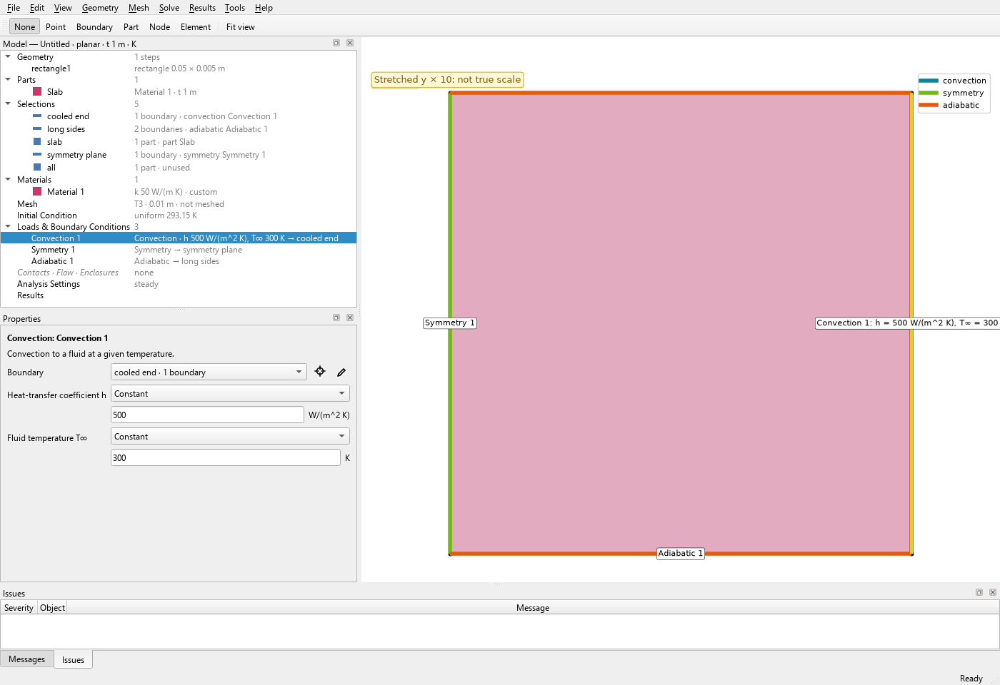
*The same model with View > Stretch > Stretch y × 10: a note says it is not true scale.*

### 2.5 Mesh: 40 elements along the slab, structured

1. Click the **Mesh** node. "Global element size": `0.005`, Enter.
2. In the box **Structured mesh**, the table "Boundary divisions": press **+ Add**. A new
   row appears with a dropdown of the boundary selections and a box "Elements". Choose
   `long sides` in the dropdown and type `40`; press Enter in the box to apply the whole
   row (or the check mark). Repeat for `symmetry plane` = `1` and `cooled end` = `1`. A
   row whose dropdown or value is not applied has an amber border and the check mark and
   U-turn arrow; a name already used in the table is not offered again; ✕ removes a row.
   When a row has focus, its boundaries are highlighted in the view. The rows are then
   listed in alphabetical order. (The "⌖ New..." button picks a new selection in the view
   and opens a row for it.)

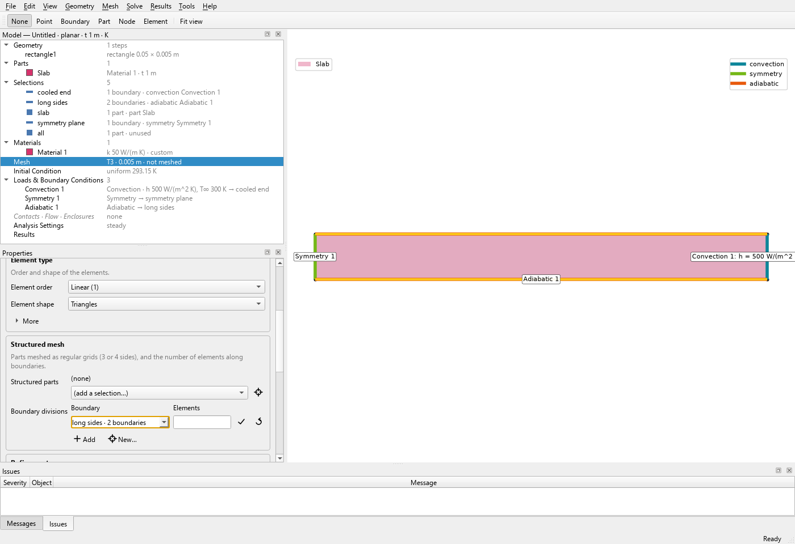
*A new row in "Boundary divisions": the dropdown has the amber border, the value is empty, the check mark and the U-turn arrow wait.*
3. "Structured parts": open the dropdown "(add a selection...)" and choose the part
   selection `slab`. It is a pending change (amber note "Not applied. Update uses this
   list; Revert goes back."); press the check mark. `slab · 1 part` now shows in the list
   above the dropdown, with a pencil and ✕.
4. **Generate mesh**. The status bar should report 82 nodes, 80 elements (a 40 by 1 grid of
   cells, each split into two triangles).

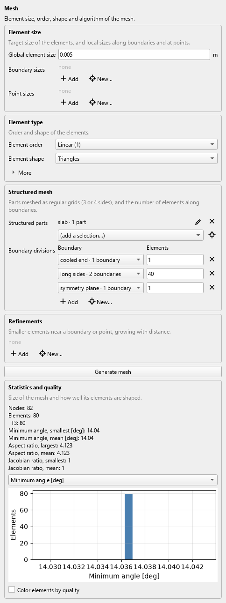
*The structured mesh: "Boundary divisions" as a table and "Structured parts" as a list in the "Structured mesh" box (the whole panel).*

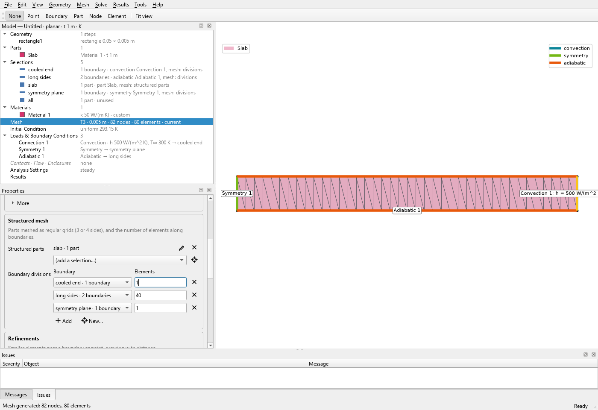
*A focused row highlights its boundary in the view (here the right edge, for "cooled end").*

### 2.6 Transient settings

1. Click **Analysis Settings** in the tree. The panel is made of boxes: **Analysis**
   ("Geometry type" "Planar", "Analysis type"), **Time**, **Time stepping**, **Integration
   (advanced)**, **Results to store** and **Convergence (advanced)**. In "Analysis type"
   choose `Transient` (the other entry is "Steady"). The boxes Time, Time stepping, Integration and
   Results to store appear.
2. "End time" `195`, Enter.
3. "Output steps": choose `At given times` (the others are "All steps" and "Every n-th
   step"). "Output times": `39, 195`, Enter. (The step at 0 s, the initial state, is always
   stored.) Leave "Adaptive time step" on and everything else at its default. "Largest time
   step" shows the hint "no limit"; under "Time stepping" > "More" are "Initial time step"
   (hint "suggested from the mesh"), "Smallest time step", "Time-step tolerance" and
   "Largest temperature change per step". The box "Integration (advanced) · Backward Euler"
   holds "Time integration" (a dropdown: "Backward Euler (θ = 1, default)", "Galerkin (θ =
   2/3)" and "Crank-Nicolson (θ = 1/2)") and "Lumped capacitance"; the box "Convergence
   (advanced)" holds "Residual tolerance", "Temperature tolerance", "Maximum iterations" and
   "Line search". Both advanced boxes start collapsed; their titles count the values you
   changed ("Convergence (advanced) · 2 changed").
4. Click **Initial Condition**. "Kind" is `Uniform`. "Temperature" `400` (K), Enter. (The
   panel shows only the fields of the chosen kind. "Per part" shows the table "Temperature
   per part", whose rows pick parts; "From a results file" shows the file name with a
   folder icon to browse for it.)

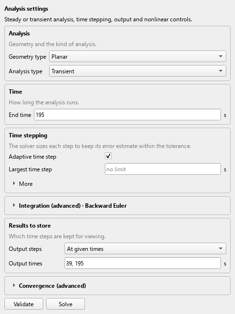
*Analysis Settings for the transient run, advanced boxes collapsed (the whole panel).*

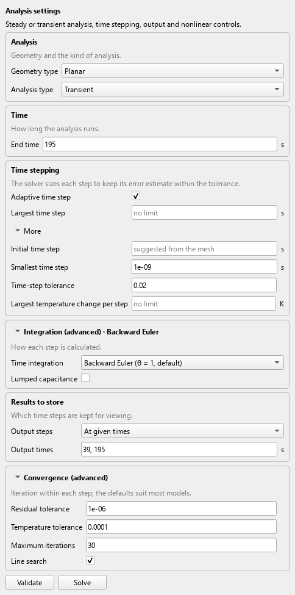
*The same panel with "More", "Integration" and "Convergence" opened.*

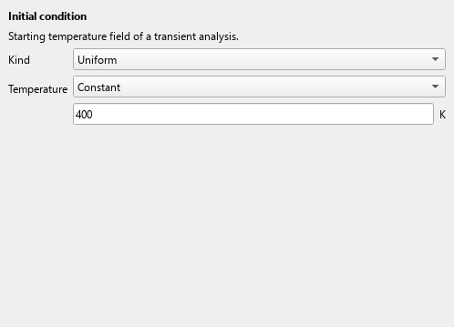
*The Initial Condition panel, kind Uniform, with 400 K.*

### 2.7 Expected model tree (before the solve)

```
Model — Untitled · planar · t 1 m · K          (title of the Model dock)

Geometry                       | 1 steps
  rectangle1                   | rectangle 0.05 × 0.005 m
Parts                          | 1
  Slab                         | Material 1 · t 1 m
Selections                     | 5
  cooled end                   | 1 boundary · convection Convection 1, mesh: divisions
  long sides                   | 2 boundaries · adiabatic Adiabatic 1, mesh: divisions
  slab                         | 1 part · part Slab, mesh: structured parts
  symmetry plane               | 1 boundary · symmetry Symmetry 1, mesh: divisions
  all                          | 1 part · unused
Materials                      | 1
  Material 1                   | k 50 W/(m K) · custom
Mesh                           | T3 · 0.005 m · 82 nodes · 80 elements · current
Initial Condition              | uniform 400 K
Loads & Boundary Conditions    | 3
  Convection 1                 | Convection · h 500 W/(m^2 K), T∞ 300 K → cooled end
  Symmetry 1                   | Symmetry → symmetry plane
  Adiabatic 1                  | Adiabatic → long sides
Contacts · Flow · Enclosures   | none          (one dimmed line)
Analysis Settings              | transient 0–195 s
Results
```

No item carries a warning mark. After the solve, "Results" holds "Temperature 1 | contour ·
current".

### 2.8 Solve and compare

1. Solve > **Validate** (no errors), then Solve > **Solve**. The progress window shows time
   and step size.

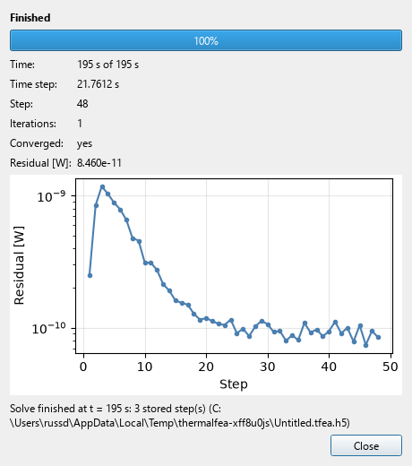
*The Solving window of the transient run.*
2. The viewport shows the temperature at the last step (195 s). In the "Temperature 1"
   panel the "Step" slider and spin box, and the "Time" box (type `39`, Enter), move between
   the stored steps 0, 39 and 195 s (steps 0, 1 and 2). "Play" animates. The header at the
   top of the panel reads "Analysis: transient 0–195 s", the mesh line, "Results written
   ..." and "Status: current".

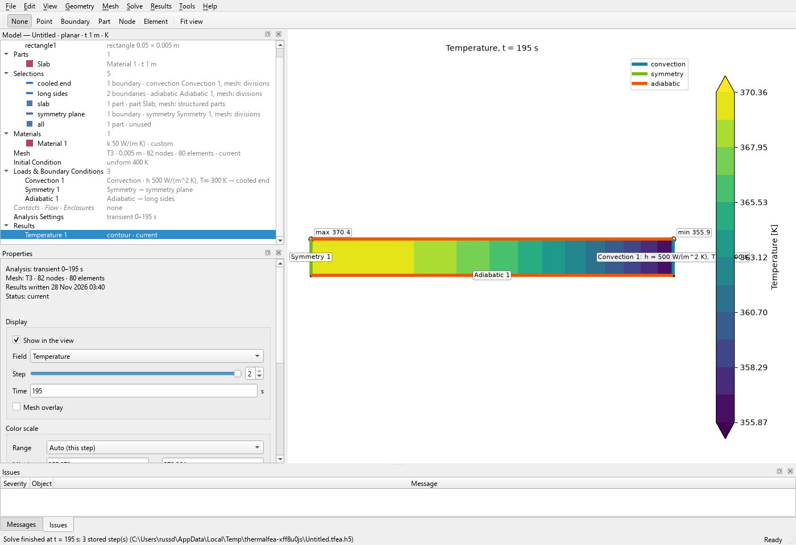
*V-17 at 195 s with the result header.*
3. **The numbers.** File > Export > **Nodal results (CSV)...**. In the CSV (columns
   `step,time,node,x,y,T,qx,qy`) take the rows with y = 0 and x = 0 or x = 0.05 at time 39
   and time 195. Compare T [K] with the table above: the relative error
   |T - T_exact| / T_exact must be below 2e-3.
4. **Charts and result items.** Nodal histories and path plots are saved items under
   **Results**, like the contour; each has its own panel.
   - Results > **Nodal history...** adds an item "Nodal history 1" and opens its panel,
     which starts picking nodes by itself (the toolbar switches to **Node**). The strip
     says "Click the nodes in the view (Ctrl+click adds or removes one)." and counts
     "0 nodes picked"; the buttons are "Use nodes" and "Cancel". Click the node at the
     centre (0, 0) and Ctrl-click the node at the surface (0.05, 0): "2 nodes picked". Press
     **Use nodes** (or Enter). The panel then lists "node 0 · (0, 0) m" and "node 1 ·
     (0.05, 0) m" each with ✕, with the checkbox "Show the nodes in the view", the button
     "Pick nodes" (to change them), "Quantity" "Temperature" and **Plot**. The nodes are
     marked in the view with their numbers, and the chart's legend uses the same numbers.
     The tree item reads "history · 2 nodes".
   - Results > **Energy balance** shows the energy balance per step; the transient limit is
     1e-3 (V-34). Results > **Heat-flow history** plots the heat entering through each
     condition. These two need no input; they redraw after a new solve.
   - Results > **Path plot...** adds an item "Path 1" ("path · two points") whose panel has
     two boxes, **Path** ("Defined by" "Two points", "Point A" and "Point B" with a
     crosshair each, "Snap A and B to the nearest nodes", "Samples", "Run from B to A") and
     **Plot**. The panel says "the path needs at least two points" until the points are
     set. There are no "Finish path plot" or "Cancel path plot" entries any more.

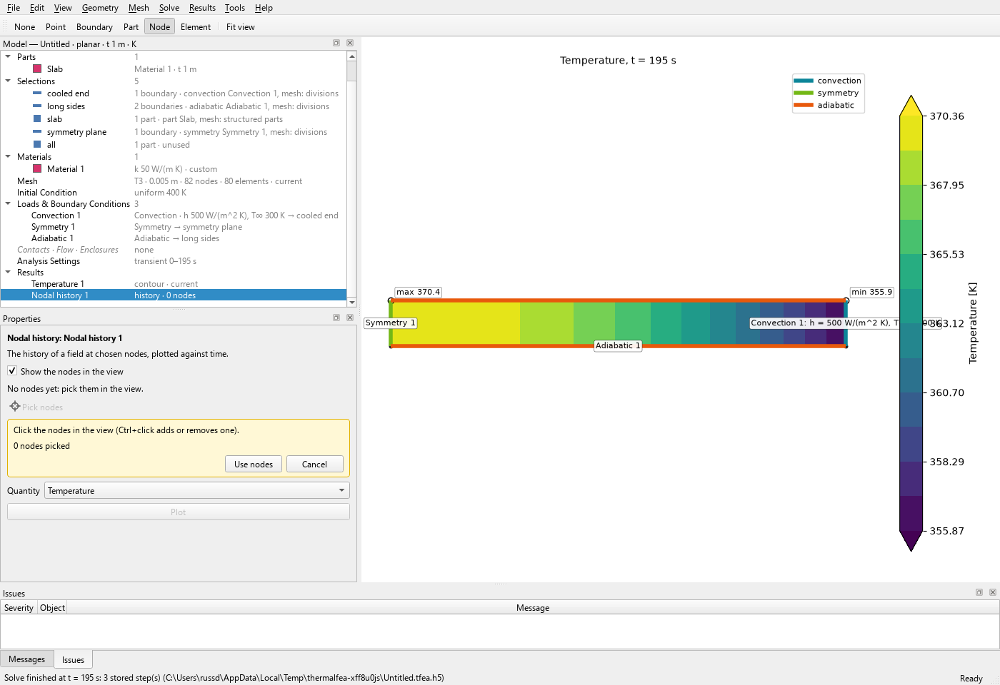
*The nodal history item picking nodes: the toolbar is on Node, the strip counts "0 nodes picked".*

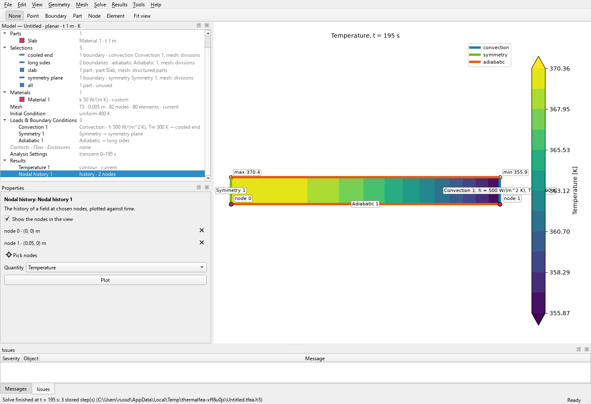
*The nodal history item with its two nodes, marked in the view as node 0 and node 1.*

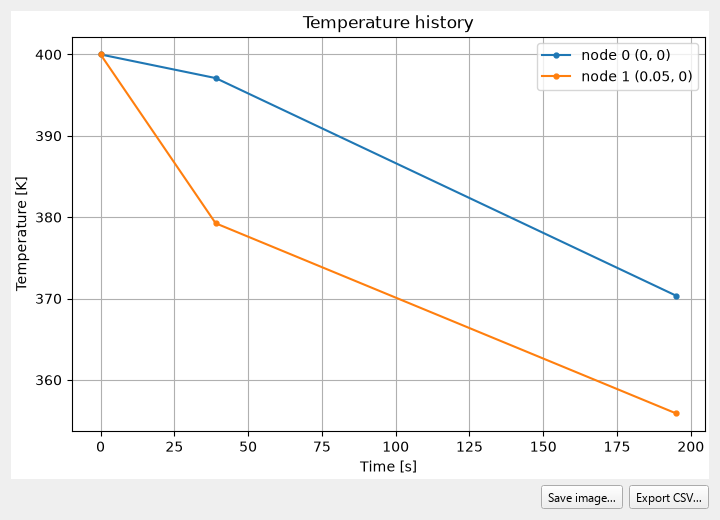
*Nodal history of the centre and surface nodes.*

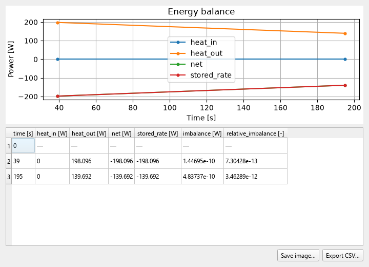
*Energy balance of the transient run.*

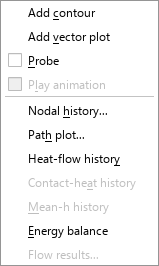
*The Results menu.*

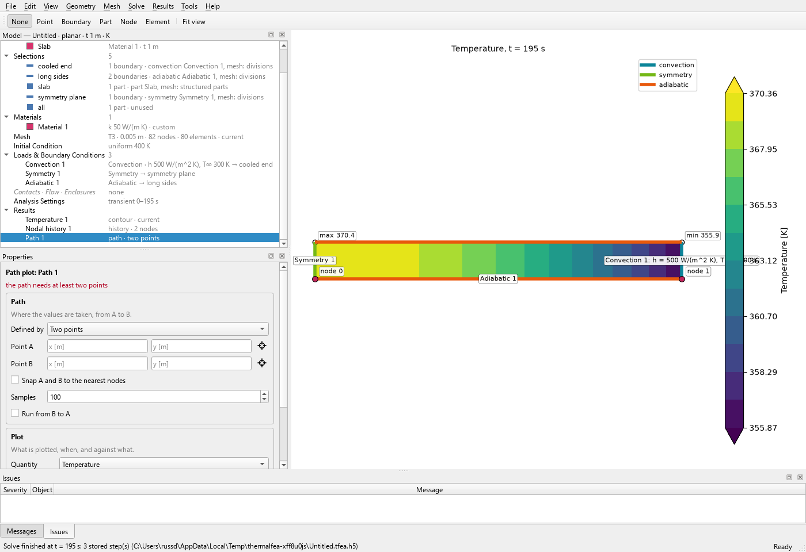
*A new path plot item: the boxes Path and Plot.*

### 2.9 What to check in this review (V-17)

1. **Toolbar.** None, Point, Boundary, Part, Node, Element. The picks above switch it to
   Boundary, Part and Node themselves and back to None afterwards.
2. **Tree and dock title.** The tree is as in 2.7. The "Analysis Settings" summary reads
   "transient 0–195 s" after step 2.6, and the "Initial Condition" summary "uniform 400 K".
   The "Mesh" summary reads "T3 · 0.005 m · 82 nodes · 80 elements · current" and turns
   "out of date" when you change a mesh setting.
3. **Geometry.** Click `rectangle1`: the strip is highlighted. Rename it (for example
   `strip`) and undo.
4. **Parts.** "Slab" with a swatch; summary "Material 1 · t 1 m". Try View >
   **Color by** > Material and None.
5. **Selection field.** "1 boundary picked", "2 boundaries picked", "1 part picked". The Name
   box is empty at the start of every pick; you typed `cooled end`, `symmetry plane`,
   `long sides` and `slab`.
6. **Selections section.** Each selection lists its users, including the mesh settings:
   `long sides` reads "2 boundaries · adiabatic Adiabatic 1, mesh: divisions". Click
   `long sides`: its two boundaries are highlighted. In its panel "Used by" lists the load
   and "mesh: divisions"; "Delete" is greyed out. Rename `long sides` to `sides` in the
   panel: the "Boundary divisions" row of the mesh panel and the load summary follow.
   Undo it. Page Down and Page Up step through the selections.
7. **Materials.** "k 50 W/(m K) · custom".
8. **Form labels and tables.** The mesh panel has the tables "Boundary sizes", "Point sizes"
   and "Boundary divisions" and the list "Structured parts"; the initial condition panel,
   kind "Per part", has "Temperature per part". (A contact would have "Interface
   boundaries"; V-17 has no contact.) Each table row: dropdown, value, ✕; "+ Add" and
   "⌖ New..." below.
9. **Results.** After the solve, "Temperature 1" reads "contour · current". Change "End
   time" to `200` and press Enter: the summary reads "contour · out of date", the viewport
   title reads "Temperature, t = 195 s · out of date", and the result panel shows "Status:
   out of date (1 change)" and in the yellow box "• Analysis settings: End time 195 s →
   200 s". Undo makes it current again.
10. **Hover and inspect.** In **Boundary** mode, hover the long edges: the tooltip reads
    "in: long sides" and "adiabatic Adiabatic 1". The right edge reads "in: cooled end" and
    "convection Convection 1". A single click shows the report in the status bar and
    puts the related tree items in bold.
11. **View menu.** Summary column, Color by, Part names (the label is "Slab"), Load values
    and Stretch.

## 3. What the GUI cannot do that the example scripts do

- **Place a mesh node at a given point.** The scripts look the node up (`node_at`) because they
  drew two rectangles. In the GUI do the same (V-10 section 1.1) and read the value from the CSV
  export. There is no "node probe by coordinates"; Results > Probe is a click.
- **Enter temperatures in degC.** Scripts use `100.0 + 273.15`; in the GUI choose degC with
  Tools > Units... first (added in M10.4), otherwise enter kelvin.
- **Set per-boundary element counts without a load, and the reverse.** "Boundary divisions"
  takes names of existing selections. You can make a selection without a load: use the
  "⌖ New..." button of the table (it picks in the view and opens a row for the new
  selection), select it in the Selections section and use "Add from viewport", or pick from
  any selection field. The extra Adiabatic condition in V-17 is the way this text takes
  because it names the long sides in the same step as a load.

## 4. Friction found while writing this (so you can confirm or dismiss)

Found by the scripted runs and by reading the code; none confirmed on a real screen. The
list is the one of the second version of this text, with what the redesign (tasks M11.66 to
M11.78) resolved marked as resolved.

1. (Resolved in M10.4: Tools > Units... sets the temperature and all other units.)
2. (Resolved in M11.69 and M11.70: a pick switches the toolbar to the entity it needs,
   Boundary for a fixed temperature, and switches it back to None afterwards. The scripted
   run checked both.)
3. The viewport is fitted only when the first shape appears; later shapes may lie outside
   the view until "Fit view". (Open. The scripted run confirms it: after the second
   rectangle the y range is -0.17 to 0.37 m for a plate that is 1 m high.)
4. (Resolved in M11.70: the Name box of a new selection starts empty and "Create and use"
   stays disabled until a valid unused name is typed, so a default name is never kept by
   accident. Whether typing a name is natural is still for the review to say.)
5. File > New builds the empty geometry on the gmsh thread; harmless but visible as
   "Building geometry..." in the status bar. (Open, not changed by the redesign.)
6. A new material starts with every property at 0 (owner's decision, 2026-11-24); a steady
   solve needs the conductivity, a transient one all three. (Open by decision. Task M11.78
   marks problems in the tree, but with no part yet no mark was seen on
   "Material 1 | k 0 W/(m K)"; Validate does refuse it once a part uses it.)
7. Results > Probe reads a pixel, not a coordinate. (Open. The probe now uses the common
   pick strip, "Click in the view to read values · Esc to stop.", task M11.69.)
8. Opening a saved model attaches its results file only after a mesh exists, so the
   results appear only after you press "Generate mesh" again. (Open.)

Seen in the screenshot run of 2026-11-24:

9. (Resolved in M11.70 and M11.72, convention C11: a refused selection name is shown once,
   under the Name box. The panel-top error line stayed empty in the run.)
10. (Resolved in M11.70 and M11.71: "Structured parts" is a list with ✎ and ✕ and a
    dropdown on its own row, and there is no cut-off picking row; see g19.)
11. (Resolved in M11.74: labels of the loads are drawn in front of the lines and of the
    inspect highlight; see g16.)
12. On the long V-17 strip, the label of the convection runs into the color bar. (Open. It
    is still cut off at the right edge of the view in g19a, g22 and g23a.)
13. At start the "Issues" tab is in front of "Messages" in the bottom dock. (Open; see g01.)

Seen in the screenshot run of 2026-11-28 (offscreen, so check them on the screen):

14. The status bar keeps the message "Selection change not applied" for many steps
    (it appears in g08b and is still there in g10a) instead of fading.
15. In the contour views (g14, g16) the label of the minimum ("min ...") at the top right
    corner is partly hidden under the legend of the load colors.
16. The selection row of a part is labeled "Selection", not "Part" like the "Boundary" row
    of a load.
17. The probe's strip reads "Click in the view to read values · Esc to stop." and the
    conventions (C2) give "Click to read values · Esc to stop".
18. After a chart window of a nodal history is closed, the next edit of the model prints
    "RuntimeError: ... ChartWindow already deleted" from `history_tools.py` (in the
    terminal; no dialog). The window works on, but the message should not appear.

## 5. Friction log (fill in)

| # | Walkthrough step | What I did | What happened / what I expected | Severity (blocker / slows me down / cosmetic) | Suggested change |
|---|---|---|---|---|---|
| 1 | | | | | |
| 2 | | | | | |
| 3 | | | | | |
| 4 | | | | | |
| 5 | | | | | |

Also record: total time to build V-10 from scratch; total time to build V-17; and whether
each answer was inside its tolerance (V-10 within 0.15 degC; V-17 within 2e-3).

| Case | Minutes | Answer | Inside tolerance? |
|---|---|---|---|
| V-10 | | | |
| V-17 | | | |
