# Counterflow double-pipe oil cooler

**What this example shows.** Hot engine oil flows through a copper tube; cooling water
flows the opposite way through the annulus between the tube and a shell. ThermalFEA models
the copper wall as an axisymmetric solid and each liquid as a one-dimensional *stream*
that picks up or gives off heat along the wall. The two streams exchange heat only through
the copper, so the model predicts both outlet temperatures, the heat duty and the axial
temperature difference that drives the heat through the wall, and, in a transient, how the
copper stores heat when the oil gets hotter.

The case is checked three ways: against the counterflow effectiveness–NTU method with the
film coefficients held constant, against an LMTD balance with the program's own duct
correlations, and, in the start-up, against an energy balance on the copper.

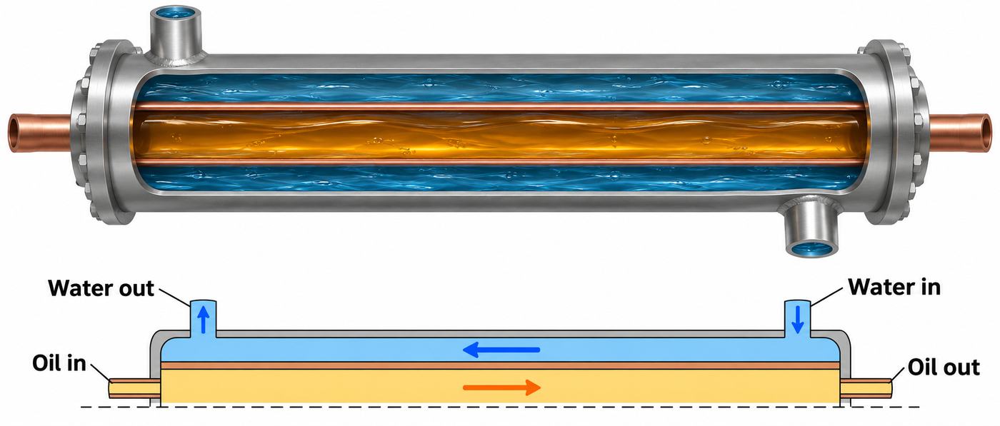

*A double-pipe (tube-in-tube) oil cooler. Oil enters the copper tube at the left and leaves
at the right; water enters the shell at the right and leaves at the left. The model is the
straight copper span between the fittings (illustration).*

Contents:
1. [The cooler and the model](#1-the-cooler-and-the-model)
2. [Inputs](#2-inputs)
3. [Results: steady operation](#3-results-steady-operation)
4. [Verification against effectiveness–NTU](#4-verification-against-effectivenessntu)
5. [Start-up: a 20 K rise in oil inlet temperature](#5-start-up-a-20-k-rise-in-oil-inlet-temperature)
6. [Simplifications](#6-simplifications)
7. [Building the model in the window](#7-building-the-model-in-the-window)
8. [Running the scripts](#8-running-the-scripts)

## 1. The cooler and the model

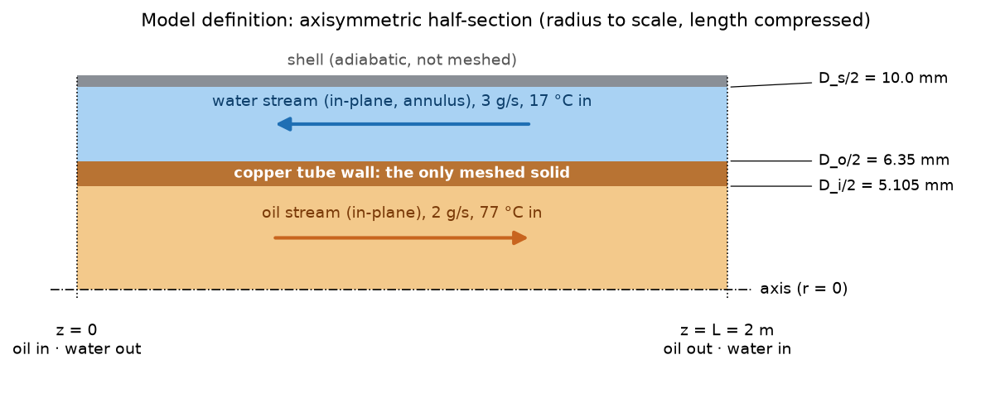

*The modelled half-section. Radii are to scale; the 2 m length is compressed.*

- **Solid:** only the copper tube wall is meshed, an axisymmetric ring from r = D_i/2 to
  D_o/2 and from z = 0 to L. In the program the axisymmetric coordinates are x = r and
  y = z, so the axis is vertical on screen; this page draws z horizontally, as the
  illustration does. The two tube ends are insulated.
- **Oil stream:** an in-plane stream on the inner face of the tube, flowing from z = 0 to
  L. Its duct is the tube bore: flow area π D_i²/4, wetted perimeter π D_i, cross-section
  `circular`.
- **Water stream:** an in-plane stream on the outer face of the tube, flowing from z = L
  to 0. Its duct is the annulus: flow area π (D_s² − D_o²)/4 and wetted perimeter
  π (D_s + D_o), so the hydraulic diameter is D_s − D_o. Its cross-section is
  `annulus_inner` (the heated inner surface of a concentric annulus, the outer surface
  insulated) with the diameter ratio D_o/D_s.
- **Shell:** adiabatic and not meshed. Only the tube's outer face exchanges heat with the
  water, so all the heat the oil releases goes to the water, apart from what the copper
  stores in a transient.
- **Heated areas:** an axisymmetric wall's area is ∫ 2πr ds, so the oil sees π D_i L and
  the water π D_o L.

Each stream solves its own energy balance cell by cell along its path (Theory §9.1): one
fluid temperature per cell boundary, heat exchanged with the wall nodes of that cell, the
film coefficient from the duct correlation of Theory §8.1 at the local fluid temperature.
The mesh has 200 elements along the tube and 4 across the wall, and each stream has one
cell per wall element, 200 cells.

## 2. Inputs

| Quantity | Value | Source |
|---|---|---|
| Tube | copper, D_o = 12.70 mm, wall 1.245 mm, D_i = 10.21 mm | ASTM B88 Type K, 3/8 in nominal |
| Copper | k = 401 W/(m K), ρ = 8933 kg/m³, c_p = 385 J/(kg K) | library "Copper (pure)", Incropera Table A.1, 300 K |
| Shell bore D_s | 20.0 mm (D_o/D_s = 0.635, annulus D_h = 7.30 mm) | assumption |
| Length L | 2.0 m | assumption |
| Oil | library "Engine Oil (Unused)", 273–430 K | Incropera Table A.5, "unused engine oil" |
| Oil flow, inlet | 0.002 kg/s, 350 K (76.9 °C); start-up: 370 K (96.9 °C) | assumption |
| Water | library "Water", liquid at 0.1 MPa, 280–370 K | library |
| Water flow, inlet | 0.003 kg/s, 290 K (16.9 °C) | assumption |

The oil table is not a particular SAE grade. Fluid properties are evaluated at each cell's
fluid temperature; each stream's specific heat is taken at its inlet temperature.

## 3. Results: steady operation

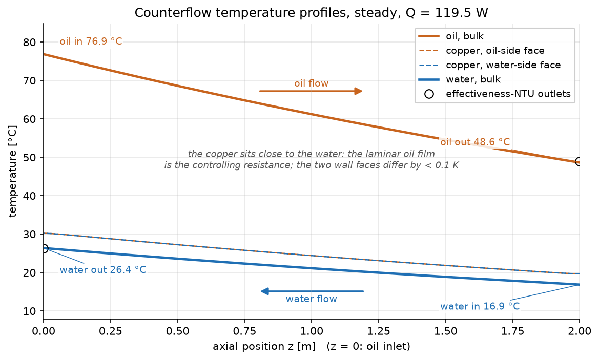

*Steady operation with the duct correlations. The oil (top) cools from 76.9 °C to 48.6 °C;
the water (bottom) warms from 16.9 °C to 26.4 °C in the opposite direction. The circles
are the outlets predicted by the effectiveness–NTU method (section 4).*

| | Oil | Water |
|---|---|---|
| Reynolds number | 3.9 (laminar) | 120 (laminar) |
| Correlation | circular duct, Nu = 3.66 | annulus, heated inner surface, Nu interpolated at D_o/D_s = 0.635 |
| Mean film coefficient | 50.2 W/(m² K) | 452 W/(m² K) |
| Inlet → outlet | 350.00 → 321.78 K | 290.00 → 299.52 K |
| Heat | 119.5 W released | 119.5 W gained |
| Pressure drop | 1.12 kPa | 18.7 Pa |

What an engineer would look for:

- **The two duties are equal** (119.537 W each) and the solid's energy balance closes to a
  relative 2e-11.
- **Counterflow:** the oil inlet (76.9 °C) meets the water outlet (26.4 °C) at z = 0, and
  the oil outlet (48.6 °C) meets the water inlet (16.9 °C) at z = L. For the same UA and
  heat-capacity rates, counterflow gives an effectiveness of 0.466 against 0.450 for
  parallel flow (Incropera Table 11.3), about 3.5 % more duty.
- **The oil film controls.** The oil's film coefficient is about a ninth of the water's, so
  the copper sits close to the water temperature (3–4 K above it) and 30–47 K below the
  oil. The temperature drop across the copper wall itself is under 0.1 K. Improving this
  cooler means improving the oil side (turbulators, fins, a smaller bore), not the water
  side.
- **LMTD check:** LMTD = 40.41 K, and Q/LMTD = 2.958 W/K equals the UA built from the two
  mean film coefficients and the wall resistance (2.959 W/K) to 0.02 %.

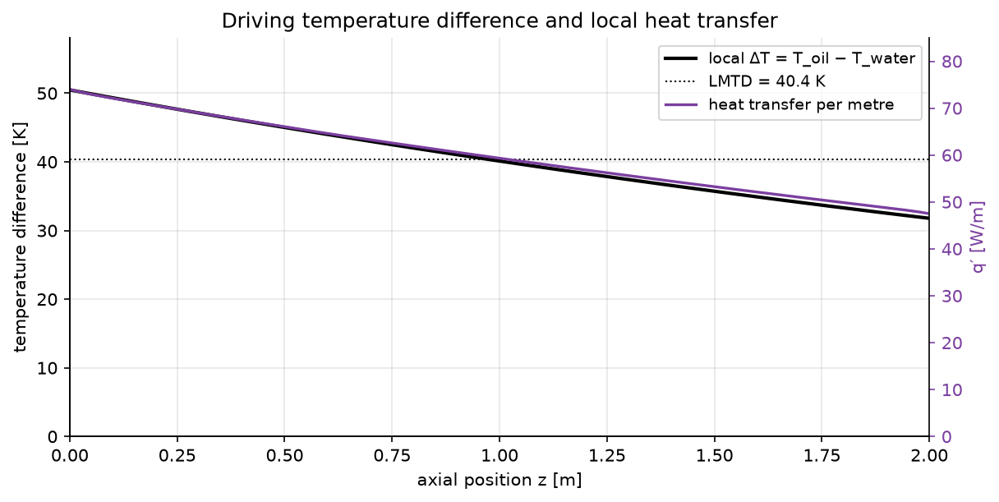

*The local temperature difference between the two streams falls from 50.5 K at the oil
inlet to 31.8 K at the oil outlet, and the heat transferred per metre of tube follows it.
The LMTD of the two end differences is 40.4 K.*

## 4. Verification against effectiveness–NTU

For this check both streams get a constant film coefficient ("Coefficient override"),
equal to the fully developed values with properties at the inlet temperatures: h_oil =
49.47 W/(m² K) and h_water = 446.4 W/(m² K). The specific heats are those of the inlet
temperatures, as the solver uses them. Then, by hand:

- 1/UA = 1/(h_oil π D_i L) + ln(D_o/D_i)/(2π k L) + 1/(h_water π D_o L), so UA = 2.914 W/K;
- C_oil = ṁ_oil c_p,oil = 4.236 W/K and C_water = 12.560 W/K, so C_min = C_oil,
  C_r = 0.3373 and NTU = UA/C_min = 0.6878;
- counterflow effectiveness ε = (1 − E)/(1 − C_r E) with E = exp[−NTU (1 − C_r)]:
  ε = 0.4656 (Incropera Table 11.3);
- Q = ε C_min (T_oil,in − T_water,in) = 118.35 W, T_oil,out = 322.06 K,
  T_water,out = 299.42 K.

| Axial elements = stream cells | 50 | 100 | 200 | 400 |
|---|---|---|---|---|
| Oil outlet − ε-NTU [K] | +0.0046 | +0.0042 | +0.0041 | +0.0040 |
| Water outlet − ε-NTU [K] | −0.0016 | −0.0014 | −0.0014 | −0.0014 |
| Duty − ε-NTU [%] | −0.017 | −0.015 | −0.015 | −0.014 |

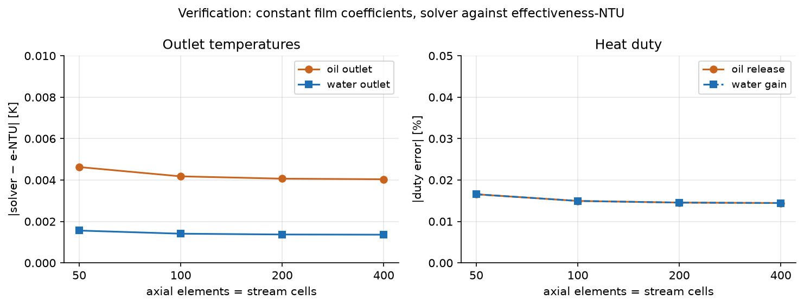

The solver's outlets agree with the hand calculation to within 0.005 K and the duty to
0.015 %, already on the coarsest mesh. The small residual does not shrink with refinement,
so it is not a discretisation error. The likely cause is physics the hand calculation
leaves out, such as axial conduction along the copper. Either way it is far below any
engineering tolerance. The stream discretisation (Theory §9.1) is exact for a constant wall
temperature in each cell, which is why 50 cells already suffice.

With the duct correlations instead of constant coefficients (section 3), the duty is 1 %
higher (119.5 W against 118.3 W) because each cell evaluates the film coefficient at its own
fluid temperature, not at the inlet.

## 5. Start-up: a 20 K rise in oil inlet temperature

The start-up begins from the steady solution of section 3 (initial condition "from
results"). The oil inlet temperature rises from 350 K to 370 K over 1 s and then holds; the
water inlet and both flows are unchanged. The run covers 120 s with time steps of at most
0.25 s (485 stored steps).

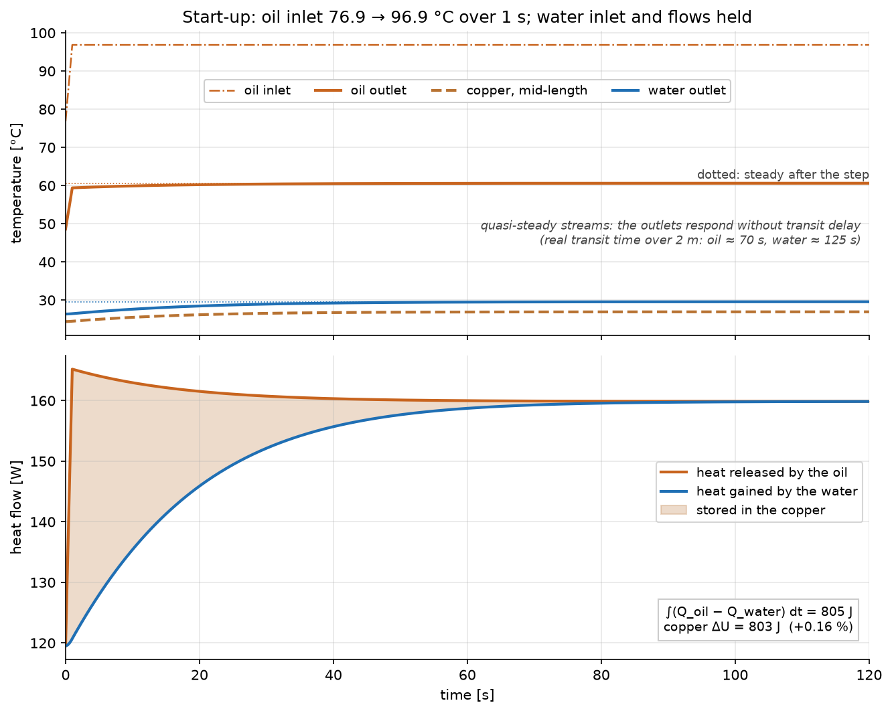

*Top: oil inlet and outlet, water outlet and the copper at mid-length. Bottom: the heat
released by the oil, the heat gained by the water, and between them the heat stored in the
copper.*

- The duty rises from 119.5 W to 159.9 W. At 120 s both outlets are within 0.001 K of a
  separate steady solution at the new oil inlet (oil 333.76 K, water 302.73 K).
- **The copper stores the difference.** The integral of (oil release − water gain) over the
  run is 804.7 J; the change of the copper's internal energy, ρ c_p ∫ ΔT dV, is 803.4 J, a
  difference of 0.16 %. With a time step four times smaller the two agree to 0.01 %.
- The wall responds with a time constant of about 20 s: the copper (about 300 J/K) is
  heated through the weak oil film and cooled through the strong water film.

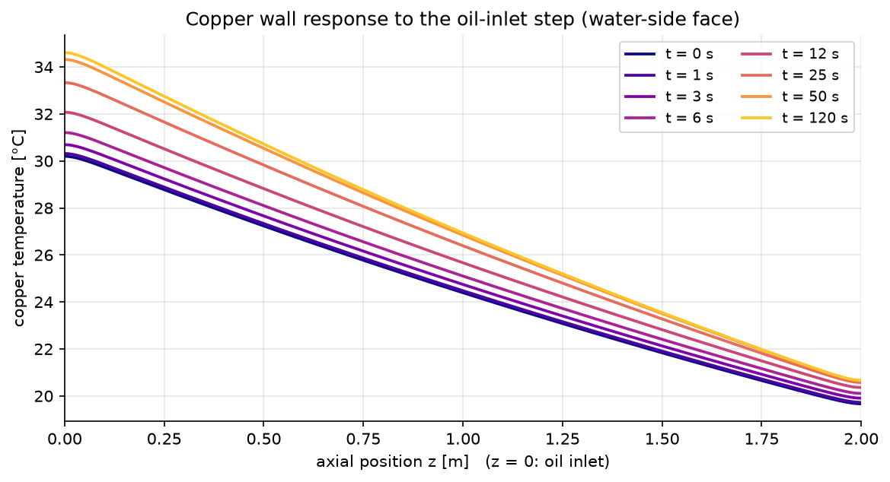

*Copper temperature along the tube at several times after the step.*

## 6. Simplifications

State these when you show the results:

- **Fully developed duct correlations.** The film coefficients are the fully developed
  values of Theory §8.1 (Nu = 3.66 for the oil). The program does not model the thermal
  entrance region. At Re ≈ 4 and Pr ≈ 400–550 the oil's thermal entry length,
  roughly 0.05 Re Pr D_i, is about as long as the tube, so the real oil film coefficient is
  higher than 3.66 k/D_i over much of the length, and the correlation run under-predicts
  the duty. The verification of section 4 prescribes the film coefficients and is not
  affected.
- **Quasi-steady streams, no transit delay.** The liquids store no heat (Theory §9.1). In
  the start-up both outlets respond as soon as the inlet changes. In a real cooler the oil
  takes about 70 s to travel the 2 m tube (28.6 mm/s) and the water about 125 s
  (16.0 mm/s), so the real outlets lag by those times. The start-up shows the copper's
  heat storage, not the fluids' residence time.
- **Constant solid properties** at 300 K (the library's copper).
- **The annulus correlation assumes the outer wall is insulated,** which is why the shell
  is adiabatic.
- **One specific heat per stream,** taken at its inlet temperature.

## 7. Building the model in the window

These steps were run in the program's window, with the screenshots taken along the way, and
the model they build gives the same results as the script (oil outlet 321.781 K, water
outlet 299.517 K, 119.537 W). Start the program from the project folder with
`.venv\Scripts\python.exe -m thermalfea.gui.app`. Widen the Properties dock (drag its
right edge): the stream panel is long and its picking row needs the width.

**About the screenshots of the tube.** The wall is 1.245 mm thick and 2 m long. Zoomed to
true scale it is either invisible (the whole length) or a few elements of one color (a few
centimetres). The views of the whole tube below were therefore taken with the radial
direction stretched, which the window cannot do; in the window, zoom with the mouse wheel
and pan with the middle button.

### 7.1 An axisymmetric model

1. **File > New.** Click **Analysis Settings** in the tree and set "Geometry type" to
   **Axisymmetric**. The Model dock title reads "Model — Untitled · axisymmetric · K". In an
   axisymmetric model x is the radius r and y the axial position z.

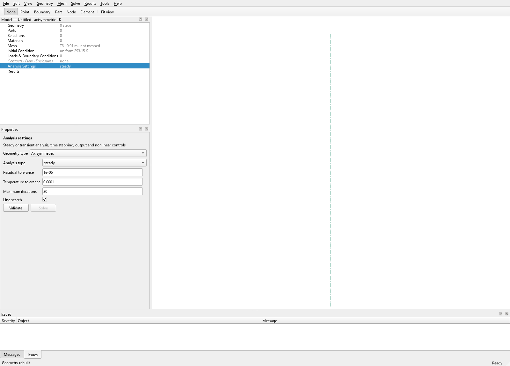

### 7.2 The copper wall

1. **Geometry > Rectangle...**: x = `0.0051054`, y = `0`, Width = `0.0012446`,
   Height = `2.0` (the wall from r = D_i/2 to D_o/2, from z = 0 to 2 m). Press **OK**.
2. **View > Fit view.** The wall is a thin vertical line; zoom with the wheel near the
   bottom end (z = 0) to see it.

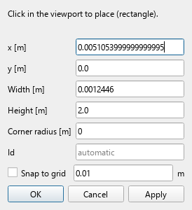

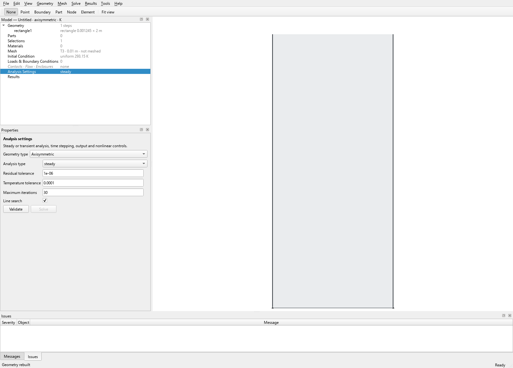

*The bottom 3 cm of the wall after zooming (radial direction stretched).*

### 7.3 The two streams

A stream is added from the dimmed **Contacts · Flow · Enclosures** line (right-click >
**Add stream**). The first stream of a model is made in a "New stream" dialog; a later
**Add stream** copies the first stream, and a copied circular stream cannot be changed to
the annulus. So open **both** dialogs before creating either stream:

1. Right-click **Contacts · Flow · Enclosures** > **Add stream**, then do it again. Two
   "New stream" dialogs are open.
2. In the first, for the oil: Fluid **Engine Oil (Unused)**, Flow area [m^2] `8.1886e-05`,
   Wetted perimeter [m] `0.032078`, Cross-section **circular**, Inlet temperature [K] `350`.
   Press **Create**.
3. In the second, for the water: Fluid **Water**, Flow area `1.8748e-04`, Wetted perimeter
   `0.10273`, Cross-section **annulus_inner**, Diameter ratio D_i/D_o (annulus only)
   `0.635`, Inlet temperature `290`. Press **Create**.

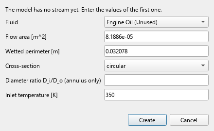 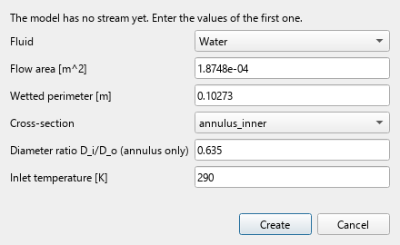

The streams are called "Stream 1" and "Stream 2" under Flow > Streams. Rename them (right-
click > Rename) to `Oil` and `Water`. Then, in each stream's panel:

4. **Walls:** press **Pick in viewport**, choose **Boundary** in the toolbar, click the
   inner face of the wall (the left edge, r = D_i/2) for the oil, type `oil wall` in "New
   name" and press **Apply**; switch picking off. For the water, pick the outer face (the
   right edge, r = D_o/2) and name it `water wall`.
5. **Mass flow:** its mode box starts at "None". Set it to **Constant** first, then type
   `0.002` for the oil and `0.003` for the water and press Enter. (A number typed while the
   mode is "None" is not used, and Validate then reports the stream as having no mass
   flow.)
6. **Path:** the stream's path from its inlet to its outlet, as `x, y` pairs separated by
   semicolons. Oil: `0.0051054, 0; 0.0051054, 2` (up the bore). Water:
   `0.00635, 2; 0.00635, 0` (down the annulus: this is what makes it counterflow).
7. Leave "Mode" at **in_plane** and "Number of cells" empty (one cell per wall element).

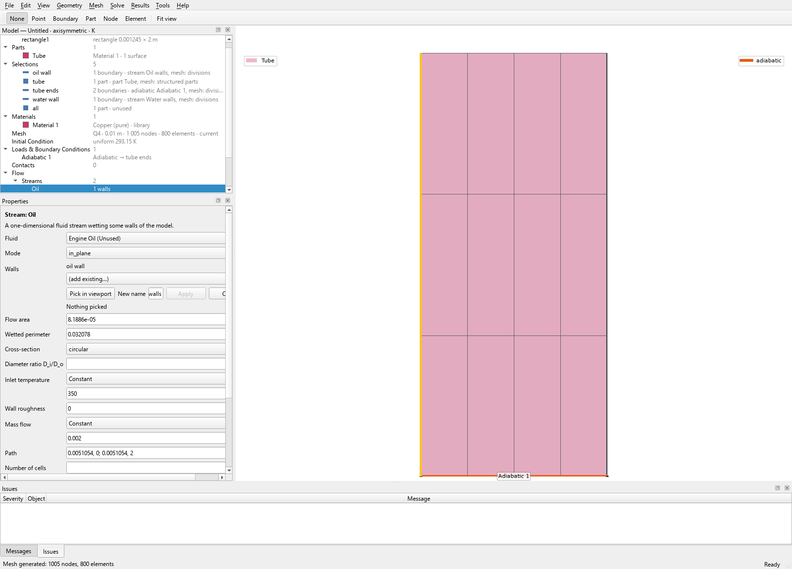

*The oil stream's panel. The oil wall is the left face of the tube (highlighted).*

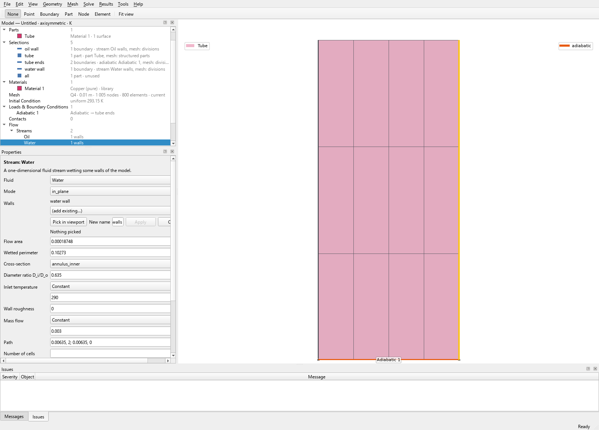

### 7.4 Insulated ends, material and part

1. **Tube ends:** right-click **Loads & Boundary Conditions** > **Add** > **Add
   Adiabatic**. Pick the bottom end edge, zoom to the top and Ctrl-click the top end edge
   ("2 boundaries picked"), name them `tube ends`, **Apply**. The ends would be insulated
   anyway; the named selection is needed for the mesh.
2. **Material:** right-click **Materials** > **Add material**. In the panel's "From library"
   box type `Copper (pure)` and press **Use library values**. The tree's summary reads
   "Copper (pure) · library".
3. **Part:** right-click **Parts** > **Add part**. Name `Tube`. In its Selection field pick
   with **Part** mode inside the wall, name it `tube`, **Apply**. Material "Material 1".

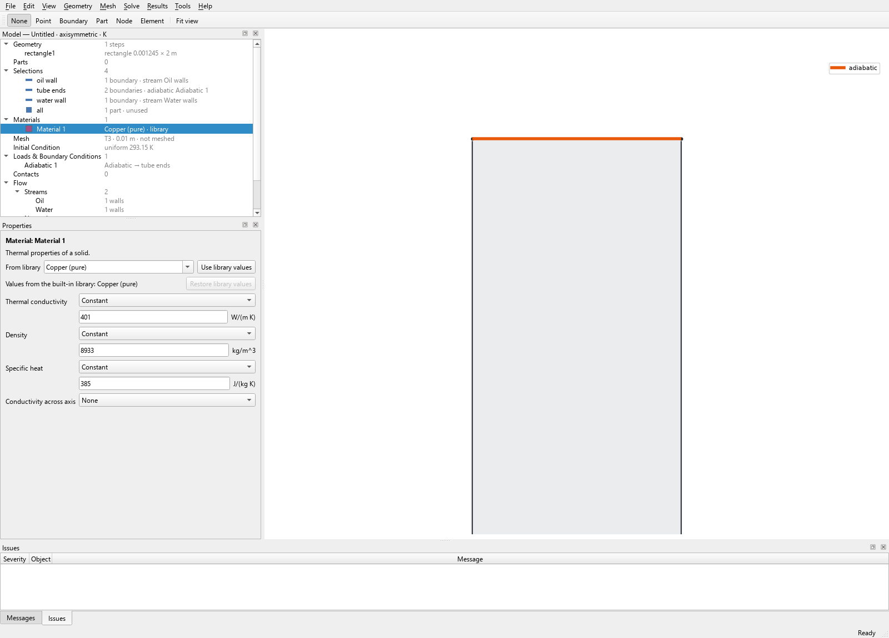

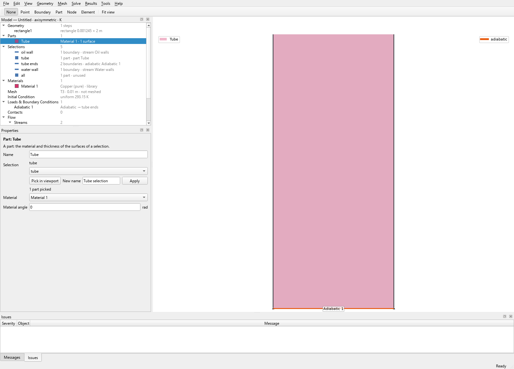

### 7.5 Mesh

Click **Mesh**. "Element shape" **quad**, "Global element size" `0.01`, "Boundary
divisions" `oil wall=200, water wall=200, tube ends=4`, "Structured parts": choose
**tube**. Press **Generate mesh**: "Mesh generated: 1005 nodes, 800 elements" (200 along the
tube, 4 across the wall).

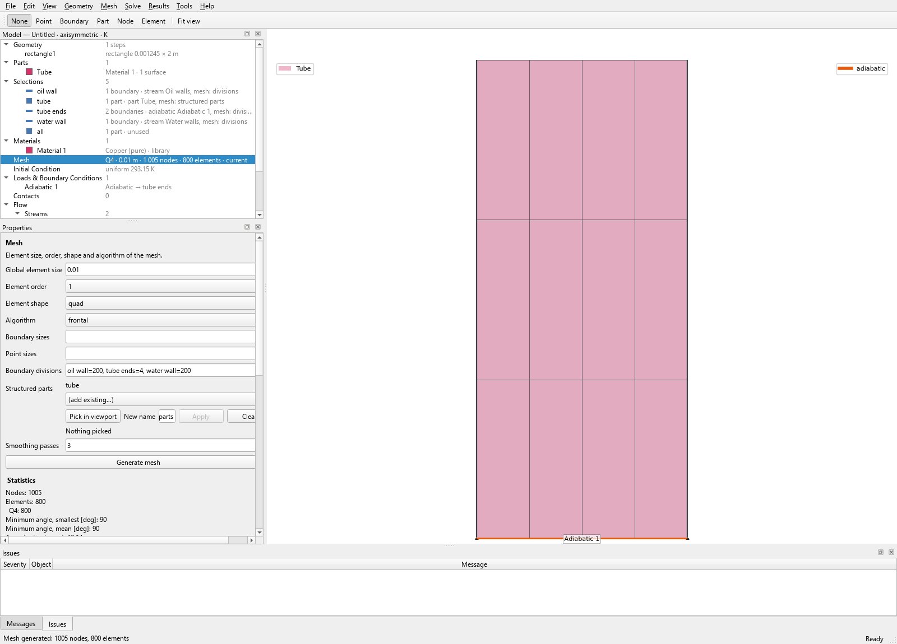

*The structured mesh near z = 0: 4 quadrilaterals across the wall, each 10 mm long.*

The tree now describes the whole model:

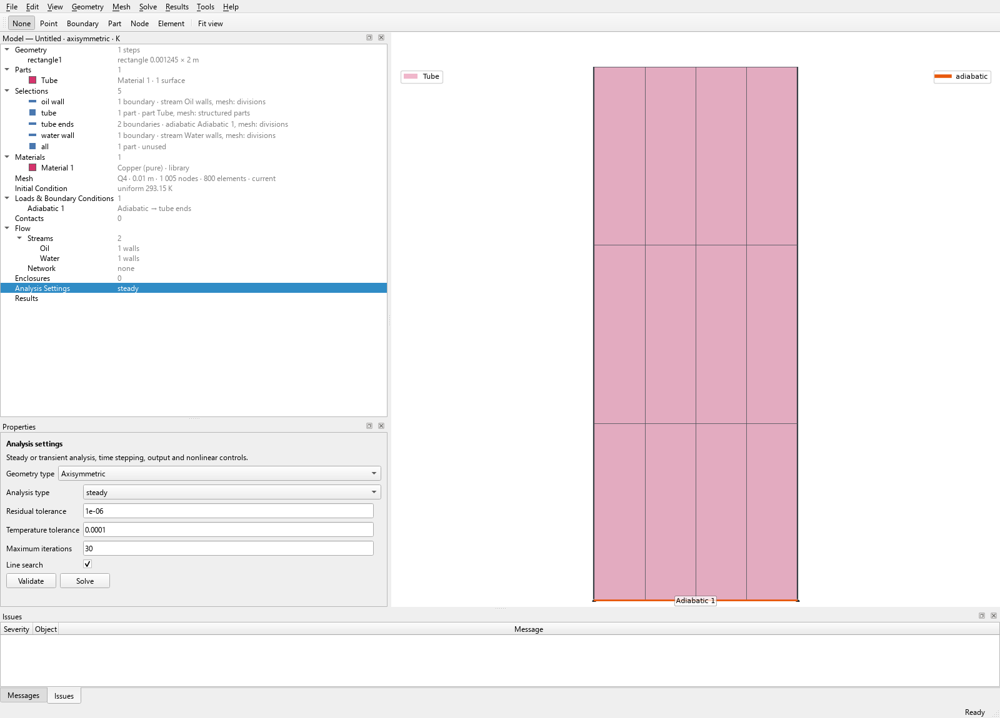

### 7.6 Solve and read the results

1. **File > Save As...** `oil-cooler.tfea`. The results will be written beside it as
   `oil-cooler.tfea.h5`.
2. **Solve > Validate** ("Validation: no issues"), then **Solve > Solve**.

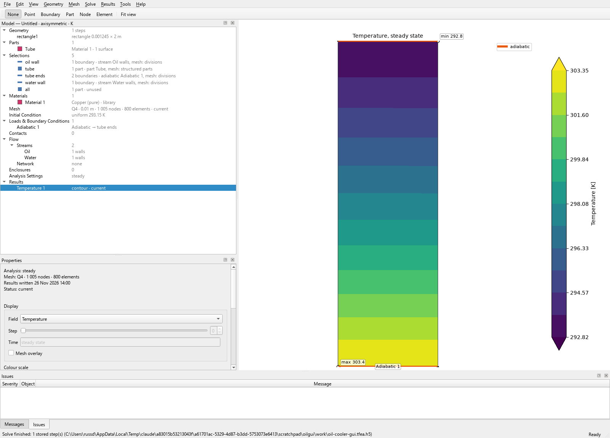

*The copper's temperature over the whole length (radial direction stretched): 30.2 °C
(303.35 K) at the oil inlet end, 19.7 °C (292.82 K) at the water inlet end. The result
header reads "Status: current".*

3. **Results > Flow results** lists each stream: Re, regime, mean h, pressure drop, inlet
   and outlet temperatures and heat. Select a row and press **Plot** for the fluid and wall
   temperature along that stream's path.

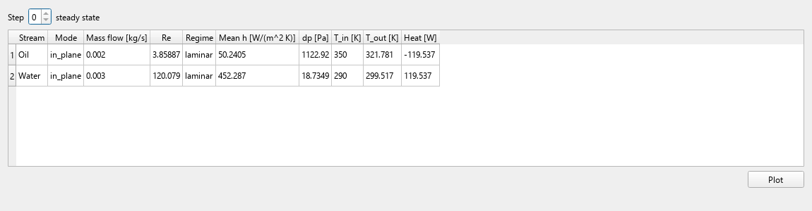

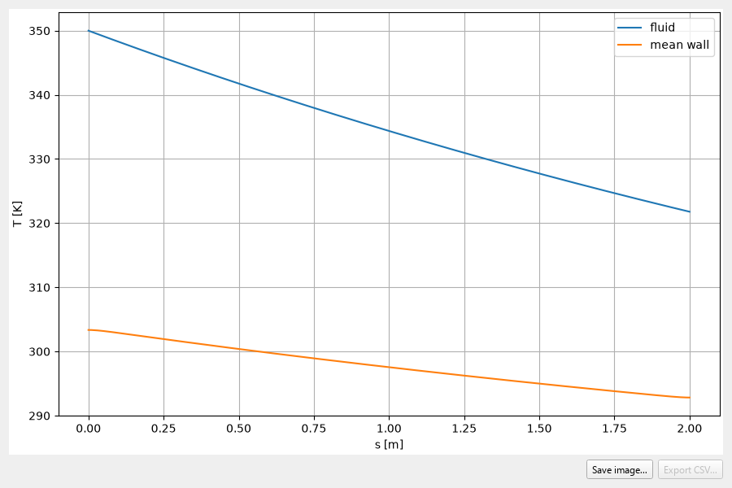

*The oil stream plot. The path coordinate s runs from the stream's own inlet, so for the
water s = L − z; the combined plot of section 3 puts both on z.*

### 7.7 The start-up

1. **File > Save As...** `oil-cooler-startup.tfea`. Do this first: a model's solve writes
   its results to `<model file>.h5`, so the start-up must not overwrite the steady results
   it starts from.
2. **Analysis Settings:** "Analysis type" **transient**, "End time" `120`, "Initial time
   step" `0.02`, "Largest time step" `0.25`, "Output steps" **every_n**, "Store every n-th
   step" `1`.
3. **Initial Condition:** "Kind" **from_results**, "Results file": the full path of
   `oil-cooler.tfea.h5` from 7.6. (The panel still shows the uniform temperature fields;
   they are not used.)
4. **Oil stream, Inlet temperature:** mode **Table**, "As a function of" **time (t)**,
   **hold ends**, rows `0, 350` and `1, 370` (the rise over 1 s, then held).
5. **Solve > Solve**: "Solve finished at t = 120 s: 485 stored step(s)".

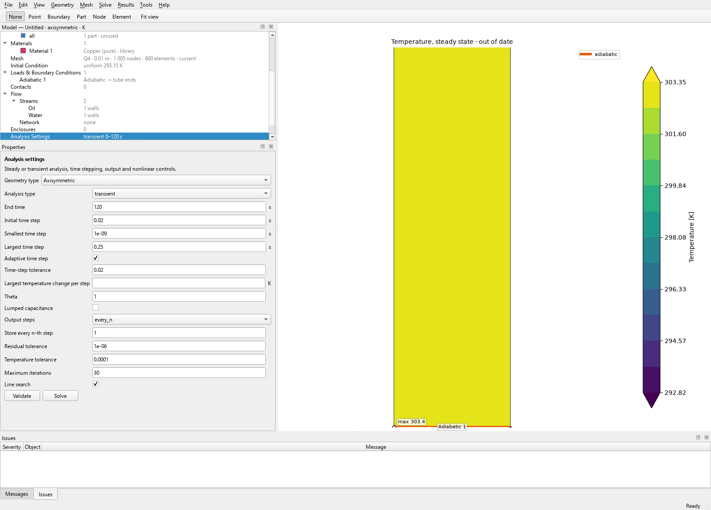

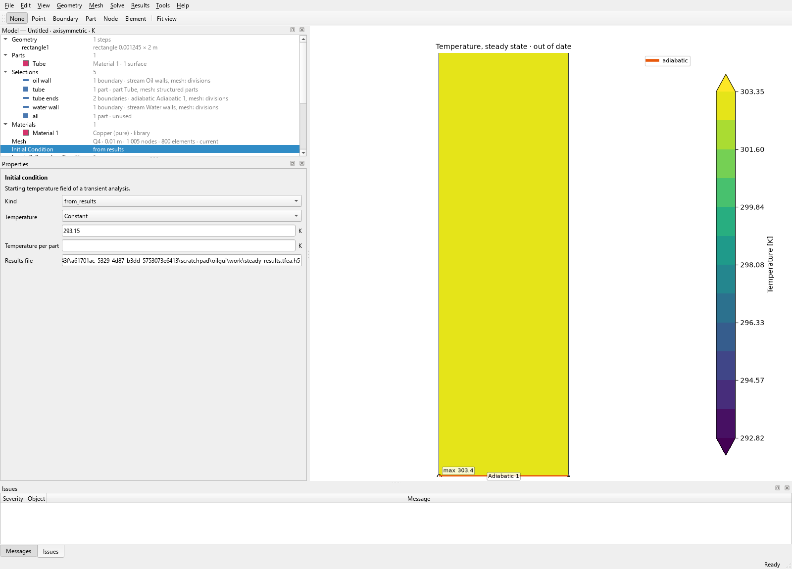

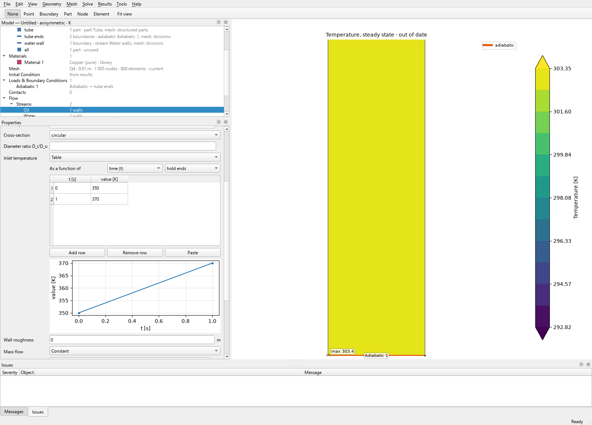

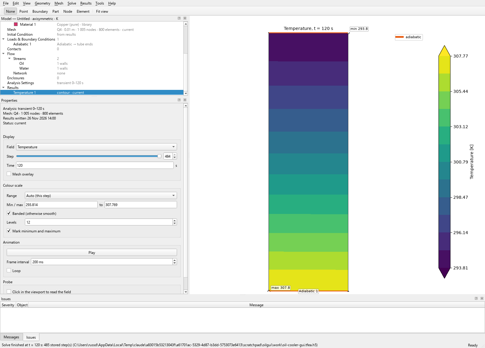

*The copper at the end of the start-up (radial direction stretched): 34.6 °C (307.77 K) at
the oil inlet end.*

6. **Results > Nodal history**: pick a node at mid-length to plot its temperature against
   time; **Results > Energy balance** lists the heat flows of every step.

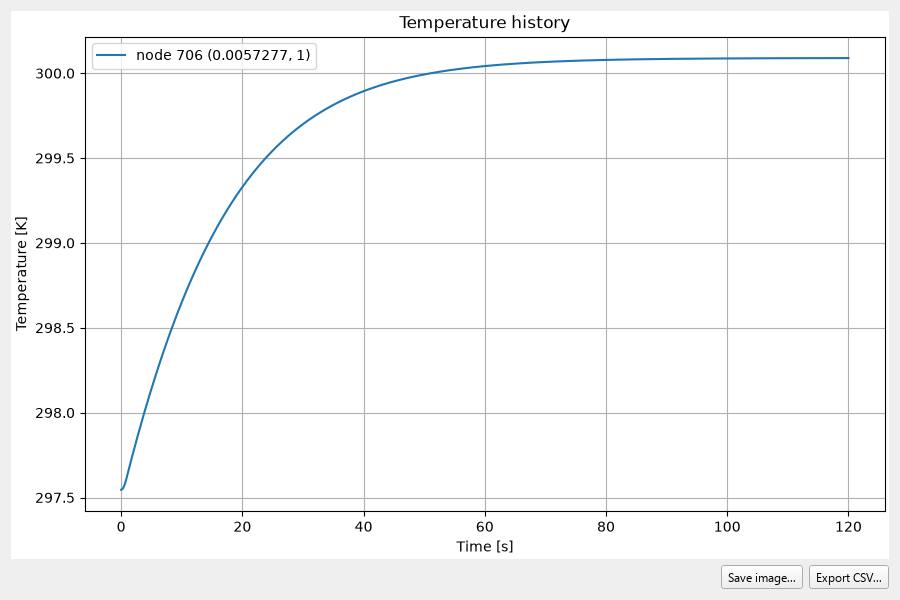

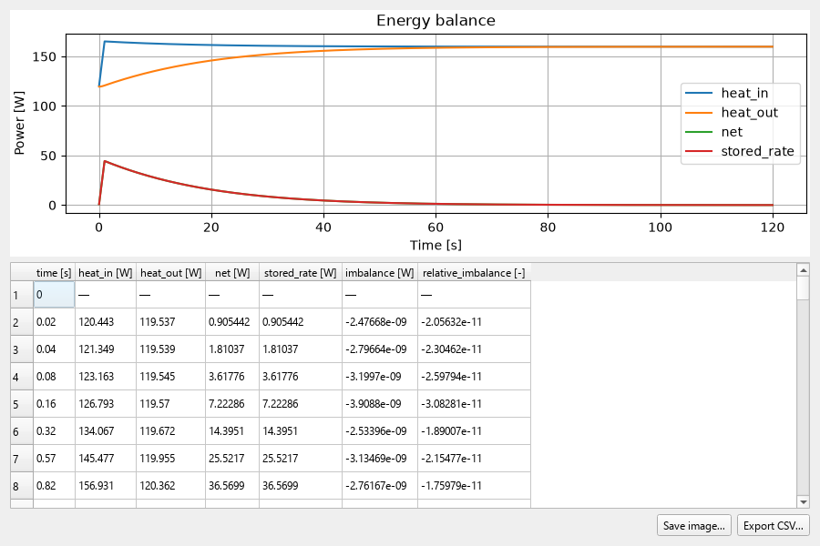

## 8. Running the scripts

```
.venv\Scripts\python.exe examples\oil_cooler\oil_cooler.py
```

`oil_cooler.py` builds the three models with the scripting interface, solves them, prints
the checks (also written to `results.txt`), writes the figures to `img/` with
`figures.py`, and saves the models to `models/`: `oil-cooler.tfea` (steady, duct
correlations) and `oil-cooler-startup.tfea` (the start-up; its initial condition names the
steady results file `oil-cooler.tfea.h5`, which the window writes beside the steady model
when you solve it).

The specification of this example is in `spec/`: the engineering brief (PDF), the
model-creation brief with the decisions of 2026-11-26, and the illustration.
