# Example: main closure of a canned-motor pump

**What it is.** An axisymmetric model of the bolted main closure between the casing of a
canned-motor pump and the main flange of its stator. Hot water inside the casing heats the
joint while several cooling circuits take heat away. The model has nine bodies, five sets of
convection films and six thermal contacts. It is solved for a six-hour heat-up and for the
steady state at full temperature, and a parameter study changes the conductance of the main
seat.

**What it shows.** How much heat reaches the flange, by which route, and how the flange
temperature develops. It also exercises most of what the program can do on a real assembly:
an axisymmetric model, many regions, an orthotropic material, a time-dependent fluid
temperature, contact resistances, adaptive time stepping and a scripted parameter study.

!!! warning "Illustrative inputs"
    Every dimension, film coefficient, fluid temperature and contact conductance on this page
    is illustrative. The model is a demonstration of the program and does not represent a
    particular pump.

Unlike the tutorials, this example is built and solved by Python scripts. The scripts, the
input file and a complete set of results are in the repository folder
[`examples/pump_closure`](https://github.com/dilleyrd/thermal-fea/tree/main/examples/pump_closure).
[Running the example](#running-the-example) explains how to open the saved results in the
program or to run the scripts again.

## The model

### Geometry

The model is a cross-section through the closure in the r-z plane of an axisymmetric model:
x is the radius r and y is the axial position z. z = 0 is the joint face between the casing
and the flange. Heat flows reported on this page are for the full 360° ring. The program
can open and solve an axisymmetric model, but a model created in the window is planar, so
this one is built by script.

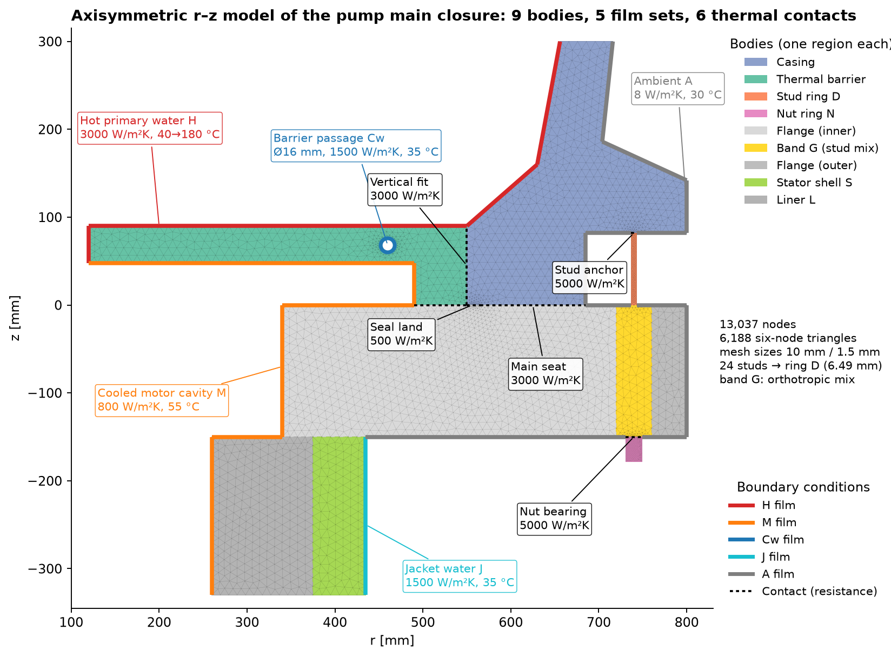

*The model (6-node triangles drawn in grey). Coloured edges carry convection films, dotted
edges are thermal contacts. Edges with neither are insulated or bonded.*

| Body | Extent (mm) | Material |
|---|---|---|
| Casing | polygon through (r, z) = (550, 0), (550, 90), (630, 160), (656, 300), (716, 300), (704, 186), (800, 142), (800, 82), (685, 82), (685, 0) | Stainless steel 304 |
| Thermal barrier | plate r = 120 to 550, z = 48 to 90, with a skirt r = 490 to 550 down to z = 0. A cooling passage of Ø16 mm at (r, z) = (460, 68) is cut out | Stainless steel 304 |
| Main flange | r = 340 to 800, z = 0 to −150, in three regions: inner (340 to 720), band G (720 to 760) and outer (760 to 800) | Stainless steel 304; band G is a mix, below |
| Stud ring D | r = 736.8 to 743.2 (6.486 mm wide), z = 0 to 82 | Carbon steel AISI 1010 |
| Nut ring N | 18.746 mm wide, centred on r = 740, z = −150 to −178 | Carbon steel AISI 1010 |
| Stator shell S | r = 375 to 435, z = −150 to −330 | Stainless steel 304 |
| Liner L | r = 260 to 375, z = −150 to −330 | Stainless steel 304 |

**The studs and nuts become rings.** An axisymmetric model cannot show 24 separate studs.
Each row of bolts is replaced by a solid ring with the same total cross-section: a ring of
radius R and width w has the area of N bolts of diameter d when 2πR w = N π d²/4. With 24
studs of Ø40 mm on a bolt circle of R = 740 mm, the stud ring is w = 6.486 mm wide. With an
equivalent nut diameter of 68 mm, the nut ring is 18.746 mm wide.

**Inside the flange, the studs are part of band G.** Over the 40 mm band from r = 720 to
760 mm, a fraction f = 6.486/40 = 0.162 is carbon-steel stud and the rest is stainless
flange. Band G gets a mixed, orthotropic material:

- along the studs (axial): k = (1 − f) k₃₀₄ + f k₁₀₁₀ (in parallel);
- across them (radial): k = (1 − f) k₃₀₄, which neglects the studs;
- density and volumetric heat capacity ρc_p mixed by volume.

The material axis is along r, so `k` is the radial value and `k2` the axial one (see
[Materials](../materials.md) for the two library steels). In the r-z model, the heat that
goes down the studs therefore enters the flange through band G.

### Boundary conditions

The five films are convection conditions with a constant heat-transfer coefficient:

| Film | Where | h (W/(m² K)) | Fluid temperature |
|---|---|---|---|
| **H** hot primary water | top and bore of the barrier plate, sloping inner wall of the casing | 3000 | heat-up: rises linearly from 40 °C to 180 °C over the first 1800 s, then holds; steady case: 180 °C |
| **M** cooled motor-cavity water | underside of the barrier and inside of its skirt, flange ledge and bore, liner ledge and bore | 800 | 55 °C |
| **Cw** barrier cooling passage | the Ø16 mm passage | 1500 | 35 °C |
| **J** jacket cooling water | outer face of the stator shell | 1500 | 35 °C |
| **A** ambient air | outer faces of the casing, the casing lip and the stud cavity, top, rim and underside of the flange | 8 | 30 °C |

H's fluid temperature in the heat-up is a table against time with two points, (0 s, 40 °C)
and (1800 s, 180 °C). A table holds its last value beyond its end.

The other edges are insulated (zero heat flux):

- the two planes where the model is cut off: the top of the casing at z = 300 mm and the
  bottom of the liner and shell at z = −330 mm;
- the sides of the stud ring between the flange and the casing lip, and the sides and base
  of the nut ring. These are short paths to the air in the stud cavity, left out of this
  run.

### Thermal contacts

Six interfaces have a contact conductance h_c, so their two sides can be at different
temperatures and the heat across them is h_c ΔT per unit area:

| Contact | Between | Where | h_c (W/(m² K)) |
|---|---|---|---|
| Main seat | casing and flange | z = 0, r = 565 to 685 | 3000 |
| Seal land | casing and flange | z = 0, r = 550 to 565 | 500 |
| Barrier foot | barrier skirt and flange | z = 0, r = 490 to 550 | 3000 |
| Vertical fit | barrier and casing | r = 550, z = 0 to 90 | 3000 |
| Stud anchor | casing lip and stud ring | z = 82 | 5000 |
| Nut bearing | nut ring and flange | z = −150 | 5000 |

All other faces where two bodies meet are bonded, with no resistance. That includes the foot
of the stud ring on band G, the boundaries between the three flange regions, and the faces
between the liner, the shell and the flange.

There are two parallel paths for heat from the casing into the flange:

1. across the seated joint: the seal land, the main seat and the barrier foot;
2. down the studs: from the casing lip across the stud anchor, down stud ring D, and into
   band G.

The nut ring hangs below the flange on its bearing face. It is a dead end: it only exchanges
heat while it warms up.

### Initial state, mesh and solution

| Item | Value |
|---|---|
| Initial temperature | 40 °C everywhere |
| Heat-up | transient, 0 to 21 600 s (6 h), first step 1 s, adaptive step, results stored every 300 s (72 steps) |
| Steady hot case | steady state with H at 180 °C |
| Mesh | 6-node triangles, global element size 10 mm, 1.5 mm along the stud and nut rings, the seal land, the stud anchor, the nut bearing and the cooling passage; 13 037 nodes and 6 188 elements |

The scripts read every input from
[`closure.json`](https://github.com/dilleyrd/thermal-fea/blob/main/examples/pump_closure/closure.json).
Change a value there to run a different case.

## Results

### The heat-up

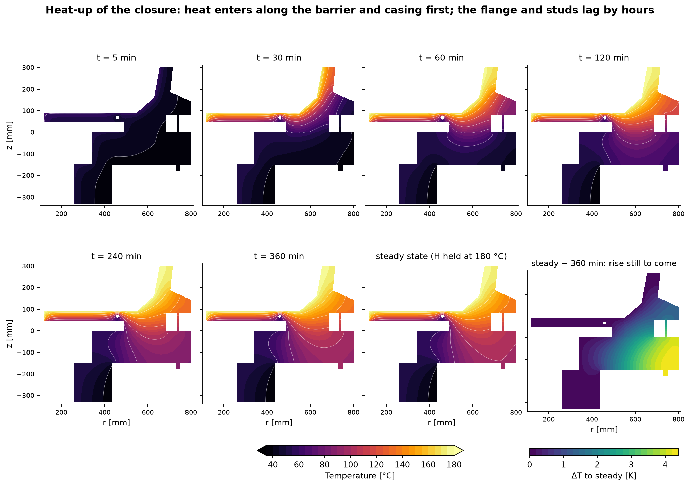

*Temperature at six times during the heat-up and at steady state. The last panel is the rise
still to come after 6 h.*

Heat enters along the barrier and the casing wall first. The flange and the studs follow
hours later. After 6 h the model is close to, but not at, steady state. The largest rise
still to come is 4.4 K, in the outer flange.

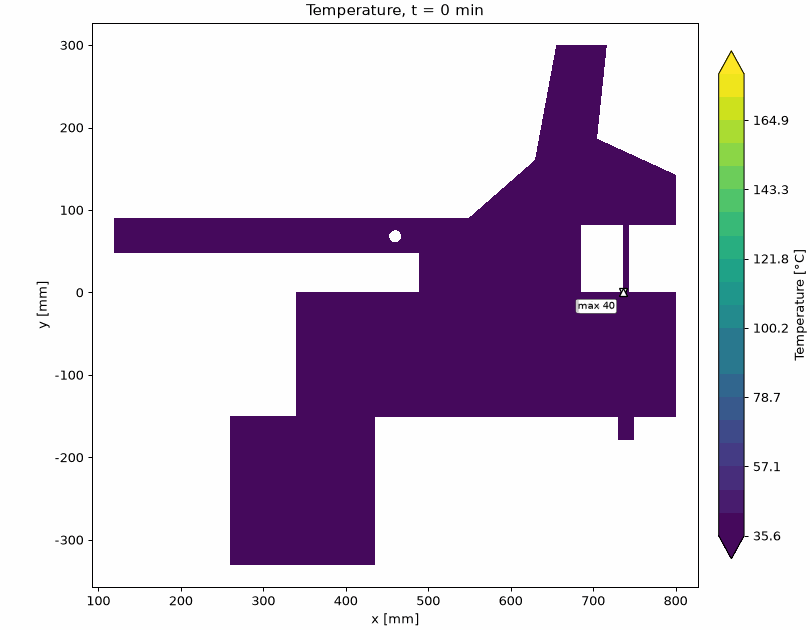

*The heat-up as an animation, written by `api.export_animation`. A frame every minute for
the first hour, then every 5 minutes. All frames use one colour scale.*

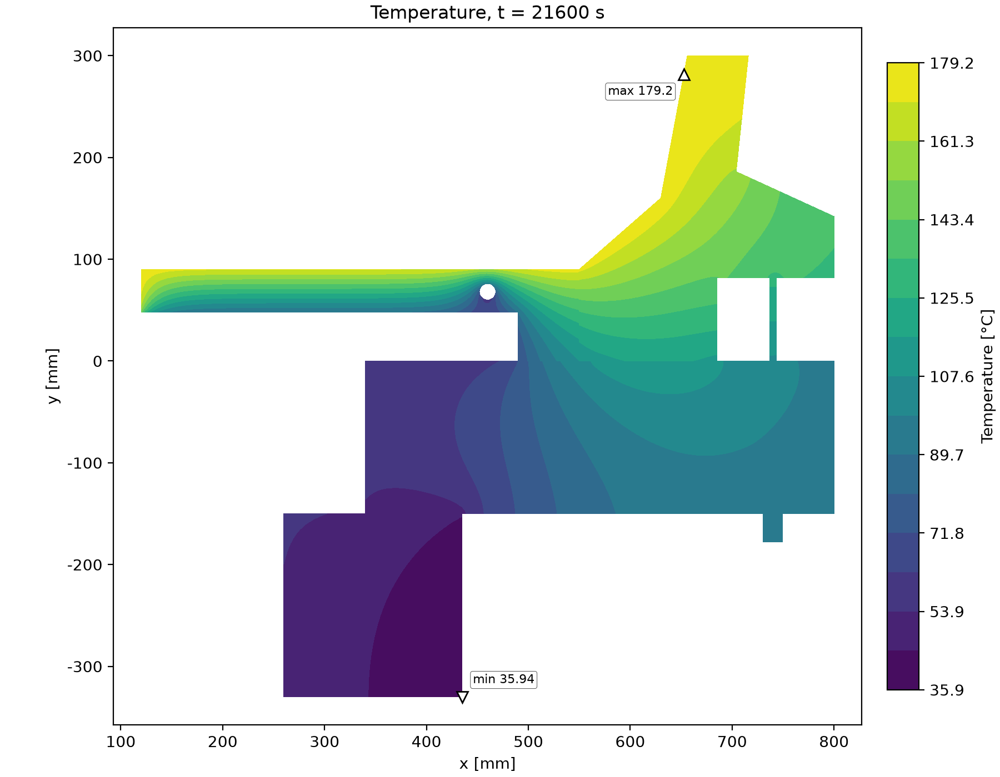

*Temperature at 6 h, plotted by `api.plot_contour` (°C; x = r and y = z in mm). The
extremes are 179.2 °C on the casing wall and 35.9 °C on the jacket-cooled stator shell.*


*Temperature in the steady hot case (a steady result is stored at t = 0 s).*

### Heat flows over time

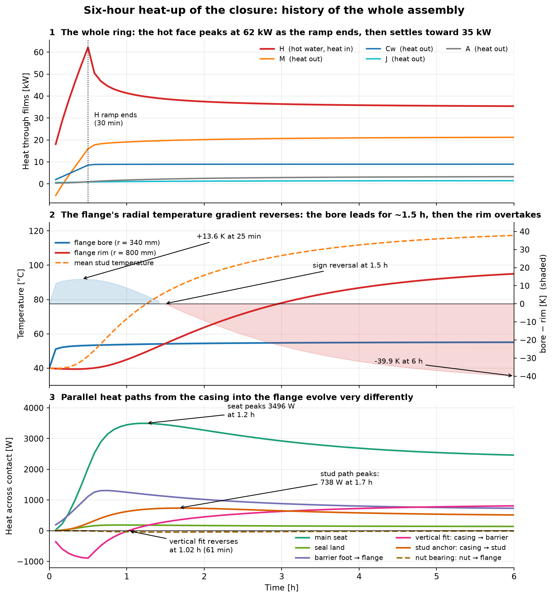

*Top: heat through each film. Middle: flange bore and rim temperatures and the mean stud
temperature, with the bore-minus-rim difference shaded against the right-hand axis. Bottom:
heat across each contact.*

- **The hot film peaks at 62 kW** as the ramp of H ends at 30 min, then settles towards
  35 kW.
- **The flange gradient reverses.** The flange bore, cooled by the motor cavity, stays near
  51 to 55 °C almost from the start. The rim first cools slightly, to about 39.4 °C, then
  heats up. The bore is 13.6 K hotter than the rim at 25 min. The two are equal at about
  1.5 h, and at 6 h the bore is 39.9 K colder than the rim (44.1 K at steady state). A
  lumped estimate would give only one sign of this difference.
- **The heat paths peak at different times.** Heat across the main seat peaks at 3496 W
  after about 1.2 h. Heat down the studs (across the stud anchor) peaks at 738 W after
  about 1.7 h.
- **The vertical fit reverses.** For the first hour heat crosses it from the barrier into
  the casing, at up to about 0.9 kW. It reverses after 1.02 h and ends at 0.81 kW from the
  casing into the barrier.

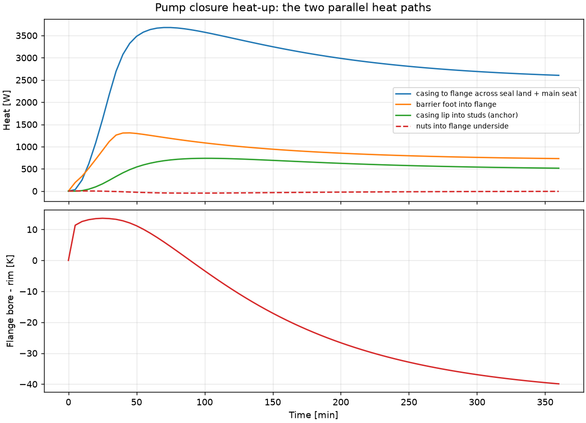

*The same two paths drawn by `run_closure.py`: the seated joint (seal land and main seat
together, peaking near 3.7 kW at about 70 min), the barrier foot, the studs and the nuts.
Below is the bore-minus-rim temperature difference.*

### Steady hot case

| Quantity | Value |
|---|---|
| Heat in through H | 35.19 kW |
| Heat out through M, Cw, J, A | 21.35, 8.99, 1.48, 3.38 kW |
| Relative energy imbalance | 4 × 10⁻¹⁴ |
| Heat into the flange: main seat, seal land, barrier foot, stud anchor | 2345, 138, 693, 479 W (3.65 kW in all) |
| Heat across the vertical fit, casing to barrier | 855 W |
| Heat across the nut bearing | 0 W (to within 3 × 10⁻⁹ W) |
| Flange bore / rim temperature | 55.2 °C / 99.3 °C |
| Mean stud temperature | 120.2 °C |

The studs carry 13 % of the heat that enters the flange: 479 W of 3.65 kW.

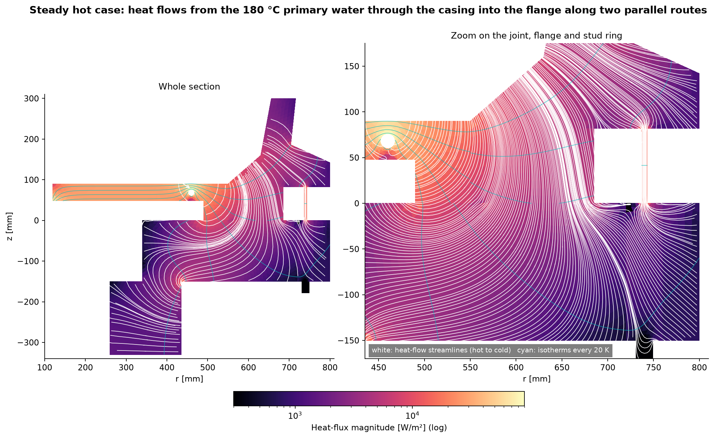

*Heat-flux magnitude (logarithmic colour scale) with heat-flow lines in white and isotherms
every 20 K in cyan. The right panel zooms in on the joint and the stud ring.*

The cooling passage is a strong sink. The highest flux, about 88 kW/m², is in the barrier
next to the passage. Heat crosses the seated joint and fans out into the flange, and a
narrow stream runs down the stud ring.

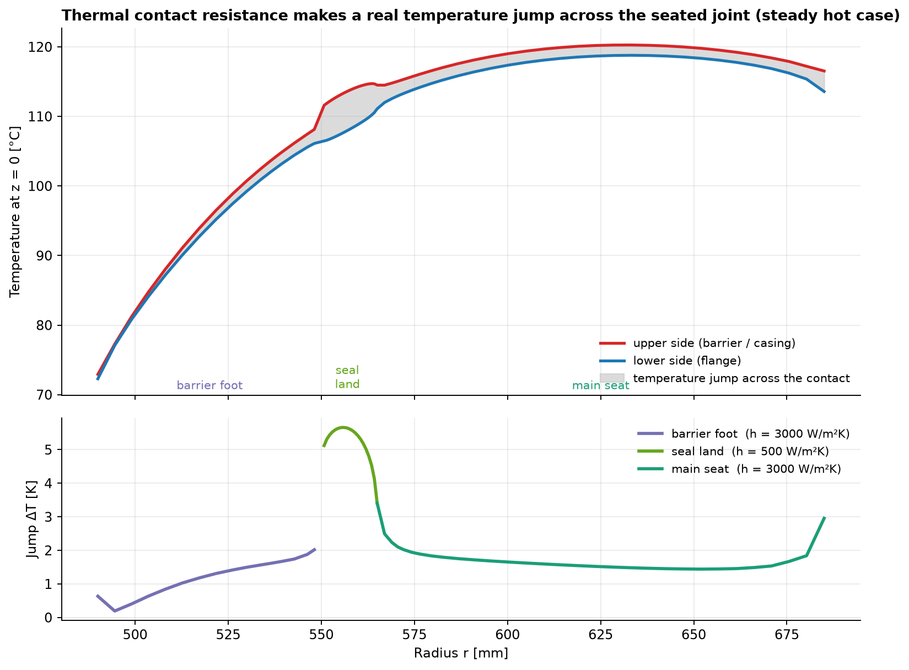

*Top: temperature on each side of the joint face z = 0. Bottom: the jump ΔT across each
contact.*

The contacts are real temperature jumps, not smeared bonds. The jump is 1.4 to 3.4 K across
the main seat and up to 5.7 K across the seal land, whose conductance is six times lower.
Adding up h_c ΔT 2πr along each face gives 2359 W for the main seat, against the solver's
2345 W, and 131 W for the seal land, against 138 W.

### Effect of the main-seat conductance

The steady hot case was solved five times, with the main-seat conductance multiplied by 0.1,
0.3, 1, 3 and 10 (300 to 30 000 W/(m² K)):

| Factor | Main seat (W) | Seal land (W) | Barrier foot (W) | Vertical fit (W) | Stud anchor (W) | Rim (°C) | Bore − rim (K) | Mean stud (°C) |
|---|---|---|---|---|---|---|---|---|
| 0.1 | 1840 | 233 | 846 | 1025 | 538 | 95.3 | −40.2 | 117.9 |
| 0.3 | 2178 | 173 | 745 | 913 | 497 | 98.0 | −42.9 | 119.5 |
| 1 | 2345 | 138 | 693 | 855 | 479 | 99.3 | −44.1 | 120.2 |
| 3 | 2406 | 122 | 675 | 833 | 474 | 99.6 | −44.5 | 120.5 |
| 10 | 2431 | 115 | 667 | 824 | 471 | 99.8 | −44.6 | 120.6 |

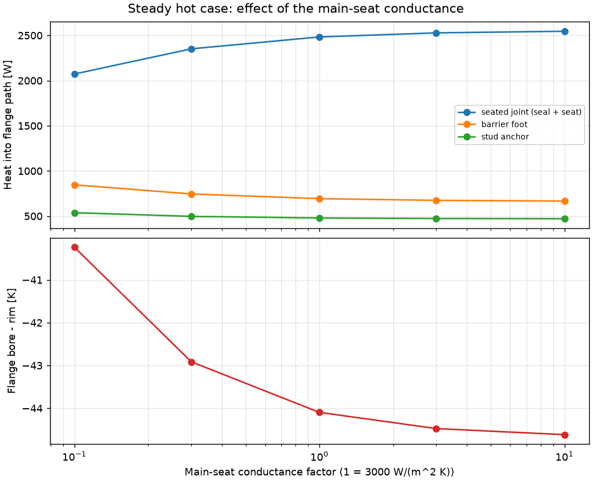

*Heat into the flange by path, and the bore-minus-rim difference, against the seat factor.*

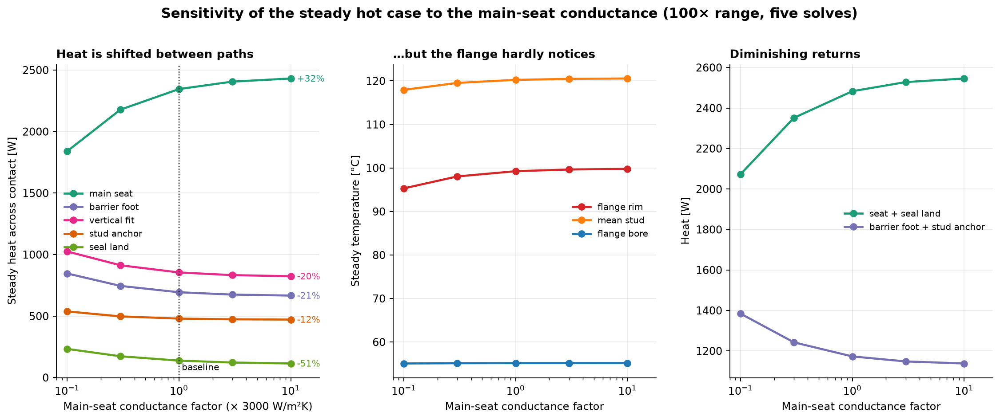

*Left: heat across each contact, with the change from 0.1× to 10×. Middle: flange and stud
temperatures. Right: the seated joint against the other two paths.*

A better seat moves heat from the other paths onto the seat, but it hardly changes the
temperatures:

- Over the 100× range, heat across the seat rises by 32 %, from 1840 to 2431 W. The seal
  land, barrier foot, vertical fit and stud anchor carry correspondingly less.
- The flange rim changes by 4.5 K and the bore by 0.1 K.
- Above 3× the seat is no longer the limiting resistance: from 3× to 10× its heat changes by
  1 %.

### Checks

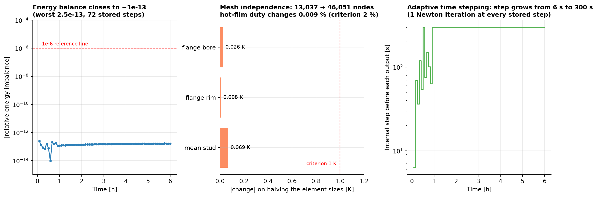

*Left: relative energy imbalance at each stored step. Middle: change in steady temperatures
when the element sizes are halved. Right: the time step the solver chose.*

- **Energy balance.** The relative imbalance is at most 2.5 × 10⁻¹³ over the 72 stored
  steps of the heat-up. In the steady case, the 35.19 kW coming in through H equals the sum
  of the four outflows.
- **Mesh.** Halving every element size (13 037 to 46 051 nodes) changes the steady
  temperatures of the flange bore, the flange rim and the mean stud by 0.026 K, 0.008 K and
  0.069 K. The heat through H changes by 0.009 %. The criteria set for the exercise were
  1 K and 2 %.
- **Time step.** The adaptive step grows to the 300 s output interval within the first
  hour, and each stored step needed one Newton iteration (the model is linear).

## Running the example

### Look at the saved results in the program

1. Use **File > Open...** to open `examples/pump_closure/out/closure_transient.tfea`, or
   `closure_steady.tfea`.
2. Press **Generate mesh**. The saved results in the `.tfea.h5` file beside the model are
   attached, so you can plot them without solving again.

The heat-up solves in a few seconds if you want to run it from the program.

### Run the scripts

From the project folder:

```
.venv\Scripts\python.exe examples\pump_closure\run_closure.py
.venv\Scripts\python.exe examples\pump_closure\run_closure.py --steady
.venv\Scripts\python.exe examples\pump_closure\animate_closure.py
.venv\Scripts\python.exe examples\pump_closure\seat_study.py
.venv\Scripts\python.exe examples\pump_closure\seat_study.py --mesh-check
```

| Script | What it does |
|---|---|
| `run_closure.py` | Builds, saves, meshes and solves the heat-up, or the steady hot case with `--steady`. Writes the model, the results, a CSV table of temperatures and heat flows at each stored step, and the plots. |
| `animate_closure.py` | Solves the heat-up again with a frame every minute for the first hour, and writes the GIF. |
| `seat_study.py` | Solves the steady hot case for each seat factor and writes `seat_study.csv` and `seat_study.png`. With `--mesh-check`, it solves with the element sizes as given and halved, and compares the two. |

Everything goes to `examples/pump_closure/out/`, which holds a complete set from these runs.
The scripts in `examples/pump_closure/showcase/` draw the other figures on this page from
those saved results, without solving again.

When the heat-up starts, the log warns that the temperatures may oscillate. The program
gives this warning when the time step is below h²ρc/(6k) in more than 5 % of the elements
([Theory](../theory.md)), and the 1 s first step is. The warning is about sudden changes,
and this model has none: H starts at the initial temperature of 40 °C and rises smoothly.

!!! note "Heat across a contact"
    The program does not yet write the heat across a contact to the results file (see
    [Limitations](../limitations.md#thermal-contact)). The example evaluates it from the
    stored temperatures with the solver's own contact terms (`closure_model.ContactHeats`).
    The heat-flux and contact-jump figures are post-processed by the showcase scripts from
    the stored nodal temperatures: a linear gradient in each element and the nodal jump
    across each contact.

## Limits of the model

- **Ring averages only.** The results are circumferential means. Individual bolt holes,
  thread roots, nozzles and any variation of the cooling around the circumference need a
  sector or three-dimensional model.
- **No thermal stress.** The program does not calculate the stress that the flange gradient
  would cause.
- **Peak times are approximate.** The peak times above come from results stored every 5
  minutes.
