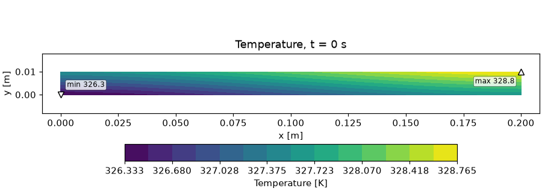
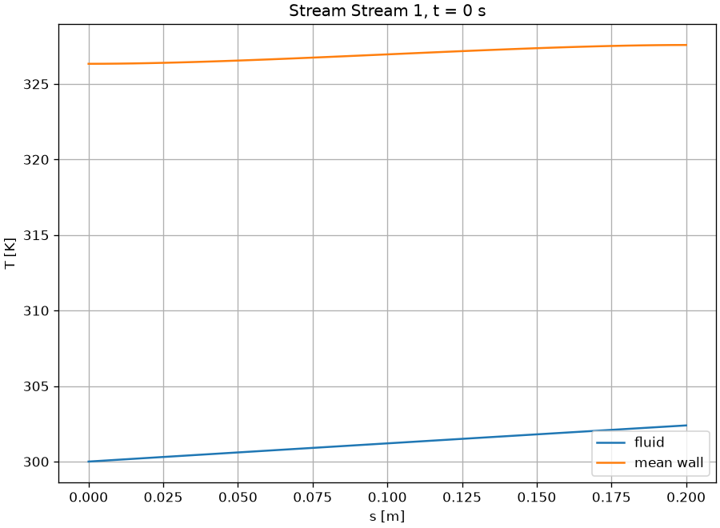

# Tutorial 3: a cold plate cooled by a stream of water

**What you will build.** An aluminium plate that carries 200 W of heat from components on its
top face, and a channel of flowing water along its bottom face that carries the heat away.
The water is not meshed. It is a *stream*: a one-dimensional model of the fluid that supplies
the heat-transfer coefficient and the water temperature along the wall, and is solved together
with the plate.

**What you will learn.** How to create a stream with the New stream dialog; what the path, the
flow area, the wetted perimeter and the cross-section are for; how the heat-transfer
coefficient follows from the duct correlation; how to read the stream results (outlet
temperature, heat picked up, Reynolds number, heat-transfer coefficient, pressure drop); how
to check the energy balance by hand; and how the answer changes with the mass flow.

The finished model is in [models/cold-plate.tfea](models/cold-plate.tfea); open it with
**File > Open...** to compare with your own. If you have not used the program before, do
[Tutorial 1](t4-plate.md) first: it explains the selection procedure used below in detail.

## The problem

The plate is a strip of 6061-T6 aluminium, 200 mm long, 10 mm thick and 50 mm deep. Components
mounted on its top face put 20 kW/m² into it. Over the whole top face that is
20 000 × 0.2 × 0.05 = **200 W**. Water at 300 K enters a flat channel along the bottom face
and flows from the left end to the right end. The channel is 50 mm wide (as wide as the plate
is deep) and 2 mm high. The mass flow is 0.02 kg/s, about 1.2 litres per minute. The two ends
of the plate are insulated.

The model is a drawing of the plate seen from the side: a rectangle 0.2 m long (x) and 0.01 m
tall (y). The depth of 0.05 m is the region "Thickness". The bottom edge is the *wall* the
water touches.

The stream does not know the shape of the channel. It is told five things:

- the **flow area** A, the cross-section the water flows through: 0.05 m × 0.002 m = 1e-4 m²;
- the **wetted perimeter** P, the length of wall around that cross-section:
  2 × (0.05 + 0.002) = 0.104 m. With the flow area it gives the hydraulic diameter,
  D_h = 4 A / P = 3.846 mm;
- the **cross-section** type, which selects the laminar Nusselt number. The flat gap is heated
  from one side (the plate) and insulated on the other (the cover), so the type is
  `parallel_plates_one_side`, with Nu = 4.86 for a constant wall temperature (Theory §8.1);
- the **fluid** and its **inlet temperature**;
- the **path**: the polyline the water follows, from inlet to outlet, in the model plane. It
  tells the program which wall edges are upstream of which.

The heat-exchange area is taken from the model: the length of the wall edge times the region
thickness, 0.2 m × 0.05 m = 0.01 m². It agrees with the channel because the channel is as wide
as the plate is deep.

| Item | Value |
|---|---|
| Geometry | rectangle 0.2 m (x) by 0.01 m (y); depth 0.05 m ("Thickness" of the region) |
| Material | Aluminium 6061-T6, from the library: k = 167 W/(m K) |
| Heat flux on the top edge | 20 000 W/m², into the plate (200 W in all) |
| Left and right edges | adiabatic |
| Fluid | Water, inlet temperature 300 K, mass flow 0.02 kg/s |
| Flow area / wetted perimeter | 1e-4 m² / 0.104 m |
| Cross-section | `parallel_plates_one_side` |
| Path | from (0, 0) to (0.2, 0), along the bottom edge |
| Wall | the bottom edge |
| Mesh | global element size 0.005 m (126 nodes, 166 elements) |
| Analysis | steady |

The water properties (density 997 kg/m³, viscosity 8.55e-4 Pa s, conductivity 0.613 W/(m K),
specific heat 4179 J/(kg K) at 300 K) come from the library table for water, which covers 280 K
to 360 K. The water here stays between 300 K and 302.4 K, so the program does not warn.

**Temperature units.** Everything is in kelvin, the default.

## Steps

### 1. Draw the geometry

1. Choose **Geometry > Rectangle...**. Type x = `0`, y = `0`, Width = `0.2`, Height = `0.01`
   and press **OK**. The status bar shows "Building geometry..." and then "Geometry rebuilt".
2. Choose **View > Fit view** (or press **F**).

The plate is twenty times longer than tall, so it is a thin band on screen. Zoom with the mouse
wheel if you cannot hit the edges later. A middle-button drag pans.

### 2. Take the material from the library

1. Choose **Tools > Material library...**. On the **Built-in** tab select **Aluminium 6061-T6**
   and press **Copy into model**. A node "Aluminium 6061-T6" appears under **Materials**.
   Close the window.

### 3. Assign it to the plate

1. Right-click **Regions** and choose **Add region**. The panel "Region" opens.
2. Open the box of the "Selection" field and choose **all** (every surface of the model, here
   the one plate).
3. "Material" already reads "Aluminium 6061-T6". In "Thickness" type `0.05` and press Enter.

### 4. Enter the loads

**The heat flux of the components.**

1. Right-click **Loads & Boundary Conditions** and choose **Add > Add Heat Flux**. The node
   "Heat Flux 1" appears and its panel opens.
2. In "Selection" press **Pick in viewport**, choose **Curve** in the toolbar, click the top
   edge ("1 curve(s) picked"), press **Apply** and switch picking off.
3. In "Heat flux" type `20000` and press Enter (W/m²). A positive flux heats the plate.

**Insulated ends.**

1. Right-click **Loads & Boundary Conditions** and choose **Add > Add Adiabatic**.
2. In "Selection" pick the left edge, **Ctrl**-click the right edge ("2 curve(s) picked"), press
   **Apply** and switch picking off.

The bottom edge gets no load. It belongs to the stream, which you add next.

### 5. Create the stream

1. In the tree, open **Flow**. Right-click the node **Streams** and choose **Add stream**.
2. Because the model has no stream yet, a window titled "New stream" opens. It says "The model
   has no stream yet. Enter the values of the first one." Its fields start empty, so no value
   is assumed. Fill in:

   | Field | Value |
   |---|---|
   | Fluid | Water |
   | Flow area [m^2] | `1e-4` |
   | Wetted perimeter [m] | `0.104` |
   | Cross-section | parallel_plates_one_side |
   | Inlet temperature [K] | `300` |

3. Press **Create**. If a field is empty, the window stays open and says which one ("enter the
   flow area", "choose a fluid", ...). When it closes, a node **Stream 1** appears under
   **Streams** and its panel "Stream: Stream 1" opens. The mode is `in_plane`: the water
   flows along a path in the plane of the drawing. (The other mode, `through_plane`, is for
   flow perpendicular to the drawing, such as a cooling hole seen in cross-section.)

The dialog only asks for the values every stream needs. The rest are in the panel, which you
now complete.

### 6. Complete the stream

1. **Walls.** In the "Walls" field press **Pick in viewport**, choose **Curve** in the toolbar,
   click the bottom edge ("1 curve(s) picked"), press **Apply** and switch picking off. The
   field now lists "Stream 1 walls". This is the edge the water cools.
2. **Path.** In "Path" type `0, 0; 0.2, 0` and press Enter. The format is `x, y; x, y`, one
   pair per point, in metres. The label under the "Path" buttons reads "2 path points". (You
   may instead press **Pick path points** and click the inlet and then the outlet in the
   viewport. The clicks are not exact, so typing is better here.) The path runs along the wall
   from the inlet end to the outlet end.
3. **Mass flow.** The box "Mass flow" shows the mode Constant and the value 0, although no mass
   flow has been set yet. Type `0.02` and press Enter (kg/s). (Leave the field empty only when
   a flow network supplies the flow.)
4. Leave the rest as it is: "Wall roughness" 0 (smooth), "Number of cells" empty (one fluid
   cell per wall edge along the path, which is 40 here), "Nusselt option" **auto** (laminar
   table, Gnielinski for turbulent flow), "Coefficient multiplier" 1 and "Coefficient override"
   empty.

### 7. Mesh and solve

1. Click the node **Mesh**. In "Global element size" type `0.005` and press Enter. Press
   **Generate mesh**. The mesh panel lists 126 nodes and 166 elements.
2. Choose **Solve > Validate**. The status bar says "Validation: no issues".
3. Choose **Solve > Solve**. The analysis is steady (the default), but nonlinear, because the
   heat-transfer coefficient and the fluid properties depend on temperature. The "Solving"
   window shows 3 iterations. The status bar reads "Solve finished ... 1 stored step(s)".
   (For a steady solution the time shown is a placeholder, "t = 0 s".)

The unknowns are the plate temperatures and the water temperature at the 41 fluid nodes of
the stream, solved together in one system.

### 8. Read the stream results

1. Choose **Results > Flow results...**. (It is greyed out unless the results contain a
   stream.) A window titled "Flow results" opens with one row per stream:

   | Stream | Mode | Mass flow [kg/s] | Re | Regime | Mean h [W/(m^2 K)] | dp [Pa] | T_in [K] | T_out [K] | Heat [W] |
   |---|---|---|---|---|---|---|---|---|---|
   | Stream 1 | in_plane | 0.02 | 917.291 | laminar | 776.587 | 72.8141 | 300 | 302.393 | 200 |

   "Heat" is the heat the water picks up from the wall. "Mean h" is the average of the
   coefficient over the cells.
2. Select the row and press **Plot**. A chart window shows the water temperature and the mean
   wall temperature against the distance along the path.
3. The temperature field is drawn in the viewport. Choose **Results > Probe** and click it to
   read single values, or use **File > Export > Nodal results (CSV)...**.
4. **Results > Heat-flow history** and the "Messages" dock list the heat entering through each
   condition: Heat Flux 1 gives +200 W and Stream 1 gives -200 W.

## Results

| Quantity | Value |
|---|---|
| Water outlet temperature | 302.39 K (rise 2.39 K) |
| Heat picked up by the water | 200.0 W |
| Reynolds number | 917 (laminar) |
| Mean heat-transfer coefficient | 776.6 W/(m² K) |
| Pressure drop | 72.8 Pa |
| Hottest point of the plate | 328.77 K |
| Coolest point of the plate | 326.33 K |

The plate is hottest at the outlet end of the top face, where the water is warmest, and coolest
at the inlet end of the bottom face. The whole plate lies within 2.5 K, because the aluminium
conducts well compared with the water film. Most of the temperature difference between the
plate and the water is across the film (step 7 of the hand check below).

## Checking the answer

### By hand

Use the water properties of the library at 300 K, as listed above.

1. **Hydraulic diameter.** D_h = 4 A / P = 4 × 1e-4 / 0.104 = 3.846 mm.
2. **Velocity.** V = ṁ / (ρ A) = 0.02 / (997 × 1e-4) = 0.2006 m/s.
3. **Reynolds number.** Re = ṁ D_h / (A μ) = 0.02 × 3.846e-3 / (1e-4 × 8.55e-4) = **900**.
   This is below 2300, so the flow is laminar. The program reports 917.3. It takes the
   properties at the local water temperature, 300 K to 302.4 K, and the viscosity falls as the
   water warms, so its Reynolds number is 2 % higher.
4. **Heat-transfer coefficient.** For laminar flow the Nusselt number is the table value,
   4.86. h = Nu k / D_h = 4.86 × 0.613 / 3.846e-3 = **774.6 W/(m² K)**. The program's mean is
   776.6, 0.3 % higher, for the same reason.
5. **Heat load.** Q = q L depth = 20 000 × 0.2 × 0.05 = **200 W**.
6. **Outlet temperature.** ṁ c_p ΔT = Q gives ΔT = 200 / (0.02 × 4179) = **2.393 K**, so
   T_out = 302.393 K. The program gives 302.393 K: it takes c_p at the inlet temperature,
   exactly as in this calculation.
7. **Wall above the water.** The bottom edge carries the same flux density as the top edge,
   so the wall is q / h above the water: 20 000 / 774.6 = **25.8 K**. In the model, the mean
   wall temperature at mid-length is 25.75 K above the water temperature there.
8. **Pressure drop.** Δp = f (L / D_h) ρ V² / 2. For laminar flow f is close to 64 / Re
   (Theory §9.2 uses it as the starting value of its flow iteration), here 64 / 900 = 0.0711.
   With L / D_h = 0.2 / 3.846e-3 = 52.0 and ρ V² / 2 = 20.06 Pa, Δp ≈ 74.2 Pa. The program
   gives 72.8 Pa, using the Reynolds number above and its own friction formula (Churchill, in
   Theory §8.1). The two differ by 2 %, which is the difference in the Reynolds number.

### Energy balance

The 200 W that enter through Heat Flux 1 must leave with the water: heat in equals
ṁ c_p (T_out − T_in). Both sides are 200 W. The program checks this at every solve: the
relative imbalance of this case is about 1e-13, far below the limit of 1e-3 for nonlinear
cases (verification case V-29 sets the same check for streams, to 1e-8). You can read it at
the end of the log in the "Messages" dock, under "relative imbalance".

## What if the mass flow changes?

1. Click the node **Stream 1**. In "Mass flow" type `0.1` and press Enter. The result panel
   now says "These results are out of date: the model changed since the solve." (Click the
   result node under **Solution** to see it.) The mesh is still valid.
2. Choose **Solve > Solve** again. The "Flow results" window, if still open, shows the new
   numbers when the solve finishes.
3. Repeat with `0.005`.

| Mass flow [kg/s] | Re | Regime | Mean h [W/(m² K)] | Δp [Pa] | T_out [K] | Hottest point of the plate [K] |
|---|---|---|---|---|---|---|
| 0.005 | 244 | laminar | 782.7 | 17.1 | 309.57 | 334.08 |
| 0.02 | 917 | laminar | 776.6 | 72.8 | 302.39 | 328.77 |
| 0.1 | 4516 | turbulent | 5407 | 1019 | 300.48 | 305.32 |

The heat picked up is 200 W in all three cases: it is set by the components, not by the water.
What changes is how warm the water gets and how hot the plate runs.

- Between 0.005 and 0.02 kg/s the flow is laminar. The Nusselt number is a constant of the
  cross-section, so h barely changes (it changes a little because the water properties
  change). A faster flow lowers the outlet temperature (309.57 K to 302.39 K) and so the plate
  temperature, but only through the water temperature: the difference between the wall and
  the water at mid-length stays at about 26 K (25.5 K and 25.75 K).
- At 0.1 kg/s the Reynolds number, 4516, is above 4000 and the program switches to the
  turbulent correlation (Gnielinski, Theory §8.1). The coefficient rises by a factor of seven
  and the difference between the wall and the water at mid-length falls from about 26 K to
  3.7 K. The plate runs at 305.3 K
  instead of 328.8 K. The price is a pressure drop 14 times as large: 1019 Pa against 72.8 Pa.
- Between Reynolds numbers of 2300 and 4000 the program interpolates between the laminar and the
  turbulent values, so h rises smoothly through the transition.

## Things to try

- Change "Cross-section" in the stream panel to `parallel_plates` (heated on both sides) and
  see how the laminar h changes: the table gives 7.54 against 4.86.
- Give "Wall roughness" a value and compare the pressure drop at 0.1 kg/s.
- Type a value in "Coefficient override" to replace the correlation with a fixed h, and
  compare the plate temperature with the correlation result.
- Set "Number of cells" to `10` and compare the outlet temperature and the plate temperature
  with the 40-cell result.

## The same model as a script

The same model, the hand calculation and the what-if cases are in
`examples/tutorial_cold_plate.py`.
