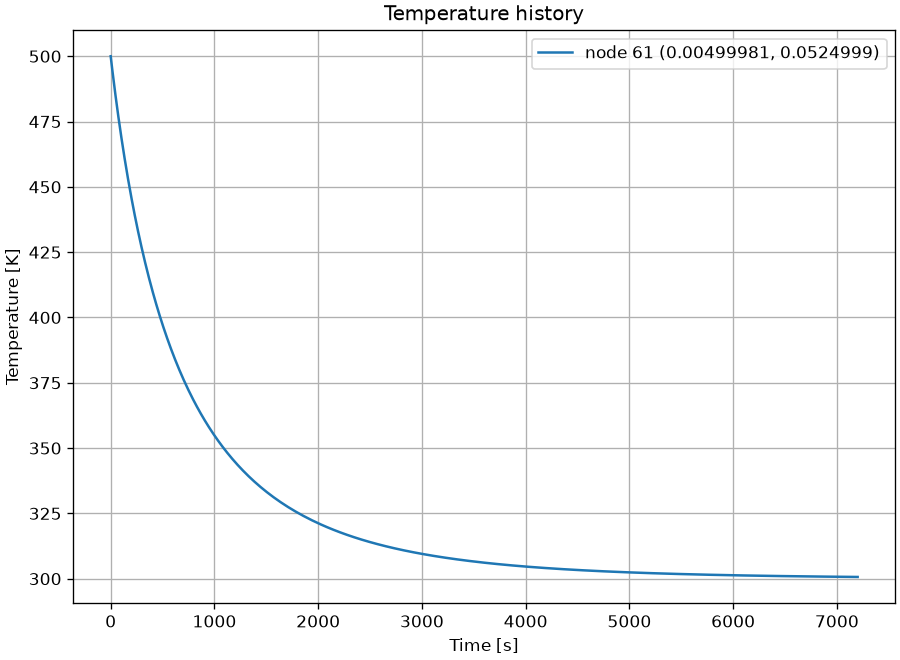
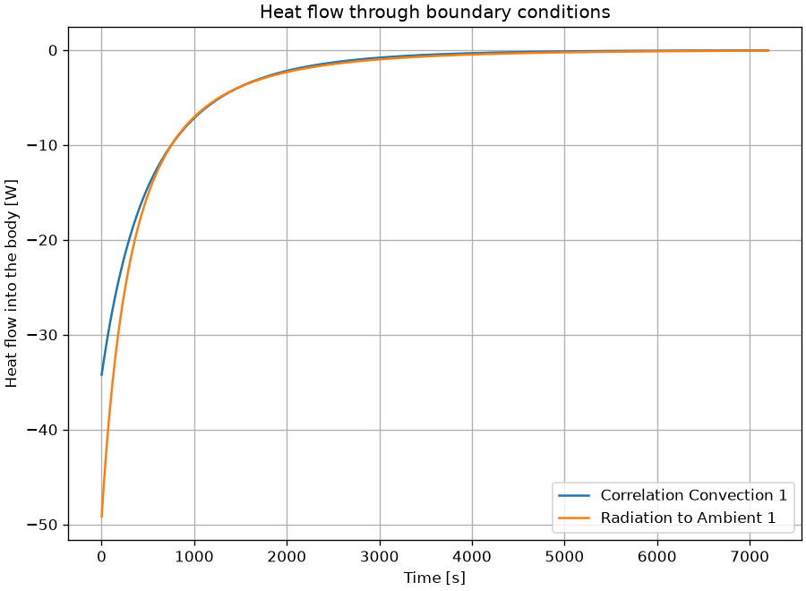
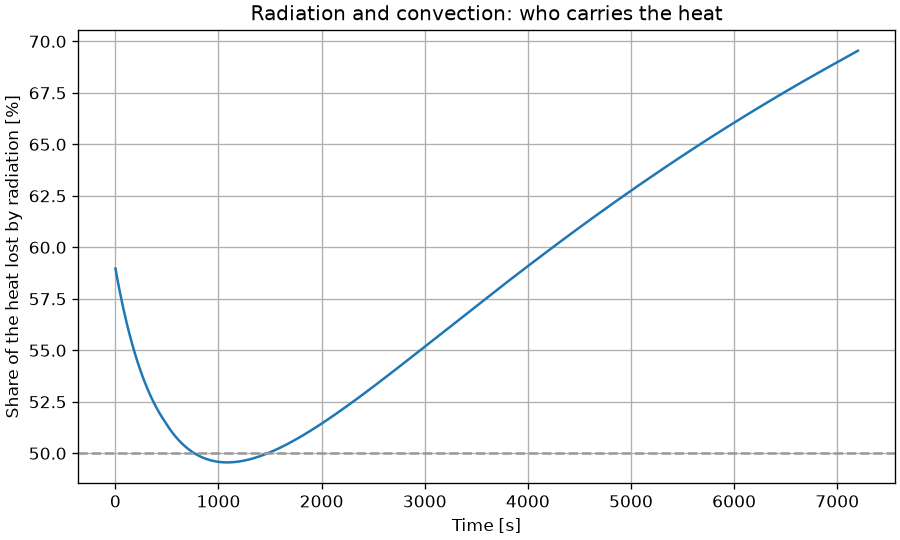

# Tutorial 2: a hot fin cooling in still air

**What you will build.** A thin aluminium plate, a fin cut from heat-sink stock, that starts at
500 K and cools in still air. It loses heat by natural convection and by radiation, and you
follow it for an hour and then for a second hour.

**What you will learn.** How to set up a transient analysis (initial temperature, end time,
time stepping); how to get a heat-transfer coefficient from a correlation instead of typing
one, and how to preview that coefficient; how to add radiation to the surroundings; how to
read a temperature history and the split of the heat loss between convection and radiation;
how to read the energy balance of every step; how to continue a finished run to a later end
time; and how to check the result by hand.

The finished model is in [models/fin-quench.tfea](models/fin-quench.tfea); open it with
**File > Open...** to compare with your own. If you have not used the program before, do
[Tutorial 1](t4-plate.md) first: it explains the selection procedure used below in detail.

## The problem

The fin is a plate 10 mm thick, 100 mm high and 100 mm deep, standing upright. It is made of
2024-T6 aluminum and starts at a uniform 500 K. The air around it is still, at 300 K. Both
large faces lose heat by natural convection and by radiation. The two ends are insulated.
The ends are a simplification: they are small, and insulating them keeps the model a plain
plate in a plain environment.

The model is a drawing of the plate seen edge-on: a rectangle 0.01 m wide (x, the thickness)
and 0.1 m tall (y). The depth of 0.1 m is entered as the part's "Thickness". The two long
vertical edges are the faces.

| Item | Value |
|---|---|
| Geometry | rectangle 0.01 m (x) by 0.1 m (y); depth 0.1 m ("Thickness" of the part) |
| Material | Aluminum, Alloy 2024-T6, from the library: k = 177 W/(m K), density 2770 kg/m³, specific heat 875 J/(kg K) |
| Initial temperature | 500 K, uniform |
| Convection on the two faces | correlation `vplate_natural` (vertical plate, Churchill and Chu), fluid Air at 300 K, characteristic length 0.1 m |
| Radiation on the two faces | emissivity 0.8, surroundings at 300 K |
| Ends (top and bottom) | adiabatic |
| Mesh | global element size 0.005 m (66 nodes, 86 elements) |
| Analysis | transient, end time 3600 s, initial time step 1 s, automatic time stepping |
| Later | continue the run to 7200 s |

The air properties (density, viscosity, conductivity, specific heat) come from the library
table for air, at the film temperature, which is the mean of the surface and the air
temperature. At the start that is (500 + 300)/2 = 400 K. The table covers 100 K to 3000 K,
so every temperature of this run is inside it and the program will not warn.

**Temperature units.** Everything is in kelvin, the default. The convection coefficient
depends on the temperature difference and on the film temperature, so it changes as the plate
cools. The program recomputes it in every nonlinear iteration of every step.

## Steps

### 1. Draw the geometry

1. Choose **Geometry > Rectangle...**. Type x = `0`, y = `0`, Width = `0.01`, Height = `0.1`
   and press **OK**. The status bar shows "Building geometry..." and then "Geometry rebuilt".
2. Choose **View > Fit view** (or press **F**).

The plate is ten times taller than wide, so it is a thin band on screen. Zoom with the mouse
wheel if you cannot hit the edges later. A middle-button drag pans.

### 2. Take the material from the library

1. Choose **Tools > Material library...**. A window titled "Material library" opens, with a
   **Built-in** tab and a **User** tab.
2. On the **Built-in** tab select **Aluminum, Alloy 2024-T6**. Its properties are shown below the
   list.
3. Press **Copy into model**. A node "Aluminum, Alloy 2024-T6" appears under **Materials** in the
   tree. Close the window.

### 3. Assign it to the plate

1. Right-click **Parts** and choose **Add part**. A part "Part 1" appears and the panel
   "Part" opens. Type `Plate` in "Name" and press Enter.
2. Open the box of the "Selection" field and choose **all**. ("all" is made by the program: it
   is every surface of the model, here the one plate.)
3. "Material" already reads "Aluminum, Alloy 2024-T6", because it is the only material.
4. In "Thickness" type `0.1` and press Enter.

### 4. Enter the loads

**Natural convection.**

1. Right-click **Loads & Boundary Conditions** and choose **Add > Add Correlation
   Convection**. A window "New correlation convection" opens; its fields are empty and
   **OK** stays disabled until all are filled. Open the "Correlation" box and choose
   **vplate_natural**, open the "Fluid" box and choose **Air**, type `300` in "Ambient
   temperature" and press **OK**. (Cancel adds nothing.) The node "Correlation Convection
   1" appears and its panel opens; the three values are already in it.
2. In "Selection" press **Pick in viewport**, choose **Boundary** in the toolbar, click the
   left long edge, **Ctrl**-click the right long edge ("2 boundaries picked"), type `faces`
   in "New name", press **Apply** and switch picking off.
3. A frame below the form shows the correlation you chose: the title "Vertical plate
   (Churchill–Chu)", its formula, its validity ("all Ra") and its characteristic length
   (the height).
4. In "Characteristic length" type `0.1` and press Enter. For a vertical plate this is its
   height. If you leave the field empty the program takes a length from the geometry.
5. Leave "Velocity" empty, "Wall temperature" at local (the film temperature is computed
   at each point of the edge from the temperature there), "Multiplier" at 1 and "Extra
   inputs" empty.

**Preview the coefficient.** Below the form is a frame "Preview of h". It asks for the inputs
that the condition does not already hold. Here that is only the "Surface temperature".

1. In "Surface temperature" type `500` and press Enter. The frame shows:

   ```
   h = 8.57576 W/(m^2 K)
   Nu = 25.3721
   Ra = 4.851e+06
   Pr = 0.6903
   Regime: single correlation
   T_film = 400 K
   Length used = 0.1 m
   ```

The preview is not stored in the model. It is the coefficient the first iteration of the
first step starts from, 8.58 W/(m² K) for a plate 200 K above the air.

The same calculation is available on its own: **Tools > HTC calculator...** opens a window
where you choose the correlation and the fluid and type the surface temperature (`500`), the
fluid temperature (`300`) and the characteristic length (`0.1`). It shows the same numbers,
and it updates as you type. Use it to see how h changes: for the same plate try a surface
temperature of `400` or `320`.

**Radiation.**

1. Right-click **Loads & Boundary Conditions** and choose **Add > Add Radiation to Ambient**.
   In the window "New radiation" type `0.8` in "Emissivity" and `300` in "Ambient
   temperature", then press **OK**.
2. The two faces already have a selection, made for the convection. Do not pick them again.
   Open the box of the "Selection" field and choose **faces**.

**Insulated ends.**

1. Right-click **Loads & Boundary Conditions** and choose **Add > Add Adiabatic**.
2. In "Selection" pick the bottom edge, **Ctrl**-click the top edge ("2 boundaries
   picked"), type `ends` in "New name", press **Apply** and switch picking off.

Three nodes now stand under **Loads & Boundary Conditions**: Correlation Convection 1,
Radiation to Ambient 1 and Adiabatic 1. Their heat flows are reported under these names.

### 5. Mesh

1. Click the node **Mesh**. In "Global element size" type `0.005` and press Enter.
2. Press **Generate mesh**. The status bar says "Mesh generated: 66 nodes, 86 elements".

### 6. Initial condition

1. Click the node **Initial Condition**. "Kind" is **uniform**, which is what you want.
2. In "Temperature" type `500` and press Enter. The default is 293.15 K, so this step is
   not optional: without it the plate would start almost at room temperature.

### 7. Transient settings

1. Click the node **Analysis Settings**. In "Analysis type" choose **transient**. More
   fields appear: end time, the time-step controls, integration and output.
2. In "End time" type `3600` and press Enter (seconds).
3. In "Initial time step" type `1` and press Enter. See the note below.
4. Leave the rest: "Adaptive time step" on, "Time-step tolerance" 0.02, "Theta" 1 (backward
   Euler, stable for any step), "Lumped capacitance" off, "Output steps" **all** (every step
   is stored).

*Why set the first time step?* If the field is empty the program suggests a first step from
the mesh and the material (0.0367 s for this plate) and starts from it. Here the start is
uniform, so a first step of 1 s is accurate enough and saves the first few steps. The time
stepping adapts from there on its own: it halves a step whose error estimate is too large and
enlarges a step whose error is small.

A first step that you type is checked once. If it is below h² ρc/(6k) in more than 5 % of the
elements, the **Messages** dock warns that with consistent capacitance the temperatures may
oscillate near sudden changes. The suggested step is not checked: on a graded mesh it would
fail the test in most elements even when nothing jumps.

### 8. Solve

1. Choose **Solve > Validate**. The status bar says "Validation: no issues".
2. Choose **Solve > Solve**. The "Solving" window shows the time, the time step, the step
   number, the iterations of the last step and whether it converged. The steps get longer as
   the plate cools. When the run ends the window says "Finished", and the status bar reads
   "Solve finished at t = 3600 s: 218 stored step(s)" followed by the results file.
3. The **Messages** dock holds one line for every step and every nonlinear iteration. Its
   last lines give the energy balance and a summary:

   ```
   transient run finished at t = 3600 s: 217 step(s), 0 rejected, 0 Newton failure(s)
   ```

   There were 217 steps. The 218 "stored steps" count the initial state as well.
4. A node "Temperature 1" appears under **Results**, and the viewport shows the last step.
   The plate is almost uniform: the colour scale spans less than a thousandth of a kelvin.
   The "Step" and "Time" boxes of its panel move between stored steps.

### 9. Look at the results

**Temperature history.**

1. Choose **Results > Nodal history...**. The viewport switches to node picking by itself and
   the status bar says to pick the nodes.
2. Click a node near the middle of the plate. Choose **Results > Nodal history...** again. A
   chart window shows the temperature of the node against time.

**Heat-flow history.** Choose **Results > Heat-flow history**. A chart window shows the heat
flow through each condition against time. A negative value is heat leaving the plate. Two
lines appear, Correlation Convection 1 and Radiation to Ambient 1. The adiabatic condition
carries no heat and has no line.

**Energy balance.** Choose **Results > Energy balance**. It plots, against time, the rows of
the energy balance of each step. The series are named `heat_in`, `heat_out`, `net`,
`stored_rate` and `imbalance`. Here `heat_in` is zero, `heat_out` is the heat leaving, `net`
is its negative, and `stored_rate` (the rate at which the stored energy changes) lies exactly
on `net`. The imbalance is too small to see.

### 10. Continue the run to 7200 s

The plate is not yet at the air temperature after an hour. You can go on without starting
again.

1. In **Analysis Settings** change "End time" to `7200` and press Enter. The properties
   Click the node "Temperature 1": its panel now says "These results are out of date: the
   model changed since the solve." That is correct: the results end at 3600 s and the model
   now asks for 7200 s.
2. Choose **Solve > Continue transient run**. (The ordinary **Solve > Solve** would start
   again from 500 K.) The program reads the last stored step and goes on from t = 3600 s. The
   message log says "continuing ... from t = 3600 s to t = 7200 s".
3. When it ends, the status bar says "Solve finished at t = 7200 s: 248 stored step(s)". Thirty
   steps were added to the same results file, and the out-of-date note is gone.

Change nothing else between the two solves. The mesh must be the one the first run used, and
a change to a material or a load would make the second part a different problem from the
first.

## Results

The temperature of a node at the middle of the plate, over both parts of the run (this is the
chart of step 9 after step 10):



The heat flows through the two conditions:



| Quantity | Value |
|---|---|
| Stored steps to 3600 s / to 7200 s | 218 / 248 |
| Temperature of the plate centre at 3600 s | 306.17 K |
| Temperature of the plate centre at 7200 s | 300.68 K |
| Largest temperature difference across the plate, after the first step | 0.062 K |
| Largest temperature difference across the plate, at 3600 s | below 0.001 K |

**How the heat loss is shared.** These are the heat flows leaving the plate through the two
conditions (for 0.1 m of depth), from the heat-flow history.

| Time | Convection [W] | Radiation [W] | Radiation share |
|---|---|---|---|
| 1 s (first step) | 34.2 | 49.2 | 59.0 % |
| 3600 s | 0.460 | 0.623 | 57.5 % |
| 7200 s | 0.0291 | 0.0664 | 69.5 % |

At the start radiation carries the larger part, because the plate is hot and radiation
depends on the fourth power of the absolute temperature. While the plate is hot, radiation
falls fastest and its share falls, to a minimum of 49.6 % at about 1081 s, where the two are
nearly equal. After that the share rises again: close to the air temperature the convection
coefficient from the correlation falls proportionally more than the radiation coefficient
does, and radiation carries most of the heat. The picture shows the whole curve:



## Checking the answer

### By hand: the lumped time constant

The plate is thin and made of a good conductor, so it should cool as one lump. Check that,
and then check the time scale of the cooling. The formulas are the lumped-capacitance ones that the program's own verification
(V-16 and V-17) uses.

1. **Biot number.** Bi = h L / k, with L half the thickness (the heat has to travel from the
   middle to a face). Take h as convection plus radiation (steps 2 and 3).
2. **Convection coefficient.** From the preview or the HTC calculator at 500 K: 8.58 W/(m² K).
3. **Radiation coefficient.** The radiation heat flux is ε σ (T⁴ − T∞⁴). Dividing it by the
   temperature difference (T − T∞) gives an equivalent coefficient. With ε = 0.8,
   σ = 5.670374e-8 W/(m² K⁴), T = 500 K and T∞ = 300 K: 12.34 W/(m² K).
4. **Total.** h = 8.58 + 12.34 = 20.91 W/(m² K).
5. **Biot number.** Bi = 20.91 × 0.005 / 177 = 5.9e-4. This is far below 0.1, so the plate is
   close to one temperature at every instant. The program agrees: the largest temperature
   difference across the plate is 0.062 K after the first second and below 0.001 K at 3600 s.
6. **Time constant.** τ = ρ c V / (h A), with V = 0.01 × 0.1 × 0.1 = 1e-4 m³ and
   A = 2 × 0.1 × 0.1 = 0.02 m² (two faces; the ends are insulated). ρ c V = 2770 × 875 ×
   1e-4 = 242.4 J/K and h A = 20.91 × 0.02 = 0.418 W/K, so **τ = 579 s**.
7. **Initial heat loss.** h A (T − T∞) = 0.418 × 200 = **83.7 W**. The program's first step
   (at t = 1 s) loses 34.2 + 49.2 = **83.4 W**. They agree to 0.3 %; the plate has already
   cooled by about 0.35 K during that first second.

**The time constant does not describe the whole curve.** With a constant h the plate would
cool as T∞ + (T₀ − T∞) e^(−t/τ), which gives 373.6 K at t = τ = 579 s. The finite-element
model gives **388.3 K** there, about 15 K warmer. The reason is that h is not constant: it
falls as the plate cools, in the correlation (smaller temperature difference, cooler air
film) and in radiation (lower temperature), so the real cooling is slower than any single
exponential fitted to the first instant. This is the reason to use a correlation and not a
fixed coefficient for a quench.

### Energy balance of every step

Each step checks that heat generated plus heat entering through the boundaries equals the rate
at which the stored energy changes. For a transient case the relative imbalance must be below
1e-3. The largest value over all 247 steps, in both parts of the run, is 7.1e-7. The last
step of the first part gave 2.821e-7, and you can read it in the message log, in the line
"relative imbalance". **Results > Energy balance** shows the whole history.

## Things to try

- Change "Emissivity" to `0.1` (a bare, polished surface). Solve again from the start with
  **Solve > Solve** and compare the shares and the time constant with the table above.
- Switch on "Lumped capacitance" in **Analysis Settings** and compare the temperature at
  3600 s. Then leave "Initial time step" empty and see how the warning of step 7 changes.
- Change "Time-step tolerance" to `0.005` and watch the number of steps and the answer.
- Set "Output steps" to **times** and "Output times" to `600, 1800, 3600`. The results then
  hold four stored steps, and the history chart has four points.
- Open **Tools > Units...** and show temperatures in degrees Celsius. Every panel and chart
  converts; nothing in the model changes.

## The same model as a script

The same model, the hand calculation and the continuation are in
`examples/tutorial_fin_quench.py`.
