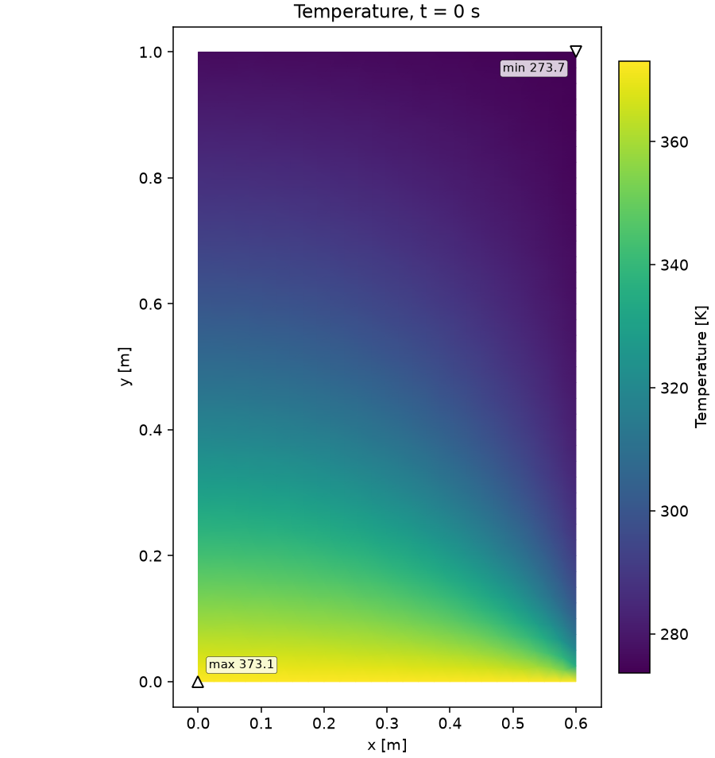
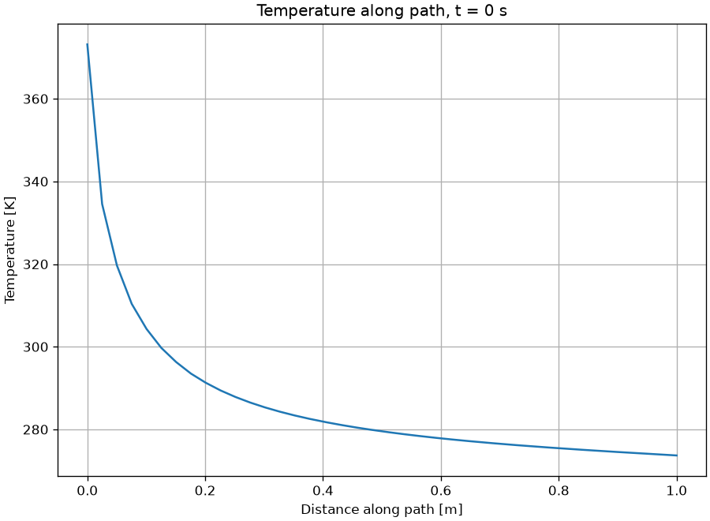
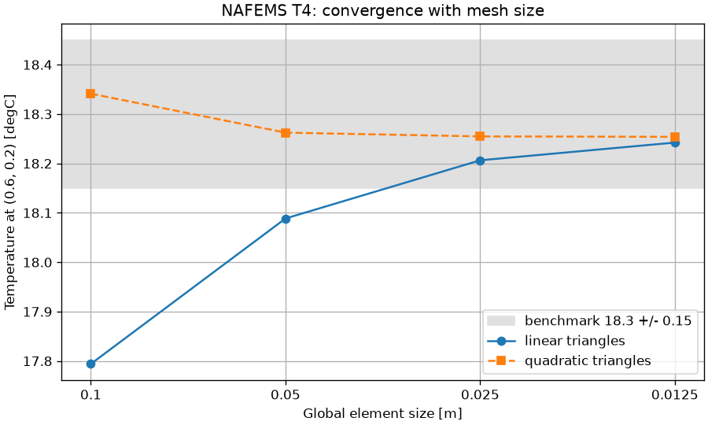
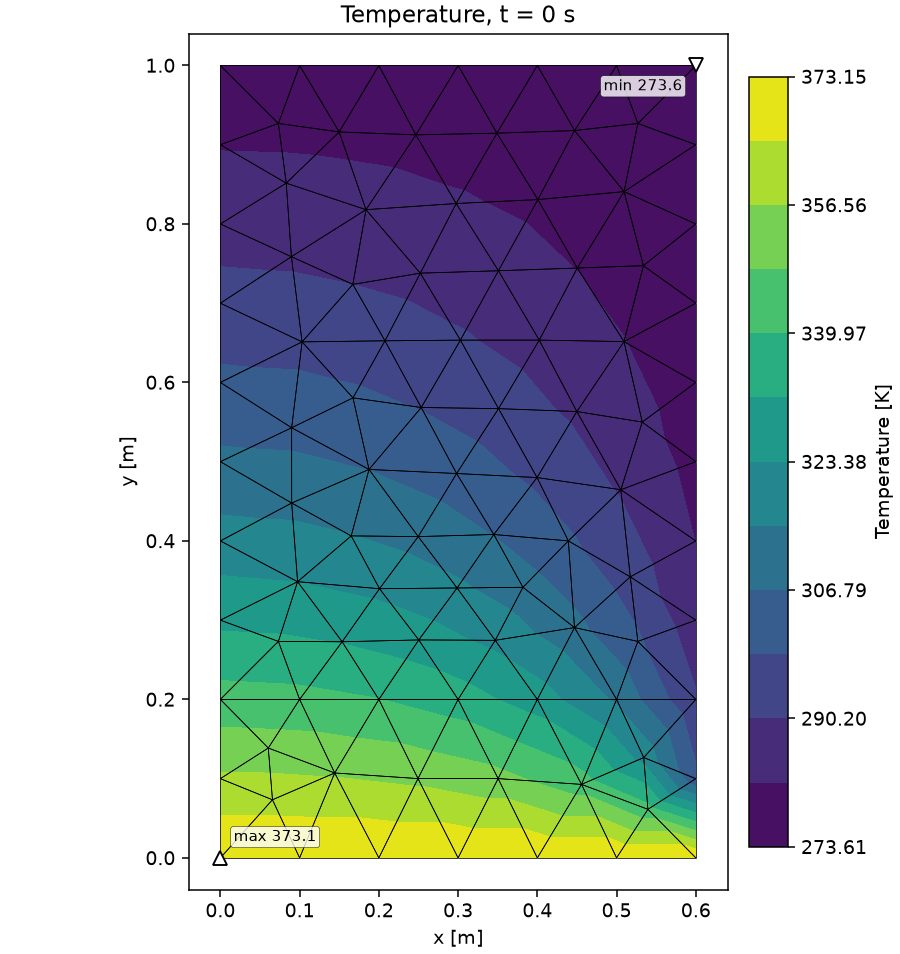

# Tutorial 1: NAFEMS T4, a steady plate

**What you will build.** A rectangular plate held at 100 °C on one edge and cooled by
convection on two others. It is the NAFEMS "T4" heat-transfer benchmark, and the published
answer is a single temperature at a single point.

**What you will learn.** How to draw the geometry; how to pick edges and faces in the
viewport; how to enter a material, boundary conditions and a mesh size; how to solve a
steady analysis and read a temperature at a point; how to check the energy balance; and how
the answer changes as the mesh is refined.

The finished model is in
[models/t4-plate.tfea](models/t4-plate.tfea); open it with **File > Open...** to compare with
your own.

## The problem

A plate of conductivity k = 52 W/(m K) measures 0.6 m in x and 1.0 m in y. Its bottom edge
is held at 100 °C. Its left edge is insulated. Its right and top edges lose heat by
convection to air at 0 °C. The question is the temperature at the point (0.6, 0.2), on the
right edge, 0.2 m above the hot edge.

| Item | Value |
|---|---|
| Plate | 0.6 m (x) by 1.0 m (y), planar model, thickness 1 m (the default) |
| Conductivity k | 52 W/(m K), constant |
| Bottom edge (y = 0) | fixed temperature 100 °C = 373.15 K |
| Left edge (x = 0) | adiabatic (insulated) |
| Right edge (x = 0.6) and top edge (y = 1) | convection, h = 750 W/(m² K), fluid at 0 °C = 273.15 K |
| Benchmark | T(0.6, 0.2) = 18.3 °C, accepted within 0.15 °C at element size 0.025 |

**Temperature units.** The program works in SI units and shows kelvin by default. This
tutorial uses the defaults, so every temperature you type is in kelvin: 100 °C is 373.15 K
and 0 °C is 273.15 K. (**Tools > Units...** can show degrees Celsius instead; the numbers
below are given in both.)

**A note on the point (0.6, 0.2).** The program cannot place a mesh node at a coordinate
you type, and you want a node exactly at the benchmark point. So you draw the plate as two
stacked rectangles that meet along y = 0.2. A shared edge puts a geometry vertex at
(0.6, 0.2), and the mesher always puts a node on a vertex.

## Before you start

Start the program from the project folder:

```
.venv\Scripts\python.exe -m thermalfea.gui.app
```

The window has the model tree (the **Model** dock, top left), the property panel (the
**Properties** dock, below it), the viewport in the middle, and the **Messages** dock at the
bottom. The solver writes its log to Messages. An **Issues** dock shares that space as a
tab. The toolbar holds the selection modes (None, Point, Curve, Surface, Node, Element) and
**Fit view**.

Three habits save trouble:

- Press **Enter** after typing a number in a property field. The value is applied when you
  press Enter or leave the field. Each applied change is one undo step (**Edit > Undo**).
- A field that holds a physical function (conductivity, temperature, heat-transfer
  coefficient, ...) has a mode box with Constant, Table and Expression. Leave it on
  **Constant** and type the number.
- Edges and faces are chosen from the panel of the object that needs them: press **Pick in
  viewport** in the **Selection** field, choose the matching toolbar mode, click, press
  **Apply**, then press **Pick in viewport** again to switch picking off. Hold **Ctrl** to
  add a second item to the selection.

## Steps

### 1. Draw the geometry

1. Choose **Geometry > Rectangle...**. A dialog titled "Rectangle" opens.
2. Type x = `0`, y = `0`, Width = `0.6`, Height = `0.2`. Leave "Corner radius" at 0 and "Id"
   empty (an id is made for you). Press **OK**.
3. Choose **Geometry > Rectangle...** again and type x = `0`, y = `0.2`, Width = `0.6`,
   Height = `0.8`. Press **OK**.
4. After each OK the geometry is rebuilt by itself: the status bar shows "Building
   geometry..." and then "Geometry rebuilt". The tree node **Geometry** now lists
   `rectangle1` and `rectangle2`.
5. Choose **View > Fit view** (or press **F**). The view is fitted only when the first shape
   appears, so the second rectangle may be partly out of sight until you do this.

You should see a 0.6 by 1.0 plate with a line across it at y = 0.2: two surfaces and seven
curves.

### 2. Enter the material

1. Right-click **Materials** and choose **Add material**. A node "Material 1" appears and its
   panel opens. A new material starts with every property at 0, which means "not set
   yet".
2. In "Thermal conductivity" (mode Constant) type `52` and press Enter. Density and specific
   heat do not affect a steady answer; they may stay at 0.

### 3. Assign it to the plate

1. Right-click **Regions** and choose **Add region**. A region node appears and its panel
   ("Region") opens. Its "Material" box already shows "Material 1".
2. In the "Selection" field press **Pick in viewport**, choose **Surface** in the toolbar,
   click inside the lower rectangle, **Ctrl**-click inside the upper one (the status line
   under the buttons says "2 surface(s) picked"), press **Apply**, and switch picking off.
   The new selection is named "Region selection".
3. Leave "Thickness" at 1 and "Material angle" at 0.

A region ties a material to some faces and, in a planar model, gives the depth of the plate
perpendicular to the drawing. Every heat flow the program reports is for that depth: here, per
metre.

### 4. Enter the boundary conditions

There are three. Each is added from the node **Loads & Boundary Conditions**.

**Fixed temperature on the bottom edge.**

1. Right-click **Loads & Boundary Conditions** and choose **Add > Add Fixed Temperature**. A
   node "Fixed Temperature 1" appears and its panel opens.
2. In "Selection" press **Pick in viewport**. The panel starts in Point mode, because a fixed
   temperature may also be put on points, so choose **Curve** in the toolbar. Click the bottom
   edge of the plate. The status line says "1 curve(s) picked". Press **Apply**. The field
   now reads "Fixed Temperature 1 selection". Switch picking off.
3. In "Temperature" type `373.15` and press Enter (the unit shown is K).

**Convection on the right and top edges.**

1. Right-click **Loads & Boundary Conditions** and choose **Add > Add Convection**.
2. In "Selection" press **Pick in viewport** and choose **Curve**. The right edge is two curves
   (it is split at y = 0.2). Click the lower right edge, then hold **Ctrl** and click the upper
   right edge and the top edge. The status line says "3 curve(s) picked". Press **Apply** and
   switch picking off.
3. In "Heat-transfer coefficient" type `750` and press Enter (W/(m² K)).
4. In "Fluid temperature" type `273.15` and press Enter (K).

**Adiabatic on the left edge.**

1. Right-click **Loads & Boundary Conditions** and choose **Add > Add Adiabatic**.
2. In "Selection" pick the lower left edge, **Ctrl**-click the upper left edge ("2 curve(s)
   picked"), press **Apply**, and switch picking off.

An adiabatic edge changes nothing: every edge without a condition is already insulated. The
condition is there so that the model says what you meant, and so that the edge has a name.

The viewport now draws a symbol for each condition. Click a condition in the tree and its
curves are highlighted.

### 5. Mesh

1. Click the node **Mesh**. The panel "Mesh" opens.
2. In "Global element size" type `0.025` and press Enter. Leave "Element order" at 1 and
   "Element shape" at tri: linear triangles.
3. Press **Generate mesh** (or choose **Mesh > Generate mesh**). The status bar reports
   "Mesh generated: 1210 nodes, 2290 elements", and the mesh panel lists the same counts. The
   mesh is drawn in the viewport.

### 6. Solve

1. Choose **Solve > Validate**. The status bar must say "Validation: no issues". If it lists
   errors, fix them first; warnings alone do not stop a solve.
2. Choose **Solve > Solve**. A window titled "Solving" shows progress and ends in the state
   "Finished". It stays open until you close it. A linear steady case takes a moment.
   (The **Analysis Settings** node has the same Validate and Solve buttons.)
3. A node "Temperature 1" appears under **Solution** in the tree, and the temperature
   contour is drawn in the viewport. Click the node to see its panel: "Field", "Levels",
   "Banded (otherwise smooth)", "Colour scale", "Mesh overlay".

The analysis type was never changed: a new model is steady, which is what this problem is.

### 7. Read the answer at (0.6, 0.2)

- **The exact value.** Choose **File > Export > Nodal results (CSV)...** and give a file
  name. Open the CSV in a spreadsheet. The columns are `step,time,node,x,y,T,qx,qy`, with T in
  kelvin. Find the row with x = 0.6 and y = 0.2. It reads T = 291.356 K, which is 18.206 °C.
- **A quick look.** Choose **Results > Probe**, then click in the viewport as close as you can
  to the right edge at the line y = 0.2. The status bar shows x, y and the temperature. A
  click lands on a pixel and the point lies on the boundary, so use this only as a rough check.
  The CSV is the exact one.
- **Energy balance.** The **Messages** dock lists the heat entering through each condition.
  Fixed Temperature 1 gives about +10396 W and Convection 1 about -10396 W (a positive value
  is heat entering the plate). Below them, "relative imbalance" is the part of the heat flow
  that the balance fails to account for. **Results > Energy balance** plots it.

## Results



The plate is hottest along the bottom edge (373.15 K) and coldest at the top right corner
(273.7 K, a little above the fluid at 273.15 K). Heat leaves mainly through the lower part of
the right edge, where the plate is hottest and the difference to the fluid is largest. The title says "steady state", because a steady
result has no time.



| Quantity | Value |
|---|---|
| Mesh | 1210 nodes, 2290 elements (linear triangles, size 0.025) |
| T at (0.6, 0.2) | 291.356 K = 18.206 °C |
| Benchmark | 18.3 °C, tolerance 0.15 °C |
| Difference | 0.094 °C, inside the tolerance |
| Heat entering at the bottom edge | 10 396 W (for 1 m depth) |
| Heat leaving by convection | 10 396 W |

## Checking the answer

**Against the benchmark.** The answer is 0.094 °C below 18.3 °C and the tolerance is
0.15 °C, so the benchmark is met.

**Energy balance.** Every solve checks that the heat in equals the heat out. For a linear
steady case the relative imbalance must be below 1e-8. Here it is about 1e-14; the two
heat flows above match to every digit shown.

**Mesh refinement.** Change "Global element size" and solve again, as in steps 5 to 7. After
you change the size the mesh is out of date and **Solve > Solve** is greyed out until you
press **Generate mesh** again. After you solve, the old contour is replaced. Read the
temperature at (0.6, 0.2) from the CSV each time.

| Global element size | Nodes | Elements | T, linear triangles [°C] | T, quadratic triangles [°C] |
|---|---|---|---|---|
| 0.1 | 93 | 152 | 17.79 | 18.34 |
| 0.05 | 328 | 590 | 18.09 | 18.26 |
| 0.025 | 1210 | 2290 | 18.21 | 18.25 |
| 0.0125 | 4629 | 9000 | 18.24 | 18.25 |

(The quadratic column needs "Element order" 2; the node counts for those meshes are 337,
1245, 4709 and 18 257.)



Read the table like this:

- With linear triangles the answer rises towards the limit from below at every refinement:
  0.51, 0.21, 0.094 and 0.058 °C below 18.3. The steepest gradients are at the lower right
  corner, where the hot edge meets the cooled one, and a coarse mesh resolves them poorly. On
  the 0.1 mesh the answer is 0.5 °C off, outside the benchmark tolerance.
- With quadratic triangles the answer is already 18.34 °C on the coarsest mesh and settles at
  18.25 °C. The last two refinements differ by less than 0.002 °C.
- So the mesh-converged answer is about 18.25 °C, not 18.3 °C. It lies 0.05 °C from the
  benchmark value, well inside the 0.15 °C the benchmark accepts. Refining further would not
  close that gap.



The picture shows the 0.1 mesh so that the triangles can be seen. At size 0.025 the plate
has about 2300 triangles and no local refinement.

## Things to try

- Select the Convection 1 node and change "Heat-transfer coefficient" to `800`. The results
  panel shows "These results are out of date: the model changed since the solve." The mesh is
  still valid, so you can solve again at once. **Edit > Undo** returns the value to 750.
- Set "Element shape" to quad and compare. Set "Element order" to 2 and compare with the
  table.
- Save the model (**File > Save As...**), choose **File > New**, then **File > Open...** the
  file. The geometry is rebuilt by itself. The results saved beside the model are attached
  again after you press **Generate mesh**.
- Use **Results > Add contour** and choose another entry in the "Field" box of its panel, for
  example the heat flux, and look at where it is largest.

## The same model as a script

The same plate is built through the Python API in `examples/v10_nafems_t4.py`, and the mesh
table above is produced by `examples/tutorial_t4_plate.py`.
